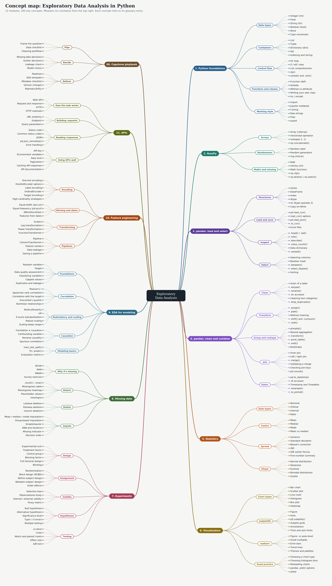

<a id="top"></a>

# Data Science Glossary: Python, pandas and Exploratory Data Analysis

[Repository guide and slide-deck completeness tracker](UNIT_GUIDE.md) — unit contents, PDF slide decks, and missing materials.

Key terms, functions and methods from the EDA unit (Unit 2), running from Python basics to APIs. Each of the 440 entries says what the term means, where it appears in the course, and (where relevant) shows working code you can copy into your own notebooks. The [Unit 3 glossary](https://github.com/CharleyHananiaGA/DSB-Unit-03/blob/main/Readme.MD) (machine learning) continues the numbering from section 12 and links back to entries here.

<a id="how-to-read-the-examples"></a>

**How to read the examples.** Examples use the course's own datasets and variable names. Run the setup block below once at the top of a notebook, then any example in this glossary will run as written. It loads every dataset straight from this repository, so it needs an internet connection. If you've cloned the repo, swap the `REPO` address for a local path such as `"../"`.

```python
import pandas as pd
import numpy as np
import matplotlib.pyplot as plt
import seaborn as sns
import sweetviz as sv

REPO = "https://raw.githubusercontent.com/CharleyHananiaGA/DSB-Unit-02/main/"
DATA = REPO + "data/"
JOIN = REPO + "02%20-%20Exploring%20and%20Joining/practice/data/"
VIZ = REPO + "03%20-%20Data%20Visualisation/practice/data/"

lego = pd.read_csv(DATA + "lego.csv")                 # LEGO sets: price, pieces, theme (most examples)
titanic = pd.read_csv(DATA + "titanic-adj.csv")       # Titanic passengers (missing data)
housing_df = pd.read_csv(DATA + "housing-geron.csv")  # California housing (EDA for modeling)
sodas = pd.read_csv(DATA + "sodas.csv")               # BIG Sodas taste test (experiments)
cpi = pd.read_json(DATA + "cpi.json")                 # US consumer price index (joins)
movies = pd.read_csv(VIZ + "imdb_1000.csv")           # IMDb top movies
ufo = pd.read_csv(VIZ + "ufo.csv")                    # UFO sightings (dates and time series)
auto = pd.read_csv(VIZ + "autoMPG.csv")               # cars: mpg, horsepower, weight
houses = pd.read_csv(VIZ + "iowa_houses.csv")         # Iowa house sales (plotly)
bonds = pd.read_csv(JOIN + "eu-govt-bonds-cleaned.csv")  # EU bond yields: one row per country
bonds_raw = pd.read_csv(JOIN + "eu-govt-bonds.tsv", sep="\t")  # the same data before cleaning
codes = pd.read_csv(JOIN + "country-codes.csv", encoding="latin-1")  # country names and codes
drinks = pd.read_csv(VIZ + "drinks.csv")              # alcohol servings by country
rock = pd.read_csv(JOIN + "rock.csv")                 # classic rock songs and play counts
loans = pd.read_csv(JOIN + "rejections.csv.gz")       # rejected loan applications

customers = pd.DataFrame({                            # the four-customer table from the slides
    "customer_id": [505, 196, 947, 952],
    "surname": ["Smith", "Peck", "Murdock", "Baracus"],
    "age": [55, 43, 36, 31],
})
```

The feature engineering examples use the synthetic housing table built at the start of that notebook. It's random but seeded, so you get the same 1,000 rows every time:

```python
np.random.seed(42)
n_samples = 1000
housing = pd.DataFrame({
    "sqft": np.abs(np.random.normal(2000, 500, n_samples)),
    "bedrooms": np.random.choice([1, 2, 3, 4, 5], n_samples, p=[0.1, 0.2, 0.4, 0.25, 0.05]),
    "bathrooms": np.random.choice([1, 1.5, 2, 2.5, 3, 3.5, 4], n_samples,
                                  p=[0.15, 0.1, 0.3, 0.15, 0.2, 0.05, 0.05]),
    "neighborhood": np.random.choice(["Downtown", "Suburb", "Rural", "Waterfront"], n_samples,
                                     p=[0.3, 0.5, 0.15, 0.05]),
    "year_built": np.random.randint(1950, 2023, n_samples),
    "garage": np.random.choice(["None", "Attached", "Detached"], n_samples, p=[0.2, 0.6, 0.2]),
    "condition": np.random.choice(["Poor", "Fair", "Good", "Excellent"], n_samples,
                                  p=[0.1, 0.2, 0.5, 0.2]),
    "income_area": np.random.exponential(50000, n_samples) + 30000,
})
effects = {"Downtown": 50000, "Waterfront": 80000, "Suburb": 20000, "Rural": -10000}
price = (housing["sqft"] * 150 + housing["bedrooms"] * 10000 + housing["bathrooms"] * 8000
         + (2023 - housing["year_built"]) * -500 + housing["income_area"] * 2
         + housing["neighborhood"].map(effects))
housing["price"] = np.abs(price + np.random.normal(0, 20000, n_samples))
```

A few entries build a small table on the spot (such as the four-customer table from the slides) so you can see every number. Examples that call a live web API are marked `# Needs internet`, and ones that need a free account key are marked `# Needs an API key`.

<a id="library-versions"></a>

**Library versions.** Every code block was run on Python 3.12.3, pandas 3.0.6, NumPy 2.5.4, matplotlib 3.11.2, seaborn 0.13.2, scikit-learn 1.9.1, SciPy 1.18.1, statsmodels 0.15.0, plotly 7.1.0, joblib 1.6.0. Libraries change between versions: parameters are renamed, defaults change and old functions are removed. Tutorials, Stack Overflow answers and older notebooks therefore sometimes use syntax that no longer works or now gives a warning. The biggest recent change is **pandas 3**: text columns now have their own `str` dtype, and **Copy-on-Write** changes how assignment works. Where a change affects something you'll use, the entry says what changed and in which version. [Library version changes to know](#library-version-changes-to-know) collects them in one table. When code fails or warns, check the documentation for the version you have installed (`pd.__version__` tells you which pandas that is).

<a id="for-your-capstone"></a>

**For your capstone.** Every section opens with an **In your capstone** line saying when to reach for its methods. Section 00, the [Capstone playbook: the data stage](#s00-capstone-playbook-the-data-stage) (placed after section 11), walks the data stage of a project from question to model-ready table. It includes a tested EDA template notebook and a common-mistakes checklist. Unit 3's [Capstone playbook](https://github.com/CharleyHananiaGA/DSB-Unit-03/blob/main/Readme.MD#s38-capstone-playbook) picks up from there with modelling.

<a id="audio-summary"></a>

**AI audio summary.** An AI-generated audio overview of the glossary's contents and key ideas, useful for revision on the go. It's a summary, not a substitute: where anything differs, the written entries are the reference.

<audio controls preload="none" style="width:100%;max-width:560px">
  <source src="assets/AISummaryEDA.m4a" type="audio/mp4">
</audio>

[Listen to or download the audio summary (AISummaryEDA.m4a)](assets/AISummaryEDA.m4a). GitHub doesn't play audio inside a README, so on github.com this link opens the file's page instead. The file is stored with Git LFS, so use the **Download** button there (**View raw** also works). It plays directly in the [HTML glossary](https://charleyhananiaga.github.io/DSB-Unit-02/#audio-summary).

<a id="contents"></a>

## Contents

1. [Python foundations](#s1-python-foundations)
2. [NumPy essentials](#s2-numpy-essentials)
3. [pandas: loading, inspecting and selecting](#s3-pandas-loading-inspecting-and-selecting)
4. [pandas: cleaning, grouping, reshaping and joining](#s4-pandas-cleaning-grouping-reshaping-and-joining)
5. [Descriptive statistics and distributions](#s5-descriptive-statistics-and-distributions)
6. [Data visualization](#s6-data-visualization)
7. [Experimental design and hypothesis testing](#s7-experimental-design-and-hypothesis-testing)
8. [Missing data](#s8-missing-data)
9. [EDA for modeling](#s9-eda-for-modeling)
10. [Feature engineering](#s10-feature-engineering)
11. [APIs and web data](#s11-apis-and-web-data)

**00. [Capstone playbook: the data stage](#s00-capstone-playbook-the-data-stage)** (placed after section 11)

[Audio summary](#audio-summary) · [Concept map](#concept-map) · [Course materials map](#course-materials-map) · [A–Z index](#a-z-index)

---

<a id="concept-map"></a>

## Concept map

The whole unit on one page: 12 modules, grouped into themes, with 245 key concepts. Modules run clockwise from the top right, and every concept has a matching entry.

[](https://charleyhananiaga.github.io/DSB-Unit-02/assets/ds-eda-glossary-mindmap.svg)

GitHub shows SVG files as static pictures, so the links inside the map only work in two places: the [interactive map on the glossary website](https://charleyhananiaga.github.io/DSB-Unit-02/assets/ds-eda-glossary-mindmap.svg) (also embedded in the [HTML glossary](https://charleyhananiaga.github.io/DSB-Unit-02/#concept-map)), or a downloaded copy of [`assets/ds-eda-glossary-mindmap.svg`](assets/ds-eda-glossary-mindmap.svg) opened in a browser. On GitHub, use the linked outline below instead: it is the same map, and every link works here.

The same map as a linked outline:

- **[1. Python foundations](#s1-python-foundations)**
  - _Data types:_ [Integer (int)](#integer-int), [Float](#float), [String (str)](#string-str), [Boolean (bool)](#boolean-bool), [None](#none), [Type conversion](#type-conversion-casting)
  - _Containers:_ [List](#list), [Tuple](#tuple), [Dictionary (dict)](#dictionary-dict), [Set](#set), [Indexing and slicing](#indexing-and-slicing)
  - _Control flow:_ [for loop](#for-loop), [if / elif / else](#if-elif-else), [List comprehension](#list-comprehension), [zip()](#zip), [sorted() and .sort()](#sorted-sort-and-reversed)
  - _Functions and classes:_ [Function (def)](#function-def), [lambda](#lambda), [Method vs attribute](#function-method-and-attribute), [Writing your own class](#writing-your-own-class), [try / except](#try-except)
  - _Working style:_ [import](#import), [Jupyter notebook](#jupyter-notebook), [f-string](#f-string), [Raw strings](#raw-string-r), [Files](#reading-and-writing-text-files), [assert](#assert)
- **[2. NumPy](#s2-numpy-essentials)**
  - _Arrays:_ [Array (ndarray)](#array-ndarray), [Vectorized operation](#vectorized-operation), [reshape(-1, 1)](#reshape-1-1), [np.concatenate()](#np-concatenate-and-np-append)
  - _Randomness:_ [Random seed](#random-seed), [Random generators](#random-number-generators), [rng.choice()](#sampling-with-rng-choice)
  - _Maths and missing:_ [NaN](#nan), [Infinity (inf)](#infinity-inf-from-dividing-by-zero), [Math functions](#math-functions-np-log-np-exp-np-sqrt-np-abs), [np.clip()](#np-maximum-and-np-clip), [np.where() / np.select()](#np-where-and-np-select)
- **[3. pandas: load and select](#s3-pandas-loading-inspecting-and-selecting)**
  - _Structures:_ [Series](#series), [DataFrame](#dataframe), [Index](#index), [dtype](#dtype), [str dtype (pandas 3)](#string-dtype-str-in-pandas-3), [Copy-on-Write](#copy-on-write)
  - _Load and save:_ [pd.read_csv()](#pd-read-csv), [read_csv() options](#read-csv-options-for-messy-files), [pd.read_json()](#pd-read-json), [.to_csv()](#to-csv), [Excel files](#excel-files-read-excel-and-to-excel)
  - _Inspect:_ [.head() / .tail()](#head-and-tail), [.info()](#info), [.describe()](#describe), [.value_counts()](#value-counts), [Data dictionary](#data-dictionary), [.sample()](#sample)
  - _Select:_ [Selecting columns](#selecting-columns), [Boolean mask](#boolean-mask-filtering), [.between()](#comparison-methods-and-between), [.select_dtypes()](#select-dtypes), [Sorting](#sort-values-and-sort-index)
- **[4. pandas: clean and combine](#s4-pandas-cleaning-grouping-reshaping-and-joining)**
  - _Clean:_ [Grain of a table](#grain-of-a-table), [.astype()](#astype), [.rename()](#rename), [.str accessor](#str-accessor), [Cleaning text categories](#cleaning-text-categories), [.drop_duplicates()](#drop-duplicates)
  - _Transform:_ [.assign()](#assign), [.pipe()](#pipe), [Method chaining](#method-chaining), [.shift() and .cumsum()](#shift-diff-and-cumulative-sums), [.rank()](#rank)
  - _Group and reshape:_ [groupby()](#groupby), [Named aggregation](#named-aggregation), [.transform()](#transform), [.pivot_table()](#pivot-table-and-pivot), [.melt()](#melt), [MultiIndex](#multiindex)
  - _Join:_ [Inner join](#inner-join), [Left / right join](#left-right-join), [.merge()](#merge), [Validating a merge](#validating-a-merge), [Checking join keys](#checking-join-keys), [pd.concat()](#pd-concat)
  - _Dates:_ [pd.to_datetime()](#pd-to-datetime), [.dt accessor](#dt-accessor), [Timestamp and Timedelta](#timestamp-timedelta-and-date-arithmetic), [.resample()](#resample), [.to_period()](#to-period)
- **[5. Statistics](#s5-descriptive-statistics-and-distributions)**
  - _Data types:_ [Nominal](#nominal), [Ordinal](#ordinal), [Interval](#interval), [Ratio](#ratio)
  - _Centre:_ [Mean](#mean), [Median](#median), [Mode](#mode), [Mean vs median](#worked-example-mean-vs-median-with-an-outlier)
  - _Spread:_ [Variance](#variance), [Standard deviation](#standard-deviation), [Bessel's correction](#bessel-s-correction-ddof), [IQR](#interquartile-range-iqr), [IQR outlier fences](#iqr-outlier-fences), [Five-number summary](#five-number-summary)
  - _Shape:_ [Normal distribution](#normal-gaussian-distribution), [Skewness](#skewness), [Kurtosis](#kurtosis), [Bimodal distribution](#bimodal-multimodal-distribution), [Outlier](#outlier)
- **[6. Visualization](#s6-data-visualization)**
  - _Chart types:_ [Bar chart](#bar-chart), [Scatter plot](#scatter-plot), [Line chart](#line-chart), [Histogram](#histogram), [Box plot](#box-plot), [Heatmap](#heatmap)
  - _matplotlib:_ [Figure](#figure), [Axes](#axes), [plt.subplots()](#plt-subplots), [Subplot grids](#subplot-grids-subplot-add-subplot-delaxes-and-suptitle), [Annotations](#annotations-text-reference-lines-and-legends), [Ticks and axis limits](#ticks-and-axis-limits)
  - _seaborn:_ [Figure- vs axes-level](#figure-level-vs-axes-level-seaborn-functions), [Small multiples](#small-multiples), [Error bars](#sns-lineplot-sns-barplot-and-error-bars), [Trend lines](#trend-lines-regplot-and-lmplot), [Themes and palettes](#themes-and-palettes-sns-set-theme)
  - _Good practice:_ [Choosing a chart type](#choosing-a-chart-type), [Choosing histogram bins](#choosing-histogram-bins), [Misleading charts](#misleading-charts), [pandas .plot() options](#pandas-plot-options), [plotly](#plotly-plotly-express)
- **[7. Experiments](#s7-experimental-design-and-hypothesis-testing)**
  - _Design:_ [Experimental unit](#experimental-unit), [Treatment factor](#treatment-factor), [Control group](#control-group), [Blocking factor](#blocking-factor), [Full factorial design](#full-factorial-design), [Blinding](#blinding)
  - _Assignment:_ [Randomization](#randomization), [Block design (RCBD)](#completely-randomized-block-design-crbd), [Within-subject design](#within-subject-design), [Between-subject design](#between-subject-design), [Order effects](#order-and-carryover-effects)
  - _Validity:_ [Selection bias](#selection-bias), [Observational study](#observational-study), [Internal / external validity](#internal-and-external-validity), [Proxy metric](#proxy-metric)
  - _Hypotheses:_ [Null hypothesis](#null-hypothesis-h), [Alternative hypothesis](#alternative-hypothesis-h), [Significance level](#significance-level), [Type I / II errors](#type-i-and-type-ii-errors), [Multiple testing](#multiple-testing)
  - _Testing:_ [p-value](#p-value), [t-test](#t-test-stats-ttest-ind), [Welch and paired t-tests](#welch-s-t-test-and-paired-t-test), [Effect size](#effect-size-cohen-s-d), [A/B test](#a-b-test)
- **[8. Missing data](#s8-missing-data)**
  - _Why it's missing:_ [MCAR](#mcar-missing-completely-at-random), [MAR](#mar-missing-at-random), [MNAR](#mnar-missing-not-at-random), [Survey exercise](#classifying-missingness-the-survey-exercise)
  - _Detect:_ [.isnull() / .isna()](#isnull-isna), [Missingness table](#missingness-table), [Missingness heatmap](#missingness-heatmap), [Placeholder values](#placeholder-values-for-missing-data), [missingno](#missingno)
  - _Delete:_ [Listwise deletion](#listwise-deletion-complete-case-analysis), [Pairwise deletion](#pairwise-deletion), [Column deletion](#column-deletion)
  - _Impute:_ [Mean / median / mode imputation](#mean-median-mode-imputation), [Group-based imputation](#group-based-imputation), [SimpleImputer](#simpleimputer), [KNN and iterative](#knnimputer-and-iterativeimputer), [Missing indicator](#missing-indicator), [Decision order](#missing-data-decision-order)
- **[9. EDA for modeling](#s9-eda-for-modeling)**
  - _Foundations:_ [Random variable](#random-variable), [Target](#target-dependent-variable), [Data quality assessment](#data-quality-assessment), [Classifying variables](#classifying-variables-in-code), [Capped values](#capped-values), [Duplicates and leakage](#duplicate-rows-and-leakage)
  - _Correlation:_ [Pearson's r](#pearson-correlation-coefficient-r), [Spearman rank correlation](#spearman-rank-correlation), [Correlation with the target](#correlation-with-the-target), [Anscombe's quartet](#anscombe-s-quartet), [Nonlinear relationships](#nonlinear-relationships-and-correlation)
  - _Redundancy and scaling:_ [Multicollinearity](#multicollinearity), [VIF](#variance-inflation-factor-vif), [Z-score standardization](#z-score-standardization), [Robust scaling](#robust-scaling), [Scaling keeps shape](#scaling-doesn-t-change-a-distribution-s-shape)
  - _Causation:_ [Correlation ≠ causation](#correlation-does-not-imply-causation), [Confounding variable](#confounding-variable), [Reverse causality](#reverse-causality), [Spurious correlation](#spurious-correlation)
  - _Modeling basics:_ [train_test_split()](#train-test-split), [fit / predict](#fit-predict), [Evaluation metrics](#evaluation-metrics-r-mse-rmse-mae-accuracy)
- **[10. Feature engineering](#s10-feature-engineering)**
  - _Encoding:_ [One-hot encoding](#one-hot-encoding), [OneHotEncoder options](#onehotencoder-options), [Label encoding](#label-encoding), [OrdinalEncoder](#ordinalencoder), [Target encoding](#target-encoding), [High-cardinality strategies](#high-cardinality-strategies)
  - _Binning and dates:_ [Equal-width (pd.cut)](#equal-width-binning-pd-cut), [Equal-frequency (pd.qcut)](#equal-frequency-binning-pd-qcut), [KBinsDiscretizer](#kbinsdiscretizer), [Features from dates](#features-from-dates)
  - _Transforming:_ [Scalers](#standardscaler-minmaxscaler-robustscaler), [Log transformation](#log-transformation), [Power transformation](#power-transformation-box-cox-yeo-johnson), [FunctionTransformer](#functiontransformer)
  - _Pipelines:_ [Pipeline](#pipeline), [ColumnTransformer](#columntransformer), [Feature names](#get-feature-names-out-and-set-output), [Data leakage](#data-leakage), [Saving a pipeline](#saving-a-fitted-pipeline-joblib)
- **[11. APIs](#s11-apis-and-web-data)**
  - _How the web works:_ [Web API](#web-api), [Request and response](#request-and-response), [HTTP](#http), [HTTP methods](#http-methods-get-post-put-delete)
  - _Building requests:_ [URL anatomy](#url-anatomy), [Endpoint](#endpoint), [Query parameters](#query-parameters)
  - _Reading responses:_ [Status code](#status-code), [Common status codes](#common-http-status-codes), [JSON](#json), [pd.json_normalize()](#pd-json-normalize), [Error handling](#timeouts-and-error-handling)
  - _Using APIs well:_ [API key](#api-key), [Environment variables](#environment-variables-and-env-files), [Rate limit](#rate-limit), [Pagination](#pagination), [Caching API responses](#caching-api-responses), [API documentation](#api-documentation)
- **[00. Capstone playbook](#s00-capstone-playbook-the-data-stage)**
  - _Plan:_ [Frame the question](#frame-the-question-and-the-target), [Data checklist](#data-understanding-checklist), [Cleaning workflow](#cleaning-workflow)
  - _Decide:_ [Missing-data decisions](#missing-data-decisions), [Outlier decisions](#outlier-decisions), [Leakage check](#leakage-check-known-at-prediction-time), [Model choice](#eda-findings-that-shape-model-choice)
  - _Deliver:_ [Pipelines](#feature-engineering-inside-pipelines), [EDA template](#eda-template-notebook), [Mistakes checklist](#capstone-common-mistakes-checklist), [Version changes](#library-version-changes-to-know), [Reproducibility](#reproducibility-habits)

---

<a id="s1-python-foundations"></a>

## 1. Python foundations

_The building blocks every notebook in the course relies on. If a pandas line confuses you, the answer is often in here: a list, a dictionary, a boolean or a function hiding inside it. The Module 2.1 stepped code-along walks from these Python collections up to NumPy and pandas._

**In your capstone:** you'll write small functions to clean columns, loop over files or API pages, and parse messy text with regular expressions. Keep reusable helpers in functions with docstrings (not copy-pasted cells), use f-strings to label your printed checks, and use `assert` to stop a notebook as soon as an assumption about your data breaks.

<a id="variable-and-assignment"></a>

### Variable and assignment

_Python_

A **variable** is a name that points to a value. The `=` sign means _assign_ (store the value on the right under the name on the left), not "equals". You can reassign a variable at any time, and the name then points to the new value.

```python
age = 41
age = age + 1      # reassign using the old value
print(age)         # 42
```

> **Watch out:** `=` assigns, `==` compares. `age == 42` asks a question and gives back `True` or `False`.

<a id="data-type"></a>

### Data type

_Python_

The **type** of a value decides what you can do with it: you can add two numbers, but you can't take the mean of a word. The core built-in types are `int`, `float`, `str`, `bool` and `None`, plus the container types `list`, `tuple`, `dict` and `set`. Use `type()` to check.

```python
type(3)          # int
type(3.5)        # float
type("3.5")      # str
type(True)       # bool
```

See also: [dtype](#dtype), [Type conversion (casting)](#type-conversion-casting)

<a id="integer-int"></a>

### Integer (int)

_Python_

A whole number with no decimal point, such as `7`, `-3` or `100_000` (underscores are allowed to make large numbers readable). Counts are usually integers: number of pieces in a LEGO set, number of customers.

```python
pieces = 1_254
pieces // 100    # 12  (floor division: whole-number result)
pieces % 100     # 54  (modulo: the remainder)
```

<a id="float"></a>

### Float

_Python_

A number with a decimal point, such as `19.99` or `-0.5`. Measurements and prices are usually floats. Dividing two integers with `/` always produces a float.

```python
price = 19.99
7 / 2            # 3.5
round(3.14159, 2)  # 3.14
```

> **Watch out:** Floats are stored approximately, so `0.1 + 0.2 == 0.3` is `False`. Use `round()` or `np.isclose()` when comparing decimals.

<a id="string-str"></a>

### String (str)

_Python_

Text, written inside single or double quotes: `"Star Wars"` or `'R '`. Strings can be joined with `+`, repeated with `*`, and indexed and sliced like lists. Column names, categories and URLs are all strings.

```python
theme = "Star Wars"
theme + " LEGO"       # 'Star Wars LEGO'
theme[0]              # 'S'
len(theme)            # 9
```

> **Watch out:** Strings that _look_ like numbers are still text: `"3" + "4"` is `"34"`, not `7`. This is why reading data sometimes gives you a text column that needs converting.

<a id="string-methods"></a>

### String methods

_Python_

Functions that belong to every string and return a new string. The ones used most in the course: `.upper()` / `.lower()` to standardise case, `.strip()` to remove leading and trailing spaces, `.replace(old, new)`, `.split(sep)` to break text into a list, and `.startswith()` / `.endswith()` to test the beginning or end.

```python
title = "  debt consolidation "
title.strip().upper()           # 'DEBT CONSOLIDATION'
"2019M02".startswith("20")      # True
"a, b, c".split(", ")           # ['a', 'b', 'c']
"On or near High St".replace("On or near ", "")  # 'High St'
```

> **Watch out:** In the product data, `'R '` has a trailing space, so `== 'R'` matches nothing. Always check for stray whitespace with `len()` or `.strip()`.

See also: [.str accessor](#str-accessor)

<a id="raw-string-r"></a>

### Raw string (r"...")

_Python_

A string written with an `r` in front, such as `r"\d+"`. Python then treats every backslash as an ordinary character instead of the start of an escape code like `\n` (newline) or `\t` (tab). You need raw strings for **regular expressions**, which use backslashes a lot, and for Windows file paths.

The IMDb practice notebook strips square brackets from actor lists with a pattern like `\[`. Written as a normal string, Python reads `\[` as an escape code it doesn't recognise.

```python
import re

re.sub(r"\[", "", "[u'Tim Robbins', u'Morgan Freeman']")   # raw string: the backslash reaches re
re.findall(r"\d{4}", "Released 1994, re-released 2004")      # ['1994', '2004']
print("a\tb")     # \t is a tab in a normal string
print(r"a\tb")    # raw: prints the backslash and the t
```

> **Watch out:** since Python 3.12, an unrecognised escape such as `"\["` or `"\d"` in a normal string gives a `SyntaxWarning`, and a future Python will make it an error. Earlier versions accepted it silently. Put an `r` in front of every regex pattern.

See also: [re (regular expressions)](#re-regular-expressions), [String methods](#string-methods)

<a id="f-string"></a>

### f-string

_Python_

A string with an `f` in front that lets you drop variables and expressions straight into the text using `{}`. You can add a format code after a colon: `:.2f` for two decimal places, `:,` for thousands separators, `:.1%` for percentages.

```python
mean_age = 41.2567
print(f"Mean age: {mean_age:.1f}")          # Mean age: 41.3
print(f"Revenue: ${1234567:,.2f}")          # Revenue: $1,234,567.00
print(f"Retained: {0.873:.1%}")             # Retained: 87.3%
```

<a id="boolean-bool"></a>

### Boolean (bool)

_Python_

A value that is either `True` or `False`. Comparisons produce booleans, and booleans drive `if` statements and pandas filters. In arithmetic, `True` counts as 1 and `False` as 0, which is why `.sum()` on a boolean column counts the `True` values.

```python
55 > 40          # True
sum([True, False, True])   # 2
```

See also: [Boolean mask (filtering)](#boolean-mask-filtering)

<a id="none"></a>

### None

_Python_

Python's built-in value for "nothing here". A function that doesn't `return` anything gives back `None`. In pandas, `None` in a column is treated as missing, just like `NaN`.

```python
result = print("hi")   # print returns nothing
result is None         # True
```

See also: [NaN](#nan)

<a id="operators"></a>

### Operators

_Python_

Symbols that do something to values. **Arithmetic**: `+ - * / // % **` (the last is "to the power of"). **Comparison**: `== != < <= > >=`, which return booleans. **Logical**: `and`, `or`, `not` for combining booleans in plain Python. **Membership**: `in` checks whether something is inside a container.

```python
2 ** 3                  # 8
(5 > 3) and (2 > 4)     # False
"2020M01" in ["2020M01", "2019M02"]   # True
```

> **Watch out:** In pandas filters use `&`, `|` and `~` instead of `and`, `or`, `not`, and wrap each condition in brackets.

<a id="type-conversion-casting"></a>

### Type conversion (casting)

_Python_

Turning a value from one type into another with `int()`, `float()`, `str()` or `bool()`. You need it when building URLs from numbers or when text needs to become a number.

```python
lat = 51.5086
url = "https://data.police.uk/api/crimes-street/all-crime?lat=" + str(lat)
float("3.7")     # 3.7
int("2023")      # 2023
int(3.9)         # 3  (truncates, does not round)
```

> **Watch out:** `float("?")` raises a `ValueError`. Real datasets often contain placeholders like `"?"` or `"SONGFACTS.COM"` that block conversion until you clean them.

See also: [.astype()](#astype), [try / except](#try-except)

<a id="list"></a>

### List

_Python_

An ordered, changeable collection written with square brackets: `[1, 2, 3]`. Lists can hold any mix of types. You use them constantly to hold column names, keywords, or results collected inside a loop.

```python
cols = ["Name", "Theme", "Pieces"]
cols.append("USD_MSRP")    # add to the end
cols[0]                    # 'Name'
cols[-1]                   # 'USD_MSRP' (negative = count from the end)
len(cols)                  # 4
```

See also: [Indexing and slicing](#indexing-and-slicing), [List comprehension](#list-comprehension)

<a id="indexing-and-slicing"></a>

### Indexing and slicing

_Python_

**Indexing** picks one item by position, starting at `0`. **Slicing** picks a range with `start:stop`, where `stop` is _not_ included. Leave a side blank to go to the start or end. Works on lists, tuples and strings.

```python
months = ["Jan", "Feb", "Mar", "Apr", "May"]
months[1]      # 'Feb'
months[1:3]    # ['Feb', 'Mar']
months[:2]     # ['Jan', 'Feb']
months[-2:]    # ['Apr', 'May']
"2019M02"[:4]  # '2019'
```

> **Watch out:** Python counts from 0, so the "first" item is `[0]` and `[1:3]` gives two items, not three.

<a id="tuple"></a>

### Tuple

_Python_

An ordered collection like a list, but written with round brackets and **unchangeable** once created. pandas uses tuples for things that shouldn't change, like `df.shape`, and plotting functions take them for sizes like `figsize=(10, 6)`.

```python
shape = (1000, 14)     # rows, columns
rows, cols = shape     # tuple unpacking
rows                   # 1000
```

See also: [Tuple unpacking](#tuple-unpacking)

<a id="tuple-unpacking"></a>

### Tuple unpacking

_Python_

Assigning several variables at once from a tuple or list. You'll see it every time a function returns more than one thing: `fig, ax = plt.subplots()` or the four outputs of `train_test_split`.

```python
from sklearn.model_selection import train_test_split

t_stat, p_value = (2.31, 0.024)      # two names, one tuple: t_stat is 2.31, p_value is 0.024

X = housing[["sqft", "bedrooms"]]
y = housing["price"]
X_train, X_test, y_train, y_test = train_test_split(X, y, test_size=0.2, random_state=42)
print(len(X_train), len(X_test))     # 800 200
```

<a id="dictionary-dict"></a>

### Dictionary (dict)

_Python_

A collection of **key-value pairs** in curly brackets: `{"key": value}`. You look things up by key rather than position. Dictionaries are everywhere in the course: building DataFrames, renaming columns, mapping categories to numbers, and reading JSON from APIs.

```python
condition_map = {"Poor": 0, "Fair": 1, "Good": 2, "Excellent": 3}
condition_map["Good"]          # 2
condition_map["Mint"] = 4      # add a new pair
list(condition_map.keys())     # ['Poor', 'Fair', 'Good', 'Excellent', 'Mint']
```

> **Watch out:** Looking up a key that doesn't exist raises a `KeyError`. Use `.get(key, default)` if the key might be missing.

See also: [Dictionary methods](#dictionary-methods), [JSON](#json)

<a id="dictionary-methods"></a>

### Dictionary methods

_Python_

`.keys()` gives all keys, `.values()` all values, `.items()` the pairs (great in a `for` loop), and `.get(key, default)` looks up safely. The `in` operator checks whether a key exists.

```python
counts = {"local-resolution": 3, "no-further-action": 7}
for outcome, n in counts.items():
    print(outcome, n)
sum(counts.values())                 # 10
"court-result" in counts             # False
counts.get("court-result", 0)        # 0
```

Example of looping through an irregular or nested disctionary to flatten the structure:

```python
import json
import pandas as pd

# 1. An unbalanced JSON payload (varying structures, nested dictionaries, missing keys)
json_payload = """
[
    {"id": 1, "name": "Alice", "info": {"city": "New York", "age": 28}},
    {"id": 2, "name": "Bob"},
    {"id": 3, "name": "Charlie", "info": {"city": "Chicago"}, "skills": ["Python", "SQL"]}
]
"""

# 2. Parse the JSON string
data_list = json.loads(json_payload)

# 3. Loop through the unbalanced payload to safely extract data
rows = []
for item in data_list:
    # Use .get() to avoid KeyError if a key is missing
    info_dict = item.get("info", {})

    row_data = {
        "ID": item.get("id"),
        "Name": item.get("name"),
        # Extracting from nested dictionary with default fallbacks
        "City": info_dict.get("city", "Unknown"),
        "Age": info_dict.get("age", None),
        # Handling a nested list by joining elements, or defaulting to empty string
        "Skills": ", ".join(item.get("skills", [])) if "skills" in item else "None"
    }
    rows.append(row_data)

# 4. Display in a DataFrame
df = pd.DataFrame(rows)
print(df)
```

<a id="nested-data"></a>

### Nested data

_Python, Concept_

Containers inside containers: a list of dictionaries, a dictionary whose values are dictionaries, and so on. API responses are almost always nested. You drill down one level at a time by chaining `[ ]`.

```python
crime = {"category": "burglary",
         "location": {"street": {"id": 1, "name": "On or near Park Lane"}}}
crime["location"]["street"]["name"]     # 'On or near Park Lane'
```

See also: [JSON](#json), [pd.json_normalize()](#pd-json-normalize)

<a id="set"></a>

### Set

_Python_

An unordered collection of **unique** values in curly brackets: `{"NY", "CA"}`. Adding a duplicate does nothing. Handy for de-duplicating or comparing two groups of values.

```python
set(["NY", "CA", "NY", "WA"])    # {'CA', 'NY', 'WA'}
{"a", "b"} & {"b", "c"}          # {'b'}  (in both)
```

<a id="built-in-functions"></a>

### Built-in functions

_Python_

Functions that come with Python without importing anything. The everyday ones: `print()`, `len()`, `type()`, `sum()`, `min()`, `max()`, `abs()`, `round()`, `sorted()`, `reversed()`, `list()`, `range()`, `enumerate()`, `isinstance()`.

```python
ages = [55, 43, 36, 31]
len(ages), sum(ages), min(ages), max(ages)   # (4, 165, 31, 55)
sorted(ages)                                  # [31, 36, 43, 55]
sorted(ages, reverse=True)                    # [55, 43, 36, 31]
abs(-0.75)                                    # 0.75
```

<a id="range"></a>

### range()

_Python_

Produces a sequence of whole numbers, most often to drive a `for` loop. `range(stop)`, `range(start, stop)` or `range(start, stop, step)`. Like slicing, `stop` is not included.

```python
list(range(5))         # [0, 1, 2, 3, 4]
list(range(1, 13))     # months 1 to 12
list(range(0, 10, 2))  # [0, 2, 4, 6, 8]
```

<a id="zip"></a>

### zip()

_Python_

Walks through two or more sequences in step, pairing up their items: the first with the first, the second with the second, and so on. It stops at the end of the shortest one. It's handy for looping over names and values together, or for building a dictionary from two lists.

```python
months = ["2019M02", "2019M03", "2019M04"]
rates = [0.45, 0.38, 0.31]

for month, rate in zip(months, rates):
    print(f"{month}: {rate:.2f}%")

dict(zip(months, rates))          # {'2019M02': 0.45, '2019M03': 0.38, '2019M04': 0.31}
```

See also: [enumerate()](#enumerate), [Tuple unpacking](#tuple-unpacking), [for loop](#for-loop)

<a id="sorted-sort-and-reversed"></a>

### sorted(), .sort() and reversed()

_Python_

`sorted(items)` returns a **new** sorted list and leaves the original alone. `my_list.sort()` sorts the list **in place** and returns `None`. Both take `reverse=True` for descending order, and `key=` for a function that says what to sort by. `reversed(items)` walks through a sequence backwards. The matplotlib practice notebook uses it to list month names from December up to January, so January ends up at the top of a horizontal chart.

```python
import calendar

themes = ["Star Wars", "City", "Duplo", "Technic"]
sorted(themes)                       # ['City', 'Duplo', 'Star Wars', 'Technic']
sorted(themes, key=len)              # shortest name first
sorted(themes, reverse=True)
themes.sort()                        # changes themes itself; returns None
list(reversed(calendar.month_name[1:]))[:3]   # ['December', 'November', 'October']
```

> **Watch out:** `themes = themes.sort()` sets `themes` to `None`, because `.sort()` returns nothing. Use either `themes.sort()` on its own or `themes = sorted(themes)`. For pandas objects, use [.sort_values() and .sort_index()](#sort-values-and-sort-index) instead.

See also: [List](#list), [Built-in functions](#built-in-functions), [lambda](#lambda)

<a id="for-loop"></a>

### for loop

_Python_

Repeats a block of code once for every item in a collection. The indented lines are the loop body. In the API lab, loops request one month of data at a time and collect the results.

```python
dates = []
for year in [2023, 2024]:
    for month in range(1, 13):
        dates.append(f"{year}-{month}")
dates[:3]      # ['2023-1', '2023-2', '2023-3']
```

> **Watch out:** Avoid looping over the rows of a DataFrame to do maths. Vectorized pandas operations do the same job far faster.

See also: [Vectorized operation](#vectorized-operation), [enumerate()](#enumerate)

<a id="enumerate"></a>

### enumerate()

_Python_

Wraps a collection so a `for` loop gets both the position number and the item. Common when filling a grid of subplots one by one.

```python
for i, col in enumerate(["sqft", "price"]):
    print(i, col)
# 0 sqft
# 1 price
```

<a id="if-elif-else"></a>

### if / elif / else

_Python_

Runs code only when a condition is `True`. `elif` checks another condition if the first was false, and `else` catches everything left over.

```python
p_value = 0.03
if p_value < 0.05:
    print("Reject the null hypothesis")
else:
    print("Fail to reject the null hypothesis")
```

<a id="continue-and-break"></a>

### continue and break

_Python_

Loop controls. `continue` skips the rest of this pass and moves to the next item; `break` stops the loop entirely. The crimes lab uses `continue` to skip months where the API returns a 404.

```python
for code in [200, 404, 200]:
    if code == 404:
        continue        # skip this one
    print("process", code)
```

<a id="list-comprehension"></a>

### List comprehension

_Python_

A one-line way to build a new list from an existing one: `[expression for item in collection if condition]`. Used in the course to clean column names and pick out columns that match a pattern.

```python
cols = [" 2019M02", "2020M01 ", "country"]
clean = [c.strip() for c in cols]                 # ['2019M02', '2020M01', 'country']
numeric_cols = [c for c in clean if c.startswith("20")]
[x ** 2 for x in [1, 2, 3]]                         # [1, 4, 9]
```

<a id="dictionary-and-set-comprehensions"></a>

### Dictionary and set comprehensions

_Python_

The same one-line idea as a [List comprehension](#list-comprehension), but building a dictionary (`{key: value for ...}`) or a set (`{value for ...}`). Use them to build lookup tables such as a rename map, or a mapping from category to code.

```python
columns = ["Song Clean", "ARTIST CLEAN", "Release Year"]
rename_map = {c: c.lower().replace(" ", "_") for c in columns}
rename_map            # {'Song Clean': 'song_clean', 'ARTIST CLEAN': 'artist_clean', ...}

themes = {name.split()[0] for name in ["Star Wars", "Star Trek", "City"]}   # {'Star', 'City'}
```

See also: [Dictionary (dict)](#dictionary-dict), [Set](#set), [.rename()](#rename)

<a id="function-def"></a>

### Function (def)

_Python_

A named, reusable block of code. `def` defines it, the names in brackets are **parameters** (inputs), and `return` sends a result back. Writing functions keeps notebooks tidy and lets you repeat an analysis on new data.

```python
def price_per_piece(price, pieces):
    """Return the price of one LEGO piece."""
    return price / pieces

price_per_piece(99.99, 1000)    # 0.09999
```

See also: [Arguments and parameters](#arguments-and-parameters), [Docstring](#docstring), [lambda](#lambda)

<a id="arguments-and-parameters"></a>

### Arguments and parameters

_Python_

**Parameters** are the names a function expects; **arguments** are the actual values you pass in. **Positional** arguments go in order; **keyword** arguments are named (`bins=20`) and can go in any order. Many parameters have **default values** that apply if you leave them out.

```python
def describe_age(age, unit="years"):     # unit has a default
    return f"{age} {unit}"

describe_age(41)                 # '41 years'
describe_age(41, unit="yrs")     # '41 yrs'
```

<a id="docstring"></a>

### Docstring

_Python_

The text in triple quotes at the top of a function that explains what it does. Jupyter shows it when you press Shift+Tab or run `help(function_name)`.

```python
def identify_data_issues(df):
    """Return missing values, duplicates and outliers for a DataFrame."""
    ...
```

<a id="lambda"></a>

### lambda

_Python_

A tiny unnamed function written in one line: `lambda inputs: result`. Handy as a quick argument to `.apply()` or as the `key` when sorting.

```python
square = lambda x: x ** 2
square(4)                                         # 16
pairs = [("a", -0.9), ("b", 0.3)]
sorted(pairs, key=lambda p: abs(p[1]), reverse=True)   # strongest first
```

See also: [.apply()](#apply)

<a id="try-except"></a>

### try / except

_Python_

Error handling. Python tries the code in `try`; if it raises an error, the `except` block runs instead of crashing. The rock music lab uses this to convert values to numbers and fall back to `NaN` for anything that won't convert.

```python
import numpy as np

def to_float(value):
    try:
        return float(value)
    except ValueError:
        return np.nan

to_float("1971"), to_float("SONGFACTS.COM")   # (1971.0, nan)
```

The full statement has four parts: `try` (attempt the code), `except` (runs only if an error was raised), `else` (runs only if **no** error was raised), and `finally` (always runs, error or not, which makes it the place for clean-up such as closing a file). Catch the specific error you expect, not every error. The errors you'll meet most:

| Error         | Usual cause                                                           |
| ------------- | --------------------------------------------------------------------- |
| `NameError`   | a variable used before it was defined (often a cell run out of order) |
| `SyntaxError` | a typo or missing bracket: the code can't be read at all              |
| `TypeError`   | the wrong type for an operation, such as `"5" + 3`                    |
| `ValueError`  | the right type but an impossible value, such as `float("abc")`        |
| `KeyError`    | a dictionary key or DataFrame column that doesn't exist               |
| `IndexError`  | a list position past the end                                          |

```python
def read_price(text):
    try:
        price = float(text)
    except ValueError:
        print(f"Not a number: {text!r}")
        return None
    else:
        return round(price, 2)          # only when the conversion worked
    finally:
        print("checked", text)          # always runs

read_price("49.99"), read_price("N/A")
```

<a id="reading-and-writing-text-files"></a>

### Reading and writing text files

_Python_

`open(path, mode, encoding=...)` opens a file. Mode `"r"` reads, `"w"` writes (replacing the file), and `"a"` appends. Use it in a `with` block, which closes the file automatically even if an error happens. `.read()` returns the whole file as one string, `.readlines()` a list of lines, and looping over the file gives one line at a time. The Module 1.4 code-along reads and writes appointment files this way. Always pass `encoding="utf-8"`, so names with accents read the same on every computer.

```python
from pathlib import Path

notes = Path("cleaning_log.txt")
with open(notes, "w", encoding="utf-8") as f:            # "w" creates or replaces the file
    f.write("raw rows: 14936\n")
    f.write("after dropping missing price: 5837\n")

with open(notes, "a", encoding="utf-8") as f:            # "a" adds to the end
    f.write("checked by: analyst\n")

with open(notes, encoding="utf-8") as f:
    for line_number, line in enumerate(f, start=1):
        print(line_number, line.rstrip())                 # rstrip() drops the newline
```

See also: [pathlib.Path](#pathlib-path), [csv module (DictReader and DictWriter)](#csv-module-dictreader-and-dictwriter), [try / except](#try-except)

<a id="csv-module-dictreader-and-dictwriter"></a>

### csv module (DictReader and DictWriter)

_Python_

Python's built-in `csv` module reads and writes CSV files without pandas. `csv.DictReader` gives each row as a dictionary keyed by the header. `csv.DictWriter(f, fieldnames=[...])` writes dictionaries back, with `.writeheader()` and `.writerows()`. Open the file with `newline=""`, as the `csv` documentation requires, otherwise Windows can add blank lines. For analysis, `pd.read_csv()` is easier. The `csv` module is for small scripts and for files you process one row at a time.

```python
import csv

rows = [{"appointment_id": "APT-0001", "department": "Cardiology", "wait_days": 12},
        {"appointment_id": "APT-0002", "department": "Neurology", "wait_days": 30}]
with open("appointments.csv", "w", newline="", encoding="utf-8") as f:
    writer = csv.DictWriter(f, fieldnames=["appointment_id", "department", "wait_days"])
    writer.writeheader()
    writer.writerows(rows)

with open("appointments.csv", newline="", encoding="utf-8") as f:
    for row in csv.DictReader(f):
        print(row["appointment_id"], int(row["wait_days"]))   # every value arrives as text
```

See also: [Reading and writing text files](#reading-and-writing-text-files), [pd.read_csv()](#pd-read-csv), [Dictionary (dict)](#dictionary-dict)

<a id="assert"></a>

### assert

_Python_

`assert condition, "message"` stops the program with an `AssertionError` if the condition is `False`, and does nothing if it's `True`. In data work, assertions turn your assumptions into checks that run every time: no duplicate IDs, no negative prices, the row count unchanged after a merge. The Module 2.2 code-along ends its cleaning with a block of final assertions, so a bad re-run fails loudly instead of quietly producing wrong numbers.

pandas has stricter checks for whole tables in `pd.testing`. `assert_frame_equal()` and `assert_series_equal()` fail with a description of exactly what differs.

```python
assert lego["Set_ID"].is_unique, "Set_ID should identify one set per row"
assert (lego["Pieces"].dropna() >= 0).all(), "piece counts can't be negative"

before = len(lego)
merged = lego.merge(cpi, on="Year", how="left")
assert len(merged) == before, "a left join on a unique key must not add rows"

pd.testing.assert_series_equal(lego["Year"], merged["Year"])   # passes silently
```

> **Watch out:** assertions are for checking your own assumptions, not for handling expected problems in user input. Python skips them entirely when run with the `-O` flag.

See also: [try / except](#try-except), [.duplicated()](#duplicated), [.merge()](#merge)

<a id="module-package-and-library"></a>

### Module, package and library

_Python_

A **module** is a single Python file of reusable code; a **package** is a folder of modules; **library** is the everyday word for a package you install, like pandas or scikit-learn. Python's **standard library** (e.g. `datetime`, `random`, `re`, `calendar`) comes pre-installed; others are installed with `pip`.

See also: [import](#import), [pip](#pip)

<a id="pathlib-path"></a>

### pathlib.Path

_Python_

The modern way to build and check file paths. `Path("data") / "lego.csv"` joins parts with the right separator on any operating system. `.exists()` checks whether a file is there, and `.mkdir(parents=True, exist_ok=True)` creates a folder (and any missing parents) without failing if it already exists. The Module 2.2 code-along saves its raw, cleaned and log files this way.

```python
from pathlib import Path

out_dir = Path("outputs") / "cleaned"
out_dir.mkdir(parents=True, exist_ok=True)       # create the folder if needed
path = out_dir / "lego_clean.csv"
lego.head(100).to_csv(path, index=False)
path.exists(), path.name, path.suffix           # (True, 'lego_clean.csv', '.csv')
```

See also: [.to_csv()](#to-csv), [pd.read_csv()](#pd-read-csv)

<a id="import"></a>

### import

_Python_

Loads a library so you can use it. `import x as y` gives it a short alias, and `from x import y` brings in one specific piece. The course uses standard aliases that everyone recognises.

```python
import pandas as pd
import numpy as np
import matplotlib.pyplot as plt
import seaborn as sns
from scipy import stats
from sklearn.preprocessing import StandardScaler
```

> **Watch out:** Stick to the standard aliases (`pd`, `np`, `plt`, `sns`, `px`). Other people's code, and most online answers, assume them.

<a id="pip"></a>

### pip

_Python_

Python's package installer. In a terminal: `pip install missingno`. Inside a Jupyter cell, put `!` or `%` in front.

```bash
pip install missingno          # in a terminal
```

```ipython
%pip install missingno         # in a notebook cell: installs into the kernel you're using
```

> **Watch out:** in a notebook, prefer `%pip` to `!pip`. `%pip` installs into the environment your notebook is running in, while `!pip` can install into a different Python. Restart the kernel after installing.

<a id="function-method-and-attribute"></a>

### Function, method and attribute

_Python, Concept_

A **function** stands alone: `len(df)`. A **method** is a function that belongs to an object and is called with a dot and brackets: `df.head()`. An **attribute** is stored information about an object, accessed with a dot but _no_ brackets: `df.shape`, `df.columns`.

```python
len(lego)       # function
lego.head()     # method  (brackets)
lego.shape      # attribute (no brackets)
```

> **Watch out:** `lego.shape()` raises `TypeError: 'tuple' object is not callable`. If you see "not callable", you've put brackets on an attribute.

<a id="object-class-and-instance"></a>

### Object, class and instance

_Python, Concept_

A **class** is a blueprint; an **object** (or **instance**) is one thing built from it. `pd.DataFrame` is a class and each DataFrame you load is an instance. scikit-learn works the same way: you create an instance like `scaler = StandardScaler()`, then call its methods.

```python
from sklearn.preprocessing import StandardScaler

scaler = StandardScaler()   # create an instance of the class
type(scaler)                # sklearn.preprocessing._data.StandardScaler
scaler.fit(housing[["sqft"]])
scaler.mean_                # an attribute learned by fit (ends in _)
```

<a id="writing-your-own-class"></a>

### Writing your own class

_Python_

A class bundles data (**attributes**) with the functions that use it (**methods**). The Module 1.4 code-along models an appointment this way.

- `__init__` runs when you create an instance and stores its attributes on `self`.
- `__str__` controls what `print()` shows.
- A method marked `@classmethod` receives the class itself (`cls`) instead of an instance. It's the usual way to write an alternative constructor, such as building an object from one CSV row.
- A subclass can extend its parent's `__init__` by calling `super().__init__(...)` and then adding its own attributes.

```python
class Appointment:
    def __init__(self, appointment_id, department, wait_days):
        self.appointment_id = appointment_id
        self.department = department
        self.wait_days = int(wait_days)
        self.completed = False

    def mark_completed(self):
        self.completed = True

    def __str__(self):
        status = "done" if self.completed else "open"
        return f"{self.appointment_id} ({self.department}, {self.wait_days} days, {status})"

    @classmethod
    def from_csv_row(cls, row):
        return cls(row["appointment_id"], row["department"], row["wait_days"])


class OnlineAppointment(Appointment):
    def __init__(self, appointment_id, department, wait_days, platform):
        super().__init__(appointment_id, department, wait_days)   # reuse the parent's set-up
        self.platform = platform

a = Appointment.from_csv_row({"appointment_id": "APT-0001", "department": "Cardiology", "wait_days": "12"})
a.mark_completed()
print(a)                                     # APT-0001 (Cardiology, 12 days, done)
print(OnlineAppointment("APT-0002", "Neurology", 30, "video").platform)
```

See also: [Object, class and instance](#object-class-and-instance), [Inheritance](#inheritance), [Function, method and attribute](#function-method-and-attribute), [Custom transformer](#custom-transformer)

<a id="inheritance"></a>

### Inheritance

_Python_

A class can be built on top of another class and **inherit** its abilities. Custom scikit-learn transformers inherit from `BaseEstimator` and `TransformerMixin`, which gives them `fit_transform()` for free.

```python
from sklearn.base import BaseEstimator, TransformerMixin

class AgeTransformer(BaseEstimator, TransformerMixin):
    """Adds a house-age column. Inherits fit_transform() from TransformerMixin."""
    def fit(self, X, y=None):
        return self
    def transform(self, X):
        X = X.copy()
        X["age"] = 2023 - X["year_built"]
        return X

AgeTransformer().fit_transform(housing)[["year_built", "age"]].head(3)
```

See also: [Custom transformer](#custom-transformer)

<a id="datetime-module"></a>

### datetime module

_Python_

Python's standard library for dates and times. `datetime.datetime.today()` (or `.now()`) gives the current moment, and `datetime.datetime(year, month, day)` builds a specific date.

```python
import datetime
current_year = datetime.datetime.today().year
datetime.datetime(2020, 1, 1)
```

See also: [pd.to_datetime()](#pd-to-datetime)

<a id="re-regular-expressions"></a>

### re (regular expressions)

_Python_

A standard library module for pattern matching in text. `re.sub(pattern, replacement, text)` replaces everything matching a pattern. Characters like `[`, `]` and `.` have special meanings and must be escaped with a backslash.

```python
import re
line = "[u'Tim Robbins', u'Morgan Freeman']"
line = re.sub(r"u'", "'", line)
line = re.sub(r"['\[\]]", "", line)
line.split(", ")      # ['Tim Robbins', 'Morgan Freeman']
```

<a id="random-module"></a>

### random module

_Python_

Python's built-in random number tools. `random.random()` gives a float between 0 and 1. For data work you'll mostly use NumPy's random functions instead because they produce whole arrays at once.

See also: [Random seed](#random-seed)

<a id="calendar-module"></a>

### calendar module

_Python_

Part of the standard library, with names and facts about dates. `calendar.month_name` and `calendar.day_name` give English month and weekday names, which is useful for labelling charts in calendar order rather than alphabetical order.

```python
import calendar

calendar.month_name[1]          # 'January' (index 0 is an empty string)
list(calendar.month_abbr)[1:4]  # ['Jan', 'Feb', 'Mar']
list(calendar.day_name)[:2]     # ['Monday', 'Tuesday']
```

See also: [datetime module](#datetime-module), [.dt accessor](#dt-accessor)

<a id="jupyter-notebook"></a>

### Jupyter notebook

_Python, Concept_

An interactive document made of **cells**. **Code cells** run Python and show the output below; **Markdown cells** hold formatted notes. Variables persist between cells, so the order you run cells in matters. The value of the last line in a cell is displayed automatically.

> **Watch out:** If results look odd, use "Restart Kernel and Run All" to make sure cells ran top to bottom with nothing left over from earlier experiments.

<a id="magic-commands"></a>

### Magic commands

_Python_

Special Jupyter commands starting with `%` (one line) or `%%` (whole cell). `%matplotlib inline` shows plots inside the notebook, `%%timeit` times a cell (used to prove vectorized pandas is faster than a loop), and `!` runs a terminal command.

```ipython
%matplotlib inline
```

```ipython
%%timeit
squared = [n ** 2 for n in range(100_000)]
```

> **Watch out:** a cell magic (`%%`) must be the very first line of its cell, so `%%timeit` needs a cell of its own. Magics only work in Jupyter or IPython, not in a plain `.py` script.

<a id="trailing-semicolon"></a>

### Trailing semicolon

_Python_

Ending the last line of a cell with `;` hides its text output. In plotting cells it stops Jupyter printing lines like `<Axes: ...>` above the chart.

```python
lego["USD_MSRP"].hist(bins=50);
```

<a id="warnings-and-filterwarnings"></a>

### Warnings and filterwarnings

_Python_

A **warning** is Python telling you something might be wrong without stopping the code. `warnings.filterwarnings('ignore')` hides them, which keeps teaching notebooks clean.

```python
import warnings
warnings.filterwarnings("ignore")
```

> **Watch out:** Hiding warnings in your own work can hide real problems. Read them first, then decide.

---

<a id="s2-numpy-essentials"></a>

## 2. NumPy essentials

_NumPy is the fast number-crunching engine underneath pandas. You'll use it directly for maths on whole columns, generating random or synthetic data, and the occasional reshape before scikit-learn._

**In your capstone:** set one random seed at the top of the notebook so every sample, split and simulation is reproducible. Use vectorized NumPy functions (`np.log1p`, `np.where`, `np.select`, `np.clip`) to build features in one line instead of looping over rows.

<a id="numpy"></a>

### NumPy

_NumPy_

The core Python library for fast numerical computing, imported as `np`. Its main object is the **array**. pandas is built on NumPy arrays, which is a big reason pandas is fast.

```python
import numpy as np
```

<a id="array-ndarray"></a>

### Array (ndarray)

_NumPy_

A grid of values that all share one type. A 1-D array is like a list of numbers; a 2-D array is like a table. Maths on an array applies to every element at once. `df["col"].values` (or `.to_numpy()`) gives you the array behind a pandas column.

```python
a = np.array([55, 43, 36, 31])
a * 2          # array([110,  86,  72,  62])
a.mean()       # 41.25
a.shape        # (4,)
```

<a id="vectorized-operation"></a>

### Vectorized operation

_NumPy, pandas, Concept_

Doing an operation on a whole array or column in one go, without writing a `for` loop. The work happens in fast compiled C code, so it's typically many times quicker than looping in Python. It's also shorter and easier to read.

```python
numbers = range(100_000)

# slow: Python loop
squared = []
for n in numbers:
    squared.append(n ** 2)

# fast: vectorized
squared = pd.Series(numbers) ** 2
```

<a id="infinity-inf-from-dividing-by-zero"></a>

### Infinity (inf) from dividing by zero

_NumPy, pandas_

Dividing by zero in pandas doesn't raise an error. It gives **`inf`** (infinity), or `NaN` for `0 / 0`. In the lesson 01 exercise, price per piece is `USD_MSRP / Pieces`. Three minifigure boxes and character packs are listed with 0 pieces, so their price per piece is `inf`, and they come out "most expensive per piece". Check for `inf` after any division, and decide what a zero denominator should mean: here, these aren't really "sets" with pieces.

```python
lego["price_per_piece"] = lego["USD_MSRP"] / lego["Pieces"]
np.isinf(lego["price_per_piece"]).sum()                        # 3
lego.loc[np.isinf(lego["price_per_piece"]), ["Name", "Pieces", "USD_MSRP"]]

safe = lego["USD_MSRP"] / lego["Pieces"].replace(0, np.nan)    # zero pieces -> NaN instead of inf
safe.nlargest(3)
```

> **Watch out:** `inf` passes `isna()` checks unnoticed, makes means and sums infinite, and breaks most scikit-learn models with a "contains infinity" error. Replace zeros in the denominator with `NaN` first, or filter those rows out.

See also: [NaN](#nan), [Vectorized operation](#vectorized-operation), [.nlargest() and .nsmallest()](#nlargest-and-nsmallest)

<a id="nan"></a>

### NaN

_NumPy, pandas_

"Not a Number": the standard marker for a missing numeric value, written `np.nan`. Any maths involving `NaN` gives `NaN`, but pandas methods like `.mean()` skip it by default. `NaN` is never equal to anything, including itself, so use `.isnull()` to find it.

```python
np.nan == np.nan                 # False (!)
pd.Series([1, np.nan, 3]).mean() # 2.0  (NaN skipped)
```

See also: [Missing data](#missing-data), [.isnull() / .isna()](#isnull-isna)

<a id="random-seed"></a>

### Random seed

_NumPy_

A starting number for the random number generator. Setting the same seed makes "random" results identical every time you run the notebook, so your analysis is **reproducible**. The course uses `42` by convention.

```python
np.random.seed(42)
np.random.normal(0, 1, 3)   # same three numbers every run
```

See also: [random_state](#random-state)

<a id="random-number-generators"></a>

### Random number generators

_NumPy_

NumPy functions for generating synthetic data with a chosen distribution. `np.random.normal(mean, sd, n)` for bell-shaped data, `uniform(low, high, n)` for evenly spread data, `exponential(scale, n)` for right-skewed data like income, `randint(low, high, n)` for whole numbers, `choice(options, n, p=probs)` for categories, and `randn(rows, cols)` for standard-normal tables.

```python
heights = np.random.normal(170, 10, 1000)
incomes = np.random.exponential(50_000, 1000)       # right-skewed
years   = np.random.randint(1950, 2023, 1000)
hoods   = np.random.choice(["Downtown", "Suburb"], 1000, p=[0.3, 0.7])
```

<a id="sampling-with-rng-choice"></a>

### Sampling with rng.choice()

_NumPy_

Draws random items from a list. `size=` says how many, `replace=False` stops any item being drawn twice, and `p=` gives each item its own probability. The feature engineering notebook builds its synthetic housing data this way: for example, 40% of houses get 3 bedrooms because of `p=[0.1, 0.2, 0.4, 0.25, 0.05]`.

```python
rng = np.random.default_rng(42)
rng.choice(["Downtown", "Suburb", "Rural"], size=5, p=[0.3, 0.5, 0.2])
rng.choice(np.arange(1, 101), size=10, replace=False)   # 10 different numbers, no repeats

bedrooms = rng.choice([1, 2, 3, 4, 5], size=10_000, p=[0.1, 0.2, 0.4, 0.25, 0.05])
(bedrooms == 3).mean()                                   # close to 0.4
```

> **Watch out:** the probabilities in `p` must add up to 1, otherwise NumPy raises a `ValueError`. The older `np.random.choice(...)` works the same way but uses the global seed. Prefer a generator from `np.random.default_rng(seed)`.

See also: [Random number generators](#random-number-generators), [Random seed](#random-seed), [Randomization](#randomization)

<a id="math-functions-np-log-np-exp-np-sqrt-np-abs"></a>

### Math functions (np.log, np.exp, np.sqrt, np.abs)

_NumPy_

Element-wise maths on arrays or pandas columns. `np.log` is the natural log (used to tame right skew), `np.exp` reverses it, `np.sqrt` is the square root (used to get RMSE from MSE), and `np.abs` is the absolute value.

```python
income = pd.Series([30_000, 45_000, 250_000])
np.log(income)               # compresses the big value
np.exp(np.log(income))       # back to the original
np.sqrt(400_000_000)         # 20000.0
```

See also: [Log transformation](#log-transformation)

<a id="np-arange-and-np-linspace"></a>

### np.arange() and np.linspace()

_NumPy_

Create evenly spaced numbers. `np.arange(start, stop, step)` works like `range()` but allows decimals; `np.linspace(start, stop, n)` gives exactly `n` points including both ends.

```python
np.arange(0, 1, 0.25)      # array([0.  , 0.25, 0.5 , 0.75])
np.linspace(0, 10, 5)      # array([ 0. ,  2.5,  5. ,  7.5, 10. ])
```

<a id="reshape-1-1"></a>

### reshape(-1, 1)

_NumPy, scikit-learn_

Changes an array's shape. scikit-learn expects features as a 2-D table (rows by columns), so a single column of values often needs reshaping first. `-1` means "work out this dimension for me".

```python
values = housing_df["median_house_value"].values   # shape (n,)
X = values.reshape(-1, 1)                           # shape (n, 1)
```

> **Watch out:** Selecting with double brackets, `df[["col"]]`, gives a one-column DataFrame, which scikit-learn already accepts, so you often don't need to reshape at all.

<a id="flatten-and-ravel"></a>

### flatten() and ravel()

_NumPy_

Collapse a multi-dimensional array into 1-D. You'll see `axes = axes.flatten()` after `plt.subplots(2, 2)` so you can loop over the four subplots with a single index.

```python
fig, axes = plt.subplots(2, 2)
axes = axes.flatten()      # now axes[0] ... axes[3]
```

<a id="np-maximum-and-np-clip"></a>

### np.maximum() and np.clip()

_NumPy_

Keep values within limits. `np.maximum(0, x)` replaces negatives with 0; `np.clip(x, low, high)` caps values at both ends (e.g. test scores between 0 and 100).

```python
np.maximum(0, np.array([-2, 5]))         # array([0, 5])
np.clip(np.array([-5, 50, 120]), 0, 100) # array([  0,  50, 100])
```

<a id="np-where-and-np-select"></a>

### np.where() and np.select()

_NumPy_

`np.where(condition, value_if_true, value_if_false)` picks between two values row by row, with no loop. `np.select(conditions, choices, default=...)` does the same for several conditions, checked in order, which makes it the vectorized version of an `if / elif / else` chain. The Module 2.5 code-along uses `np.select` to turn wait times into "short", "medium" and "long" categories.

```python
lego["is_big"] = np.where(lego["Pieces"] >= 1000, "big", "small")

conditions = [lego["USD_MSRP"] < 20, lego["USD_MSRP"] < 100]
choices = ["budget", "mid-range"]
lego["price_band"] = np.select(conditions, choices, default="premium")
lego.loc[lego["USD_MSRP"].isna(), "price_band"] = pd.NA      # NaN fails both tests: don't call it premium
lego["price_band"].value_counts(dropna=False)
```

> **Watch out:** a missing value fails every comparison, so `np.select` sends NaN rows to `default`. Decide what missing values should become and set that explicitly, as the last line above does.

See also: [if / elif / else](#if-elif-else), [Vectorized operation](#vectorized-operation), [Binning (discretization)](#binning-discretization)

<a id="np-concatenate-and-np-append"></a>

### np.concatenate() and np.append()

_NumPy_

Join arrays end to end. `np.concatenate([a, b])` takes a list of arrays (and an `axis` for 2-D arrays). `np.append(a, values)` adds values to the end of one array. Both return a **new** array, because NumPy arrays have a fixed size. The EDA for modeling notebook uses `np.append` to add two outlier points to a cloud of synthetic data, and shows how much they change a correlation.

```python
rng = np.random.default_rng(42)
x = rng.normal(0, 1, 50)
y = 2 * x + rng.normal(0, 0.5, 50)
x_out = np.append(x, [4, 4.5])           # two extra points far to the right...
y_out = np.append(y, [-2, -2.5])         # ...and far below the trend
round(np.corrcoef(x, y)[0, 1], 2), round(np.corrcoef(x_out, y_out)[0, 1], 2)

np.concatenate([np.zeros(3), np.ones(2)])   # array([0., 0., 0., 1., 1.])
```

> **Watch out:** `np.append` inside a loop copies the whole array every time, which gets slow. Collect values in a Python list and convert once with `np.array(values)` at the end.

See also: [Array (ndarray)](#array-ndarray), [pd.concat()](#pd-concat), [Outlier](#outlier)

<a id="np-triu-and-np-ones-like"></a>

### np.triu() and np.ones_like()

_NumPy, seaborn_

Used together to build a **mask** that hides the upper triangle of a correlation heatmap, since a correlation matrix is symmetrical and the top half repeats the bottom half.

```python
corr = housing_df.corr(numeric_only=True)
mask = np.triu(np.ones_like(corr, dtype=bool))   # True above (and on) the diagonal
fig, ax = plt.subplots(figsize=(8, 6))
sns.heatmap(corr, mask=mask, annot=True, fmt=".2f", cmap="coolwarm", center=0, ax=ax)
```

<a id="np-polyfit"></a>

### np.polyfit()

_NumPy_

Fits a straight line (or curve) through points and returns its coefficients. With `deg=1` you get the slope and intercept of a trend line to draw on a scatter plot.

```python
x = np.array([1, 2, 3, 4]); y = np.array([2.1, 3.9, 6.2, 7.8])
slope, intercept = np.polyfit(x, y, 1)
```

<a id="np-poly1d"></a>

### np.poly1d()

_NumPy_

Turns the coefficients from [np.polyfit()](#np-polyfit) into a function you can call. `np.poly1d(np.polyfit(x, y, 1))` gives you `f`, and `f(x)` returns the fitted line's value at any `x`. The EDA for modeling notebook uses it to draw trend lines over scatter plots.

```python
pair = lego[["Pieces", "USD_MSRP"]].dropna()
coefs = np.polyfit(pair["Pieces"], pair["USD_MSRP"], deg=1)   # slope, intercept
trend = np.poly1d(coefs)
trend(1000)                     # predicted price for a 1,000-piece set

fig, ax = plt.subplots()
ax.scatter(pair["Pieces"], pair["USD_MSRP"], s=5, alpha=0.3)
xs = np.linspace(0, pair["Pieces"].max(), 100)
ax.plot(xs, trend(xs), color="red", label="Linear trend")
ax.set(xlabel="Pieces", ylabel="Price (USD)")
ax.legend()
```

See also: [np.polyfit()](#np-polyfit), [Scatter plot](#scatter-plot), [Simple linear regression (Unit 3)](https://github.com/CharleyHananiaGA/DSB-Unit-03/blob/main/Readme.MD#simple-linear-regression)

---

<a id="s3-pandas-loading-inspecting-and-selecting"></a>

## 3. pandas: loading, inspecting and selecting

_pandas is the main tool of the course. This section covers getting data in, looking at it, and picking out the rows and columns you want. Most examples use the LEGO dataset from the course repo. pandas 3 changed two things you'll meet at once: text columns have their own `str` dtype, and Copy-on-Write decides when a selection is a separate copy._

**In your capstone:** this is the first hour of every project. Load the raw file with explicit options (separator, missing-value markers, dates), then run `.shape`, `.info()`, `.describe()`, `.head()` and `.value_counts()` on every column you plan to use. Write down what each column means and its unit before you change anything.

<a id="pandas"></a>

### pandas

_pandas_

The most popular Python library for exploring, cleaning, joining and visualising tabular data, imported as `pd`. It's fast (built on NumPy, uses vectorized operations), reads almost any data source, and makes analysis reproducible.

```python
import pandas as pd
lego = pd.read_csv("https://raw.githubusercontent.com/CharleyHananiaGA/DSB-Unit-02/refs/heads/main/data/lego.csv")
```

The name comes from **panel data**, an econometrics term for data that follows the same subjects over time.

<a id="series"></a>

### Series

_pandas_

A **one-dimensional** labelled array: a single column (or row) of data with an index. Selecting one column of a DataFrame with single brackets gives you a Series.

```python
ages = pd.Series([55, 43, 36, 31], name="age")
type(lego["Name"])      # pandas.core.series.Series
```

Each column of a DataFrame is a Series with a single dtype. A **row** you select from columns of different types comes back as a Series with the general `object` dtype, because pandas stores data column by column.

```python
lego["Pieces"].dtype            # float64: one type per column
lego.iloc[0].dtype              # object: a row mixes text and numbers
```

<a id="dataframe"></a>

### DataFrame

_pandas_

A **two-dimensional** table of data with labelled rows (the index) and columns. Each column is a Series and each column can have its own type. Once data is loaded, a DataFrame behaves the same whether it came from a CSV, JSON, an API or a database.

```python
customers = pd.DataFrame({
    "customer_id": [505, 196, 947, 952],
    "surname": ["Smith", "Peck", "Murdock", "Baracus"],
    "age": [55, 43, 36, 31],
})
```

> **Watch out:** A list of dictionaries also works: `pd.DataFrame(api_json)` turns each dictionary into a row. This is the usual first step with API data.

<a id="index"></a>

### Index

_pandas_

The row labels of a Series or DataFrame, shown in bold on the left. By default it's `0, 1, 2, ...`, but it can be names, dates or any unique-ish values. A **DatetimeIndex** (dates as the index) unlocks time-series tools like `.resample()`.

```python
lego.index                       # RangeIndex(start=0, stop=..., step=1)
lego.set_index("Name").head()    # use set names as the row labels
```

See also: [.set_index() and .reset_index()](#set-index-and-reset-index)

<a id="dtype"></a>

### dtype

_pandas_

The data type of a pandas column. Common ones: `int64` (whole numbers), `float64` (decimals, and any numeric column containing `NaN`), `bool`, `datetime64` (dates), `category`, and `object` or `str` (text; pandas 3 shows `str`). Checking dtypes is one of the first EDA steps because a wrong dtype blocks analysis.

```python
lego.dtypes
```

> **Watch out:** A number column showing as `object` usually means some value isn't a number (e.g. `"?"` in the auto MPG data). Find it before converting.

<a id="string-dtype-str-in-pandas-3"></a>

### String dtype (str) in pandas 3

_pandas_

From pandas 3.0, a column of text gets its own **`str` dtype** instead of the general-purpose `object` dtype that older versions used. `.info()` and `.dtypes` now show `str` for columns such as LEGO's `Name` and `Theme`. Missing text is stored as `NaN`, and the `.str` methods work as before.

Two things behave differently. First, a `str` column only accepts text or missing values, so putting a number into one raises a `TypeError`. The rock music notebook meets this when it fills missing release years with `0` while the column is still text. Second, code that tests for text with `dtype == "object"` now gets `False`, so helper functions that sort columns into "text" and "numeric" can silently put text columns in neither group.

```python
lego["Name"].dtype                           # str
lego["Name"].dtype == "object"               # False in pandas 3
pd.api.types.is_string_dtype(lego["Name"])   # True in pandas 2 and 3: use this test
lego.select_dtypes(include="str").columns[:3].tolist()   # ['Set_ID', 'Name', 'Theme']

release = rock["Release Year"]                   # text: some rows aren't years
filled = release.fillna("0")                     # fill with text while it's still str...
years = pd.to_numeric(release, errors="coerce")  # ...or convert to numbers first
```

> **Watch out:** to put numbers into a text column, convert it first with [pd.to_numeric()](#pd-to-numeric) or `.astype(float)`, or fill with text such as `"0"`. In code that must also run on pandas 2, test for text with `pd.api.types.is_string_dtype()` rather than comparing to `"object"`. The pandas documentation's "migration guide for the new string data type" covers the details for your installed version.

See also: [dtype](#dtype), [.select_dtypes()](#select-dtypes), [.astype()](#astype), [.str accessor](#str-accessor)

<a id="select-dtypes"></a>

### .select_dtypes()

_pandas_

Picks the columns of a DataFrame by type. `include="number"` gives every numeric column (integers and floats), `include="str"` the text columns, `include="datetime"` the dates, and `exclude=` works the other way round. It's how you split features into numeric and categorical lists before building a [ColumnTransformer](#columntransformer).

```python
numeric_cols = housing.select_dtypes(include="number").columns.tolist()
text_cols = housing.select_dtypes(include="str").columns.tolist()
numeric_cols, text_cols
# (['sqft', 'bedrooms', 'bathrooms', 'year_built', 'income_area', 'price'],
#  ['neighborhood', 'garage', 'condition'])
```

> **Watch out:** in pandas 3, `include="object"` still returns text columns for backward compatibility but gives a `Pandas4Warning`, and a future version will stop including them. Use `include="str"`, or `include=["object", "str"]` if you also want mixed-type object columns.

See also: [String dtype (str) in pandas 3](#string-dtype-str-in-pandas-3), [dtype](#dtype), [Classifying variables in code](#classifying-variables-in-code)

<a id="pd-read-csv"></a>

### pd.read_csv()

_pandas_

Reads a CSV (comma-separated) file from a path or URL into a DataFrame. Useful options from the course: `sep="\t"` for tab-separated files, `names=[...]` to set column names, `skiprows=1` to skip the original header, `header=0`, `encoding="latin-1"` for files with special characters, and `na_filter=False` to stop text like `"NA"` being read as missing.

```python
lego = pd.read_csv(DATA + "lego.csv")                               # a URL or a local path
bonds_raw = pd.read_csv(JOIN + "eu-govt-bonds.tsv", sep="\t")       # tab-separated file
codes = pd.read_csv(JOIN + "country-codes.csv", encoding="latin-1")  # non-UTF-8 text
rock = pd.read_csv(JOIN + "rock.csv", names=["song", "artist"], usecols=[0, 1], skiprows=1)
rock.head(2)
```

> **Watch out:** `na_filter=False` matters for the drinks data: the continent code for North America is `"NA"`, which pandas would otherwise turn into missing values.

<a id="read-csv-options-for-messy-files"></a>

### read_csv() options for messy files

_pandas_

Real files rarely load cleanly with the defaults. These `pd.read_csv()` options come up across the course:

| Option                     | What it does                                                                   | Course example              |
| -------------------------- | ------------------------------------------------------------------------------ | --------------------------- |
| `sep="\t"`                 | Column separator (tab, `;`, `\|`)                                              | EU bonds `.tsv` file        |
| `encoding="latin-1"`       | Text encoding when UTF-8 fails                                                 | country codes file          |
| `names=[...]`, `header=0`  | Supply your own column names (replacing the header row)                        | rock music, drinks data     |
| `skiprows=1`, `nrows=1000` | Skip lines at the top; read only the first rows                                | rock music                  |
| `usecols=[...]`            | Load only some columns (faster, less memory)                                   |                             |
| `na_values=["?", "N/A"]`   | Extra strings to treat as missing                                              | `"?"` horsepower in autoMPG |
| `keep_default_na=False`    | Keep strings like `"NA"` as text (inspect placeholders before converting them) | Module 2.2 raw file         |
| `parse_dates=["col"]`      | Convert columns to datetimes while loading                                     |                             |
| `dtype={"id": "str"}`      | Force a column's type (keeps leading zeros in IDs)                             |                             |

Compressed files (`.gz`, `.zip`) are read directly: the loan rejections file is `rejections.csv.gz`.

```python
auto_clean = pd.read_csv(VIZ + "autoMPG.csv", na_values=["?"])   # '?' becomes NaN
auto_clean["horsepower"].dtype                                   # float64: now numeric
auto_clean["horsepower"].isna().sum()                            # 6 cars with unknown horsepower

raw = pd.read_csv(VIZ + "ufo.csv", usecols=["City", "State", "Time"], nrows=1000,
                  parse_dates=["Time"], date_format="%m/%d/%Y %H:%M")
raw.dtypes
```

> **Watch out:** `delim_whitespace=True` was removed in pandas 3. For files separated by spaces, use `sep=r"\s+"`. For dates, `date_format=` replaces the removed `date_parser=` and `infer_datetime_format=`.

See also: [pd.read_csv()](#pd-read-csv), [Placeholder values for missing data](#placeholder-values-for-missing-data), [pd.to_datetime()](#pd-to-datetime)

<a id="pd-read-json"></a>

### pd.read_json()

_pandas_

Reads a JSON file or URL into a DataFrame. Works best when the JSON is a flat list of records; nested JSON usually needs `pd.json_normalize()`.

```python
cpi = pd.read_json("https://raw.githubusercontent.com/CharleyHananiaGA/DSB-Unit-02/refs/heads/main/data/cpi.json")
```

> **Watch out:** check what a column really measures before you trust its name. The course's `cpi.json` has a column called `avg_cpi`, but according to the course notes each value is the **March** index for that year (80.1 for 1980, 312.332 for 2024), not the annual average. That's fine for practising joins, but describe it accurately in any analysis.

<a id="to-csv"></a>

### .to_csv()

_pandas_

Saves a DataFrame to a CSV file. Use `index=False` unless the index holds real information (like dates), otherwise you get an unnamed extra column when you read the file back.

```python
filtered = lego[lego["Pieces"] > 1000]
filtered.to_csv("lego_filtered.csv", index=False)   # index=False: don't write 0, 1, 2, ... as a column
pd.read_csv("lego_filtered.csv").shape == filtered.shape   # True: the round trip worked
```

<a id="excel-files-read-excel-and-to-excel"></a>

### Excel files: read_excel() and to_excel()

_pandas_

`pd.read_excel(path, sheet_name=...)` reads one sheet by name or position. `sheet_name=None` reads **every** sheet into a dictionary of DataFrames. `df.to_excel(path, sheet_name=..., index=False)` writes one sheet. To write several sheets into one workbook, use `pd.ExcelWriter` in a `with` block. The loan rejections exercise ships its data dictionary as `loans_data_dictionary.xlsx`, and the Module 1.4 stretch task exports a summary workbook. pandas needs the `openpyxl` package for `.xlsx` files.

```python
summary = lego.groupby("Theme_Group").agg(n_sets=("Set_ID", "size"), median_price=("USD_MSRP", "median"))
with pd.ExcelWriter("lego_summary.xlsx", engine="openpyxl") as writer:
    summary.to_excel(writer, sheet_name="by_theme_group")
    lego.head(100).to_excel(writer, sheet_name="sample", index=False)

sheets = pd.read_excel("lego_summary.xlsx", sheet_name=None)   # {sheet name: DataFrame}
list(sheets)                                                   # ['by_theme_group', 'sample']
pd.read_excel("lego_summary.xlsx", sheet_name="by_theme_group").head(3)
```

> **Watch out:** if `read_excel` fails with `ImportError: Missing optional dependency 'openpyxl'`, install it (`%pip install openpyxl`) and restart the kernel. Excel can't hold more than 1,048,576 rows on a sheet, so keep large tables as CSV.

See also: [.to_csv()](#to-csv), [pd.read_csv()](#pd-read-csv), [Data dictionary](#data-dictionary)

<a id="head-and-tail"></a>

### .head() and .tail()

_pandas_

Show the first or last rows (5 by default). Always the first thing to run after loading data, to check it looks the way you expect.

```python
lego.head()      # first 5 rows
lego.head(10)    # first 10
lego.tail(3)     # last 3
```

<a id="sample"></a>

### .sample()

_pandas_

Returns random rows: `n=` for a number of rows, `frac=` for a fraction. Pass `random_state=` so you get the same rows each time. Looking at a random sample is a better first look than `.head()` when a file is sorted (by date, say), because the first rows can be unrepresentative. It's also a quick way to test slow code on a smaller piece of a big file.

```python
lego.sample(5, random_state=42)[["Name", "Year", "Theme"]]
ufo_10pct = ufo.sample(frac=0.1, random_state=42)
len(ufo_10pct)                       # 8054 of 80543 rows
```

See also: [.head() and .tail()](#head-and-tail), [random_state](#random-state)

<a id="shape"></a>

### .shape

_pandas_

An attribute giving `(rows, columns)` as a tuple. No brackets after it. Check it before and after filtering or joining to see how many rows you kept or gained.

```python
lego.shape        # e.g. (2462, 14)
lego.shape[0]     # number of rows
```

<a id="info"></a>

### .info()

_pandas_

Prints a summary of a DataFrame: number of rows, each column's name, its count of non-null values and its dtype, plus memory use. The quickest way to spot missing values and wrong types together.

```python
lego.info()
```

<a id="data-dictionary"></a>

### Data dictionary

_Concept_

A table that describes every column in a dataset: its name, its meaning in plain words, its type, its units, its allowed values or range, and how much is missing. The Module 2.1 code-along builds one as the first output of EDA, and the loan rejections exercise ships with one (`loans_data_dictionary.xlsx`). Writing it forces you to find out what each column really means before you analyse it, and it's the first thing a reader of your capstone needs.

```python
data_dictionary = pd.DataFrame({
    "dtype": lego.dtypes.astype(str),
    "n_missing": lego.isna().sum(),
    "pct_missing": (lego.isna().mean() * 100).round(1),
    "n_unique": lego.nunique(),
    "example": lego.iloc[0],
})
data_dictionary["meaning"] = ""          # fill in by hand: what does each column measure, in what units?
data_dictionary.head(6)
```

See also: [.info()](#info), [Data quality assessment](#data-quality-assessment), [Missingness table](#missingness-table)

<a id="describe"></a>

### .describe()

_pandas_

Summary statistics for numeric columns: count, mean, standard deviation, min, 25%, 50% (median), 75% and max, which includes the **five-number summary**. Pass `percentiles=` for extra cut points, or `include="object"` to summarise text columns.

```python
lego["USD_MSRP"].describe()
lego["Pieces"].describe(percentiles=[0.05, 0.25, 0.5, 0.75, 0.95])
lego.describe(include="str")          # text columns: count, unique, top, freq
```

> **Watch out:** in pandas 3, text columns have the `str` dtype, so summarise them with `include="str"`. The older `include="object"` still picks them up for now but gives a `Pandas4Warning`. `include="all"` summarises every column at once.

`count` is the number of **non-missing** values, not the number of rows. For `USD_MSRP` it's 5,837 out of 14,936 rows, which is how `.describe()` quietly reveals missing data.

<a id="columns"></a>

### .columns

_pandas_

The column labels of a DataFrame. Use `.tolist()` to get a plain list. You can reassign it to rename every column at once.

```python
lego.columns.tolist()
bonds.columns = [c.strip() for c in bonds.columns]   # clean all names
```

<a id="values-to-numpy"></a>

### .values / .to_numpy()

_pandas, NumPy_

Returns the underlying NumPy array of a Series or DataFrame, without the index and column labels.

```python
lego["Pieces"].values[:5]
```

<a id="to-dict-and-tolist"></a>

### .to_dict() and .tolist()

_pandas_

Convert pandas objects back into plain Python. `.tolist()` turns a Series into a list. `.to_dict()` turns a Series into `{index: value}`. A DataFrame's `.to_dict()` can produce several layouts; `orient="records"` gives a list of row dictionaries, the same shape as most API JSON.

```python
lego["Theme_Group"].value_counts().head(3).to_dict()   # {'Licensed': ..., 'Basic': ..., ...}
customers.to_dict(orient="records")[0]                 # {'customer_id': 505, 'surname': 'Smith', 'age': 55}
customers["age"].tolist()                              # [55, 43, 36, 31]
```

See also: [Dictionary (dict)](#dictionary-dict), [Turning JSON into a DataFrame](#turning-json-into-a-dataframe)

<a id="selecting-columns"></a>

### Selecting columns

_pandas_

Single brackets with one name give a **Series**; double brackets with a list give a **DataFrame**. Dot notation (`movies.duration`) also works for simple names without spaces, but brackets always work.

```python
lego["Pieces"]                         # Series
lego[["Name", "Theme", "Pieces"]]      # DataFrame
```

> **Watch out:** `lego["Name", "Theme"]` (single brackets, two names) raises a `KeyError`. The inner brackets make the list.

<a id="boolean-mask-filtering"></a>

### Boolean mask (filtering)

_pandas_

A Series of `True`/`False` values, one per row, produced by a comparison. Put it inside `[ ]` to keep only the `True` rows. Giving the mask a name makes code easier to read.

```python
is_expensive = lego["USD_MSRP"] > 100
lego[is_expensive]
lego[lego["Theme"] == "Star Wars"]
```

See also: [Combining conditions (& | ~)](#combining-conditions)

<a id="comparison-methods-and-between"></a>

### Comparison methods and .between()

_pandas_

Method versions of the comparison operators: `.eq()` (`==`), `.ne()` (`!=`), `.lt()` (`<`), `.le()` (`<=`), `.gt()` (`>`) and `.ge()` (`>=`). They give the same boolean mask, but they fit neatly in a [method chain](#method-chaining) and accept a `fill_value`. `.between(low, high)` tests a range in one step, including both ends by default (`inclusive="both"`). The Module 2.3 code-along uses these to filter date ranges and wait-time bands.

```python
lego[lego["Year"].between(2010, 2019)].shape          # sets released in the 2010s
lego[lego["Pieces"].ge(1000) & lego["Theme"].eq("Star Wars")].shape
lego[lego["USD_MSRP"].between(10, 20, inclusive="left")].shape   # 10 <= price < 20
```

See also: [Boolean mask (filtering)](#boolean-mask-filtering), [Combining conditions (& | ~)](#combining-conditions), [.isin()](#isin)

<a id="combining-conditions"></a>

### Combining conditions (& | ~)

_pandas_

`&` means AND (both true), `|` means OR (either true), `~` means NOT (flip). Each condition must be wrapped in its own brackets because of operator precedence.

```python
recent_star_wars = (lego["Year"] >= 2015) & (lego["Theme"] == "Star Wars")
lego[recent_star_wars]
lego[(lego["Year"] >= 2015) | (lego["Pieces"] > 2000)]
lego[~lego["Theme"].isin(["Star Wars", "Technic"])]
```

> **Watch out:** Python's `and`/`or` raise "The truth value of a Series is ambiguous". Swap them for `&` and `|`.

<a id="isin"></a>

### .isin()

_pandas_

Checks each value against a list and returns a boolean mask. Cleaner than chaining lots of `|` conditions.

```python
ufo[ufo["State"].isin(["NY", "CA", "WA"])]
```

<a id="loc"></a>

### .loc[]

_pandas_

Selects by **label**: `df.loc[rows, columns]`. Rows can be index labels or a boolean mask; columns are names. Also the safe way to **update** a subset of values in place.

```python
lego.loc[lego["Pieces"] > 5000, ["Name", "Pieces"]]   # rows by condition, columns by name
lego.loc[:, lego.isnull().mean() < 0.3]               # columns under 30% missing (note the comma)
bonds.loc[bonds["country_code"] == "EL", "Country"] = "Greece"   # set a value where a condition holds
bonds.loc[bonds["country_code"] == "EL", ["country_code", "Country"]]
```

<a id="iloc"></a>

### .iloc[]

_pandas_

Selects by **integer position**: `df.iloc[row_numbers, column_numbers]`, starting at 0, with slicing that excludes the end point, exactly like Python lists.

```python
movies.iloc[0]           # first row
movies.iloc[:5, :2]      # first 5 rows, first 2 columns
corr = housing_df.corr(numeric_only=True)
corr.iloc[0, 1]          # value at row 0, column 1
```

> **Watch out:** `.loc` slices include the end label, `.iloc` slices exclude the end position.

<a id="sort-values-and-sort-index"></a>

### .sort_values() and .sort_index()

_pandas_

`.sort_values(by)` orders rows by one or more columns (`ascending=False` for largest first). `.sort_index()` orders by the index, which is how you put `value_counts()` output into year or rating order.

```python
lego.sort_values("USD_MSRP", ascending=False).head()
lego["Year"].value_counts().sort_index()
```

<a id="value-counts"></a>

### .value_counts()

_pandas_

Counts how many times each unique value appears, sorted most-common first. The go-to summary for a categorical column. `normalize=True` gives proportions instead of counts.

```python
lego["Theme_Group"].value_counts()
lego["Category"].value_counts(normalize=True)
```

`value_counts()` leaves missing values out by default. Pass `dropna=False` to count them as their own row, which is the quickest way to see how many values a categorical column is missing:

```python
titanic["Embarked"].value_counts(dropna=False)     # includes a NaN row with 2 passengers
titanic["Embarked"].value_counts(normalize=True, dropna=False).round(3)
```

> **Watch out:** a percentage table built with `normalize=True` and the default `dropna=True` is a percentage of the **non-missing** rows only. Say so in your write-up, or add `dropna=False`.

<a id="unique-and-nunique"></a>

### .unique() and .nunique()

_pandas_

`.unique()` lists the distinct values in a column; `.nunique()` counts them. The count is the column's **cardinality**.

```python
lego["Theme"].nunique()      # how many themes
lego["Theme_Group"].unique()
```

> **Watch out:** `.nunique()` ignores `NaN` by default; `.unique()` includes it.

See also: [Cardinality](#cardinality)

<a id="nlargest-and-nsmallest"></a>

### .nlargest() and .nsmallest()

_pandas_

The `n` rows with the largest (or smallest) values in a column. It's shorter and faster than sorting the whole table and then taking `.head(n)`. For a Series, call it without a column name.

```python
lego.nlargest(5, "Pieces")[["Name", "Theme", "Pieces"]]       # the five biggest sets
lego["USD_MSRP"].nsmallest(3)
```

See also: [.sort_values() and .sort_index()](#sort-values-and-sort-index), [.idxmin() and .idxmax()](#idxmin-and-idxmax)

<a id="duplicated"></a>

### .duplicated()

_pandas_

Returns `True` for each row (or value) that repeats an earlier one. `.sum()` counts duplicates; `.drop_duplicates()` removes them.

```python
lego.duplicated().sum()                  # fully duplicated rows
movies[movies["title"].duplicated()]     # repeated titles
```

<a id="pd-set-option"></a>

### pd.set_option()

_pandas_

Changes how pandas displays output, for example showing every column of a wide DataFrame instead of `...`.

```python
pd.set_option("display.max_columns", None)
```

---

<a id="s4-pandas-cleaning-grouping-reshaping-and-joining"></a>

## 4. pandas: cleaning, grouping, reshaping and joining

_Turning raw data into the shape your question needs: fixing columns, summarising by group, switching between wide and long formats, combining tables and working with dates. The Module 2.2, 2.3 and 2.5 stepped code-alongs extend this with validation checks, `assign`/`pipe` chains, pivot tables and window calculations._

**In your capstone:** do all cleaning in one ordered, re-runnable chain or function, not scattered edits, so you can rerun it on a fresh download. Check row counts before and after every merge and filter, and make sure the final table has exactly one row per thing you want to predict.

<a id="grain-of-a-table"></a>

### Grain of a table

_Concept_

The **grain** is what one row represents: one LEGO set, one passenger, one appointment, one patient per day. The Module 2.5 code-along starts every transformation by establishing it, because the grain decides which joins are safe and which counts mean anything. For a model it has to be exactly one row per thing you want to predict.

Check the grain by testing whether the columns you think identify a row really are unique.

```python
lego["Set_ID"].is_unique                                   # True: one row per set
lego.duplicated(subset=["Name", "Year"]).sum()            # same name and year: not a unique key
lego.groupby("Year").size().head()                        # changing the grain: one row per year
```

> **Watch out:** a join or reshape that silently changes the grain is one of the most common sources of wrong numbers. If the grain was "one row per set" before a merge, check that it still is afterwards.

See also: [Observation](#observation), [.duplicated()](#duplicated), [Validating a merge](#validating-a-merge)

<a id="creating-a-new-column"></a>

### Creating a new column

_pandas_

Assign to a column name that doesn't exist yet. The calculation is vectorized, so it runs on every row at once.

```python
lego["price_per_piece"] = lego["USD_MSRP"] / lego["Pieces"]
lego["Age"] = 2025 - lego["Year"]
```

<a id="assign"></a>

### .assign()

_pandas_

Adds or replaces columns and returns a **new** DataFrame, so it fits in a [method chain](#method-chaining). Each keyword becomes a column. A `lambda` receives the DataFrame as it is at that step, so later columns can use earlier ones. The Module 2.5 code-along builds all of its features in one `assign()` call.

```python
lego_features = (
    lego.assign(
        price_per_piece=lambda d: d["USD_MSRP"] / d["Pieces"],
        decade=lambda d: d["Year"] // 10 * 10,
        is_licensed=lambda d: d["Theme_Group"].eq("Licensed"),
    )
)
lego_features[["Name", "price_per_piece", "decade", "is_licensed"]].head(3)
```

See also: [Creating a new column](#creating-a-new-column), [Method chaining](#method-chaining), [.pipe()](#pipe)

<a id="drop"></a>

### .drop()

_pandas_

Removes columns or rows. Use `columns=[...]` for columns (clearest), or the older `axis=1` form. Without `inplace=True` or reassignment it returns a new DataFrame and the original is unchanged.

```python
lego = lego.drop(columns=["Owned"])                             # drop a column
housing.drop(["year_built", "price"], axis=1).columns           # axis=1 means columns
bonds.drop(bonds[bonds["country_code"] == "EE"].index)          # drop rows by index label
```

> **Watch out:** Running `lego.drop(columns=["Owned"])` on its own line does nothing lasting. Assign the result back.

<a id="drop-duplicates"></a>

### .drop_duplicates()

_pandas_

Removes repeated rows and keeps the first one (`keep="first"`), or the last one, or none of them (`keep=False`). `subset=` limits the comparison to some columns. It returns a new DataFrame.

The Module 2.2 code-along's rule is to remove only **confirmed exact duplicates**. A row that repeats on a few columns may be a genuine second record, not a mistake, so look at the duplicates before you drop them.

```python
dupes = titanic[titanic.duplicated(subset=["Name"], keep=False)]   # inspect first
len(dupes)
titanic_unique = titanic.drop_duplicates()                         # exact duplicate rows only
lego.drop_duplicates(subset=["Name"], keep="first").shape
```

See also: [.duplicated()](#duplicated), [Duplicate rows and leakage](#duplicate-rows-and-leakage)

<a id="axis"></a>

### axis

_pandas, NumPy, Concept_

Tells a method which direction to work in. `axis=0` (the default) means _down the rows_, giving one result per column; `axis=1` means _across the columns_, giving one result per row. For `.drop()`, `axis=1` means "drop columns".

```python
bonds_table = bonds.set_index("Country").drop(columns="country_code")
bonds_table.mean(axis=0)   # average of each column (each month)
bonds_table.mean(axis=1)   # average of each row (each country)
```

<a id="rename"></a>

### .rename()

_pandas_

Renames columns (or index labels) using a dictionary of `{old: new}`. Only the names in the dictionary change.

```python
rock = rock.rename(columns={"Song Clean": "song", "ARTIST CLEAN": "artist"})
```

<a id="astype"></a>

### .astype()

_pandas_

Converts a column to a different dtype. It fails if any value can't be converted, which is a useful signal that there's dirty data to find.

```python
auto = auto[auto["horsepower"] != "?"].copy()
auto["horsepower"] = auto["horsepower"].astype(float)
titanic["Age_missing"] = titanic["Age"].isnull().astype(int)   # True/False -> 1/0
```

See also: [pd.to_numeric()](#pd-to-numeric)

<a id="pd-to-numeric"></a>

### pd.to_numeric()

_pandas_

Converts a column to numbers. With `errors="coerce"`, anything that can't be converted becomes `NaN` instead of raising an error. A one-line alternative to the `try/except` helper in the rock music lab.

```python
rock = rock.rename(columns={"Song Clean": "song", "ARTIST CLEAN": "artist", "Release Year": "release"})
rock["release"].dtype                                        # str: a few values aren't numbers
rock["release"] = pd.to_numeric(rock["release"], errors="coerce")   # bad values become NaN
rock["release"].dtype                                        # float64
```

<a id="copy"></a>

### .copy()

_pandas_

Makes an independent copy of a DataFrame. Use it when you filter a DataFrame and then plan to change the result, or when you want to try a cleaning method without touching the original.

```python
recent = lego[lego["Year"] >= 2020].copy()
recent["new_column"] = "new value"     # changes recent only; lego is untouched
df_mean_imputed = titanic.copy()        # a separate copy to try a cleaning method on
```

See also: [SettingWithCopyWarning](#settingwithcopywarning)

<a id="settingwithcopywarning"></a>

### SettingWithCopyWarning and Copy-on-Write

_pandas_

In pandas 2.x and earlier, filtering a DataFrame and then assigning to the result sometimes gave a **SettingWithCopyWarning**. The filtered result might be a _view_ that shares memory with the original, so pandas couldn't tell whether your change would stick or would also change the original.

pandas 3 made **Copy-on-Write** (CoW) the only behaviour, and the warning no longer exists. Under CoW, any DataFrame or Series you get from another one behaves as an independent copy. Changing a filtered result never changes the original, and the only way to change a DataFrame is to assign to it directly, with `df[...] = ...` or `df.loc[...] = ...`.

The pattern that changed is **chained assignment**: two square-bracket steps followed by `=`, such as `df[df["a"] > 1]["b"] = 0`. In pandas 3 it never updates `df`. pandas emits a `ChainedAssignmentError` warning and leaves the data unchanged. The same applies to `inplace=True` called on a single selected column.

```python
df = lego[["Name", "Pieces", "USD_MSRP"]].copy()

# Chained assignment: does nothing to df in pandas 3 (with a ChainedAssignmentError warning)
# df[df["Pieces"] > 5000]["USD_MSRP"] = 0

df.loc[df["Pieces"] > 5000, "USD_MSRP"] = 0           # one .loc step: changes df

big = df[df["Pieces"] > 1000]
big["flag"] = True                                     # fine: changes big only, never df
"flag" in df.columns                                   # False
```

> **Watch out:** write each change as a single assignment on the DataFrame you want to change: `df.loc[rows, "col"] = value`, or `df["col"] = df["col"].fillna(0)`. Calling `.copy()` after a filter still works in every version and makes your intent clear, so the habit is worth keeping.

See also: [.copy()](#copy), [.loc[]](#loc), [inplace=True](#inplace-true), [Copy-on-Write](#copy-on-write)

<a id="copy-on-write"></a>

### Copy-on-Write

_pandas_

The memory model of pandas 3. When you take a subset or a modified version of a DataFrame, pandas shares the underlying data until one of them is changed, and only then makes a real copy. For you this means two things. Every derived object behaves like a separate copy, and chained assignment (`df[...][...] = value`) no longer works. Code written in the "one `.loc` per change" style runs the same in pandas 2 and 3.

```python
original = pd.DataFrame({"a": [1, 2, 3]})
subset = original[original["a"] > 1]
subset.loc[:, "a"] = 0                  # changes subset only
original["a"].tolist()                  # [1, 2, 3]: the original is untouched
```

See also: [SettingWithCopyWarning and Copy-on-Write](#settingwithcopywarning), [Method chaining](#method-chaining)

<a id="inplace-true"></a>

### inplace=True

_pandas_

Makes a method change the DataFrame directly instead of returning a new one. Reassigning (`df = df.drop(...)`) does the same job and is the style pandas now recommends.

```python
df = lego.copy()
df["diff"] = df["Current_Price"] - df["USD_MSRP"]
df.drop(columns=["diff"], inplace=True)     # same as:
df = lego.copy()
df["diff"] = df["Current_Price"] - df["USD_MSRP"]
df = df.drop(columns=["diff"])
```

> **Watch out:** `df["col"].fillna(0, inplace=True)` (inplace on a single selected column) is unreliable, and under pandas 3 it no longer updates the DataFrame at all. Write `df["col"] = df["col"].fillna(0)` instead.

<a id="method-chaining"></a>

### Method chaining

_pandas, Concept_

Calling several methods one after another, each working on the result of the previous one. Wrap the chain in brackets to split it over several lines with one step per line, which reads like a recipe.

```python
(
    lego.groupby("Theme_Group")["USD_MSRP"]
        .median()
        .dropna()
        .sort_values(ascending=False)
        .head(5)
)
```

<a id="pipe"></a>

### .pipe()

_pandas_

Passes a DataFrame into your own function inside a chain: `df.pipe(clean_names)` is the same as `clean_names(df)`, but reads top to bottom. This lets you write each cleaning step as a small, named, testable function and run them in order. The Module 2.5 code-along ends with a reusable pipeline built this way.

```python
def standardise_columns(df):
    return df.rename(columns=lambda c: c.strip().lower().replace(" ", "_"))

def drop_missing_price(df, col="usd_msrp"):
    return df.dropna(subset=[col])

lego_clean = (lego
              .pipe(standardise_columns)
              .pipe(drop_missing_price, col="usd_msrp"))
lego_clean.shape
```

See also: [Method chaining](#method-chaining), [.assign()](#assign), [Function (def)](#function-def)

<a id="replace"></a>

### .replace()

_pandas_

Swaps specific values for others across a Series or DataFrame. Accepts a single value, a list, or a dictionary.

```python
movies["content_rating"] = movies["content_rating"].replace(
    ["NOT RATED", "APPROVED", "PASSED", "GP"], "UNRATED")
```

<a id="map"></a>

### .map()

_pandas_

Transforms each value in a Series using a dictionary or a function. With a dictionary, values not in it become `NaN`. It's the simplest way to do label encoding of an ordered category.

```python
condition_map = {"Poor": 0, "Fair": 1, "Good": 2, "Excellent": 3}
housing["condition_encoded"] = housing["condition"].map(condition_map)
```

See also: [Label encoding](#label-encoding)

<a id="apply"></a>

### .apply()

_pandas_

Runs a function on each value of a Series, or on each column (`axis=0`) or each row (`axis=1`) of a DataFrame. Flexible but slower than vectorized code, so use it when there's no built-in alternative.

```python
movies["n_chars"] = movies["title"].apply(len)
# actors_list is text like "[u'Tim Robbins', u'Morgan Freeman']": pull the names into a real list
movies["cleanlist"] = movies["actors_list"].str.findall(r"u['\"](.+?)['\"](?=,|\])")
movies["actor_0"] = movies["cleanlist"].apply(lambda actors: actors[0])
movies[["title", "actor_0"]].head(3)
```

<a id="str-accessor"></a>

### .str accessor

_pandas_

Gives access to vectorized string methods for a whole text column: `.str.upper()`, `.str.strip()`, `.str.replace()`, `.str.contains()`, `.str.startswith()`, `.str.split()` and slicing like `.str[-2:]`.

```python
loans["title_upper"] = loans["Loan Title"].str.upper()
loans[loans["title_upper"].str.contains("DEBT", na=False)].shape
bonds_raw["country_code"] = bonds_raw["int_rt,geo\\time"].str[-2:]   # last two characters
bonds_raw["country_code"].head(3).tolist()                         # ['AT', 'BE', 'BG']
```

> **Watch out:** `.str.contains()` returns `NaN` for missing text, which breaks filtering. Drop or fill missing values first, or pass `na=False`.

<a id="cleaning-text-categories"></a>

### Cleaning text categories

_pandas_

The same category often arrives spelled several ways: `"Cardiology"`, `" cardiology "`, `"CARDIO"`. Standardise it in a fixed order, then check the result:

1. `.str.strip()` removes spaces at the ends.
2. `.str.lower()` (or `.str.title()`) makes the case consistent.
3. `.replace()` or `.map()` with a dictionary merges the known variants.
4. Compare the unique values against the list of allowed values.

The Module 2.2 code-along also uses `.str.fullmatch()` to check that every ID follows its pattern.

```python
raw = pd.Series([" Cardiology", "cardiology", "CARDIO", "Neurology ", None])
clean = (raw.str.strip()
            .str.lower()
            .replace({"cardio": "cardiology"}))
clean.value_counts(dropna=False)

allowed = {"cardiology", "neurology"}
set(clean.dropna()) - allowed                       # set(): every value is allowed

ids = pd.Series(["APT-0001", "APT-12", "apt-0003"])
ids.str.fullmatch(r"APT-\d{4}")                     # True, False, False
```

See also: [.str accessor](#str-accessor), [.replace()](#replace), [Raw string (r"...")](#raw-string-r)

<a id="groupby"></a>

### groupby()

_pandas_

Splits rows into groups by one or more columns, applies a calculation to each group, and combines the results into a new table. This pattern is called **split-apply-combine**. On its own, `groupby()` does nothing visible until you add a calculation.

```python
lego.groupby("Theme_Group")["USD_MSRP"].median()
lego.groupby("Theme_Group")["Current_Price"].describe()
titanic.groupby(["Pclass", "Sex"])["Age"].mean()
```

See also: [Split-apply-combine](#split-apply-combine), [.agg()](#agg), [.transform()](#transform)

<a id="split-apply-combine"></a>

### Split-apply-combine

_pandas, Concept_

The idea behind `groupby`: **split** the data into groups, **apply** a function (mean, count, max...) to each group separately, then **combine** the answers into one result. It's how you answer "which theme group is most expensive?" in one line.

<a id="agg"></a>

### .agg()

_pandas_

Calculates several statistics at once. Pass a list to apply the same functions to everything, or a dictionary to apply different functions to different columns.

```python
lego["USD_MSRP"].agg(["min", "max"])
lego.groupby("Theme_Group").agg({"USD_MSRP": "median", "Pieces": "max"})
movies.groupby("genre")["star_rating"].agg(["count", "mean"])
```

<a id="named-aggregation"></a>

### Named aggregation

_pandas_

A way to write `.agg()` so you name each output column yourself: `new_name=("column", "function")`. The result has flat, readable column names instead of a two-level header, which makes it easy to sort, plot or merge. The Module 2.3 code-along uses it for every grouped summary.

```python
theme_summary = (lego.groupby("Theme_Group")
                     .agg(n_sets=("Set_ID", "size"),
                          median_price=("USD_MSRP", "median"),
                          max_pieces=("Pieces", "max"),
                          n_themes=("Theme", "nunique"))
                     .sort_values("n_sets", ascending=False))
theme_summary.head()
```

See also: [.agg()](#agg), [groupby()](#groupby), [MultiIndex](#multiindex)

<a id="transform"></a>

### .transform()

_pandas_

Like `.agg()` after a `groupby`, but returns a result **the same length as the original**, with each row getting its group's value. That makes it perfect for group-based imputation.

```python
group_means = titanic.groupby(["Pclass", "Sex"])["Age"].transform("mean")
titanic["Age"] = titanic["Age"].fillna(group_means)
```

See also: [Group-based imputation](#group-based-imputation)

<a id="rank"></a>

### .rank()

_pandas_

Gives each value its position in sorted order (1 = smallest, or largest with `ascending=False`). `method=` decides what happens to ties (`"average"`, `"min"`, `"dense"`, `"first"`), and `pct=True` returns percentile ranks between 0 and 1. With [groupby()](#groupby) it ranks within each group: the Module 2.5 "group-relative rank" step finds each record's position within its own department.

```python
lego["price_rank_in_theme"] = (lego.groupby("Theme_Group")["USD_MSRP"]
                                   .rank(ascending=False, method="dense"))
lego["pieces_pct"] = lego["Pieces"].rank(pct=True)
lego.loc[lego["price_rank_in_theme"] == 1, ["Theme_Group", "Name", "USD_MSRP"]].head()
```

See also: [.transform()](#transform), [Percentile / quantile](#percentile-quantile)

<a id="shift-diff-and-cumulative-sums"></a>

### .shift(), .diff() and cumulative sums

_pandas_

Calculations that look at **neighbouring rows**, so the row order matters: sort first.

- `.shift(1)` moves values down one row, giving each row the **previous** value (the first row gets NaN).
- `.diff()` is the change from the previous row.
- `.cumsum()` is a running total, and `.cumcount()` numbers the rows within each group (0, 1, 2, …).

Combined with `groupby`, these build **history features** such as "this patient's previous wait" or "number of earlier visits". This is the Module 2.5 "prior history without leakage" step: each row only sees rows that came before it.

```python
yearly = lego.groupby("Year").size().rename("n_sets").to_frame()
yearly["prev_year"] = yearly["n_sets"].shift(1)
yearly["change"] = yearly["n_sets"].diff()
yearly["running_total"] = yearly["n_sets"].cumsum()
yearly.tail(3)

sets = lego.sort_values(["Theme", "Year"])
sets["nth_set_in_theme"] = sets.groupby("Theme").cumcount()          # 0 for each theme's first set
sets["prev_price_in_theme"] = sets.groupby("Theme")["USD_MSRP"].shift(1)
```

> **Watch out:** a feature such as "average of all this customer's visits" that includes the current and later rows leaks the future into each row. Use `shift(1)` before `cumsum()` or `expanding().mean()` so each row only uses earlier ones.

See also: [.transform()](#transform), [Data leakage](#data-leakage), [Lag, backshift and shift (Unit 3)](https://github.com/CharleyHananiaGA/DSB-Unit-03/blob/main/Readme.MD#lag-backshift-and-shift)

<a id="size-and-count"></a>

### .size() and .count()

_pandas_

After a `groupby`, `.size()` counts rows per group (including missing values) and `.count()` counts non-missing values per column.

```python
lego.groupby("Year").size()
```

<a id="idxmin-and-idxmax"></a>

### .idxmin() and .idxmax()

_pandas_

Return the **index label** where the minimum or maximum value sits, rather than the value itself. Answers "which country had the lowest rate?" directly.

```python
jan_rates = bonds.set_index("Country")["2020M01"]
jan_rates.idxmin()      # the country (index label) with the lowest January 2020 yield
jan_rates.idxmax()
```

<a id="pd-crosstab"></a>

### pd.crosstab()

_pandas_

Builds a frequency table counting combinations of two categorical columns. `normalize="index"` turns each row into proportions. A crosstab is ready to plot as a heatmap.

```python
pd.crosstab(lego["Theme_Group"], lego["Category"])
pd.crosstab(lego["Theme_Group"], lego["Category"], normalize="index") * 100
```

<a id="pivot-table-and-pivot"></a>

### .pivot_table() and .pivot()

_pandas_

`.pivot_table()` is spreadsheet-style summarising: pick the rows (`index`), the columns (`columns`), the numbers (`values`) and how to combine them (`aggfunc`, default mean). `margins=True` adds totals, and `fill_value=` replaces empty cells. `.pivot()` only **reshapes** long data to wide without aggregating, so it raises an error if any row/column pair appears twice.

```python
lego.pivot_table(index="Theme_Group", columns="Category", values="USD_MSRP",
                 aggfunc="median").round(2).head()
titanic.pivot_table(index="Pclass", columns="Sex", values="Survived",
                    aggfunc="mean", margins=True).round(2)

bonds_long = bonds.melt(id_vars=["Country", "country_code"], var_name="month", value_name="rate")
bonds_long.pivot(index="country_code", columns="month", values="rate").shape   # back to one row per code
```

See also: [pd.crosstab()](#pd-crosstab), [.melt()](#melt), [Wide vs long (tidy) format](#wide-vs-long-tidy-format), [groupby()](#groupby)

<a id="set-index-and-reset-index"></a>

### .set_index() and .reset_index()

_pandas_

`.set_index(col)` moves a column into the index (e.g. dates, for time-series work). `.reset_index()` does the reverse, turning the index back into a normal column. It's useful after a `groupby` or `stack` to get a tidy DataFrame back.

```python
lego["year_date"] = pd.to_datetime(lego["Year"], format="%Y")   # 2014 -> 2014-01-01
lego.set_index("year_date").resample("YS").size()             # needs a DatetimeIndex
lego.groupby("Theme_Group")["Pieces"].median().reset_index()   # index back to a column
```

<a id="wide-vs-long-tidy-format"></a>

### Wide vs long (tidy) format

_pandas, Concept_

In **wide** format, one variable is spread across many columns (one column per month). In **long** (or narrow, or tidy) format, each row is a single observation: one country, one month, one rate. Long format makes grouping and seaborn plotting much easier; wide format suits line plots with one line per column.

See also: [.stack() and .unstack()](#stack-and-unstack), [.melt()](#melt)

<a id="stack-and-unstack"></a>

### .stack() and .unstack()

_pandas_

`.stack()` pivots columns into rows (wide to long). `.unstack()` pivots an index level into columns (long to wide). Often followed by `.reset_index()` and `.rename()` to tidy the result.

```python
long = (bonds.drop(columns="country_code")
             .set_index("Country")
             .stack()
             .reset_index()
             .rename(columns={"level_1": "month", 0: "rate"}))

ufo["Year"] = pd.to_datetime(ufo["Time"], format="%m/%d/%Y %H:%M").dt.year
state_year = ufo.groupby("State")["Year"].value_counts()
state_year.unstack()      # one column per year
```

<a id="multiindex"></a>

### MultiIndex

_pandas_

An index with more than one level, for example (`Pclass`, `Sex`). You get one from a `groupby` on two columns or from `.agg()` with several functions per column. Select from it with tuples (`.loc[(1, "female")]`), move levels into columns with [.reset_index()](#set-index-and-reset-index), and flatten two-level column names before exporting.

```python
survival = titanic.groupby(["Pclass", "Sex"])["Survived"].mean()
survival.loc[(1, "female")]                  # first-class women
survival.unstack()                           # Sex becomes the columns

stats_table = titanic.groupby("Pclass").agg({"Age": ["mean", "median"], "Fare": ["mean"]})
stats_table.columns = ["_".join(col) for col in stats_table.columns.to_flat_index()]
stats_table.columns.tolist()                 # ['Age_mean', 'Age_median', 'Fare_mean']
stats_table.rename_axis("passenger_class").reset_index()
```

See also: [groupby()](#groupby), [Named aggregation](#named-aggregation), [.stack() and .unstack()](#stack-and-unstack)

<a id="melt"></a>

### .melt()

_pandas_

An alternative to `.stack()` for going from wide to long that lets you name the output columns directly.

```python
long = bonds.melt(id_vars=["Country", "country_code"], var_name="month", value_name="rate")
long.head()
```

<a id="t-transpose"></a>

### .T (transpose)

_pandas_

Swaps rows and columns. Used to turn "one row per country, one column per month" into "one row per month, one column per country", ready for a time-series line plot. `.transpose()` does the same.

```python
time_series = bonds.drop(columns="country_code").set_index("Country").T   # months become rows
time_series.index = pd.to_datetime(time_series.index, format="%YM%m")
time_series[["Germany", "Italy"]].plot(title="10-year bond yields")
```

<a id="pd-concat"></a>

### pd.concat()

_pandas_

Sticks DataFrames together. `axis=0` stacks them on top of each other (more rows); `axis=1` places them side by side (more columns), matching rows by index.

```python
early = lego[lego["Year"] == 2021]
late = lego[lego["Year"] == 2022]
both_years = pd.concat([early, late], axis=0)        # stack rows
len(both_years) == len(early) + len(late)            # True

extra = pd.DataFrame({"decade": lego["Year"] // 10 * 10})
pd.concat([lego[["Name", "Year"]], extra], axis=1).head(3)   # add columns side by side
```

> **Watch out:** Unlike `merge`, `concat` doesn't match on a key column. Side-by-side concatenation lines rows up by index, so the indexes must correspond.

<a id="join"></a>

### Join

_Concept_

Combining two tables by matching values in a shared **key** column (like `userId` or `Year`), so each row gains information from the other table. The type of join decides what happens to rows that have no match.

See also: [Inner join](#inner-join), [Left / right join](#left-right-join), [Outer join](#outer-join), [.merge()](#merge)

<a id="inner-join"></a>

### Inner join

_Concept, pandas_

Keeps only rows whose key appears in **both** tables. Unmatched rows from either side are dropped. pandas' default for `.merge()`. Use it when only complete records matter.

```python
merged = lego.merge(cpi, on="Year")      # how="inner" is the default
len(lego), len(merged)                   # rows lost if some years lack CPI
```

<a id="left-right-join"></a>

### Left / right join

_Concept, pandas_

A **left join** keeps every row of the left table and fills in missing matches from the right table with `NaN`. A **right join** is the mirror image. The slides group left and right joins under "outer joins". In pandas, though, `how="outer"` means a **full** outer join, which keeps unmatched rows from both tables, while `how="left"` and `how="right"` are separate options. Use one when you can't afford to lose rows.

```python
merged = lego.merge(cpi, on="Year", how="left")       # every LEGO row kept
bonds_named = bonds.merge(codes, left_on="country_code", right_on="Alpha-2 code", how="left")
bonds_named.loc[bonds_named["Alpha-2 code"].isna(), "country_code"].tolist()
# ['EA', 'EL', '19', '28', 'UK']: rows with no match in codes get NaN
```

> **Watch out:** Always compare `len()` before and after a merge. Fewer rows means an inner join dropped data; more rows means the key had duplicates in the other table.

<a id="outer-join"></a>

### Outer join

_Concept, pandas_

Keeps **all** rows from both tables, matched where possible and filled with `NaN` where not. In pandas this is `how="outer"`. (The slides also use "outer join" as the family name for left and right joins.)

<a id="merge"></a>

### .merge()

_pandas_

pandas' join method. `on=` names the shared key column; use `left_on=` and `right_on=` when the key has different names in each table; `how=` picks `"inner"` (default), `"left"`, `"right"`, `"outer"` or `"cross"`.

```python
merged = lego.merge(cpi, on="Year", how="left")
```

<a id="adding-rows-with-loc"></a>

### Adding rows with .loc

_pandas_

Assigning to a new label with `.loc` adds a row: `df.loc["Total"] = df.sum()`. It's handy for a totals row in a small summary table. The table must already have columns, so build it first and then append the row. In the police API lab, the summary is created from the API results before the total is added.

```python
summary = lego.groupby("Theme_Group").agg(n_sets=("Set_ID", "size"), pieces=("Pieces", "sum"))
summary.loc["Total"] = summary.sum()
summary.tail(3)
```

> **Watch out:** `df.loc["Total"] = ...` on an empty DataFrame (for example, when an API call returned nothing) raises `ValueError: cannot set a frame with no defined columns`. Check `df.empty` first. To add many rows, collect them in a list and use [pd.concat()](#pd-concat) once.

See also: [.loc[]](#loc), [pd.concat()](#pd-concat), [.agg()](#agg)

<a id="validating-a-merge"></a>

### Validating a merge

_pandas_

Two `.merge()` options turn a join into a checked step. `validate="many_to_one"` (or `"one_to_one"`, `"one_to_many"`) makes pandas raise an error if the keys don't have the relationship you expect. `indicator=True` adds a `_merge` column saying whether each row was found in `both` tables, `left_only` or `right_only`. The Module 2.3 code-along checks keys before joining, validates the join, inspects `_merge`, and then drops it.

```python
merged = lego.merge(cpi, on="Year", how="left", validate="many_to_one", indicator=True)
merged["_merge"].value_counts()          # LEGO years with no CPI value show as left_only
assert len(merged) == len(lego)          # a left join on a unique right key keeps the row count
merged = merged.drop(columns="_merge")
```

> **Watch out:** if the right-hand table has **duplicate keys**, every matching left row is copied once per duplicate, so the row count grows. `validate="many_to_one"` catches this immediately.

See also: [.merge()](#merge), [Checking join keys](#checking-join-keys), [Left / right join](#left-right-join), [assert](#assert)

<a id="checking-join-keys"></a>

### Checking join keys

_Concept, pandas_

Before joining, compare the key values in the two tables. Keys that look alike can still fail to match, because of different codes, spellings, spaces, case or types (the number `2014` doesn't match the text `"2014"`). Set operations show the mismatches.

The EU bonds exercise is a real example. Eurostat codes Greece as `EL` and the United Kingdom as `UK`, but the ISO country-code table uses `GR` and `GB`. The bonds file also has aggregate rows (`EA`, `19`, `28`) that aren't countries at all. A left join quietly gives those rows missing country names.

```python
bond_keys = set(bonds["country_code"])
code_keys = set(codes["Alpha-2 code"])
sorted(bond_keys - code_keys)            # ['19', '28', 'EA', 'EL', 'UK']: no match in codes

fixes = {"EL": "GR", "UK": "GB"}         # map the two real countries to ISO codes
bonds["iso_code"] = bonds["country_code"].replace(fixes)
named = bonds.merge(codes, left_on="iso_code", right_on="Alpha-2 code", how="left")
named.loc[named["Alpha-2 code"].isna(), "country_code"].tolist()   # ['EA', '19', '28']: aggregates
```

See also: [Validating a merge](#validating-a-merge), [Join](#join), [.str accessor](#str-accessor)

<a id="pd-to-datetime"></a>

### pd.to_datetime()

_pandas_

Converts text or numbers into real dates (`datetime64`). Time-series charts need actual dates, _not strings that look like dates_. Use `format=` to describe the layout, e.g. `"%Y"` for a year or `"%m/%d/%Y %H:%M"`.

```python
lego["year_date"] = pd.to_datetime(lego["Year"], format="%Y")
ufo["Time"] = pd.to_datetime(ufo["Time"], format="%m/%d/%Y %H:%M")
```

> **Watch out:** if a column mixes date formats (`"2024-01-05"` and `"05/02/2024"`), pandas 2 and 3 raise a `ValueError` rather than guessing row by row. Pass the exact `format=` when you know it, `format="mixed"` if the formats really are mixed, and `errors="coerce"` to turn unparseable values into `NaT` (missing). Then count the `NaT`s.

<a id="timestamp-timedelta-and-date-arithmetic"></a>

### Timestamp, Timedelta and date arithmetic

_pandas_

A `pd.Timestamp` is one moment in time, and a `pd.Timedelta` is a length of time. Subtracting two datetime columns gives a Timedelta column. `.dt.days` turns it into a number of days, and `.dt.total_seconds()` into seconds. The Module 2.2 code-along derives a booking lead time (appointment date minus booking date) this way, then flags negative lead times as errors.

```python
ufo["Time"] = pd.to_datetime(ufo["Time"], format="%m/%d/%Y %H:%M")
latest = ufo["Time"].max()
ufo["years_ago"] = (latest - ufo["Time"]).dt.days / 365.25
ufo["Time"].min() + pd.Timedelta(days=30)          # 30 days after the first sighting
pd.Timestamp("2024-03-01") - pd.Timestamp("2024-02-01")   # Timedelta('29 days'): 2024 is a leap year
```

See also: [pd.to_datetime()](#pd-to-datetime), [.dt accessor](#dt-accessor), [Features from dates](#features-from-dates)

<a id="dt-accessor"></a>

### .dt accessor

_pandas_

Pulls date parts out of a datetime column: `.dt.year`, `.dt.month`, `.dt.day`, `.dt.dayofweek`, `.dt.hour` and more.

```python
ufo["Time"] = pd.to_datetime(ufo["Time"], format="%m/%d/%Y %H:%M")   # text -> datetime first
ufo["Year"] = ufo["Time"].dt.year
ufo["Month"] = ufo["Time"].dt.month
ufo["Weekday"] = ufo["Time"].dt.day_name()
```

<a id="resample"></a>

### .resample()

_pandas_

Groups a time series into regular time periods, like a `groupby` for dates. Needs a DatetimeIndex. Common codes: `"D"` daily, `"W"` weekly, `"MS"` month start, `"YS"` year start. Choosing the period is choosing the **granularity**.

```python
lego["year_date"] = pd.to_datetime(lego["Year"], format="%Y")
annual_count = lego.set_index("year_date").resample("YS").size()
annual_price = lego.set_index("year_date").resample("YS")["USD_MSRP"].median()
```

> **Watch out:** pandas 2.2 renamed the "end of period" codes and pandas 3 removed the old ones: `"M"` is now `"ME"` (month end), `"Y"`/`"A"` is `"YE"`, `"Q"` is `"QE"` and `"H"` is `"h"`. The "start of period" codes `"MS"`, `"QS"` and `"YS"` are unchanged. Older notebooks that use `resample("M")` now raise a `ValueError`.

See also: [Granularity](#granularity)

<a id="to-period"></a>

### .to_period()

_pandas_

Converts timestamps to **periods** (a whole month, quarter or year) instead of exact moments. `ufo["Time"].dt.to_period("M")` labels each sighting with its month, such as `1930-06`, which makes clean group keys and axis labels.

```python
ufo["Time"] = pd.to_datetime(ufo["Time"], format="%m/%d/%Y %H:%M")
ufo["month"] = ufo["Time"].dt.to_period("M")
ufo.groupby("month").size().tail(3)
ufo["Time"].dt.to_period("Q").head(2)                   # quarters such as 1930Q2
```

See also: [.resample()](#resample), [Granularity](#granularity), [.dt accessor](#dt-accessor)

<a id="granularity"></a>

### Granularity

_Concept_

The level of detail of time-series data: per minute, daily, weekly, monthly, yearly. Too fine and the chart is noisy; too coarse and you hide the pattern. Pick the level that matches the question.

**In Unit 3:** [Resample for time series](https://github.com/CharleyHananiaGA/DSB-Unit-03/blob/main/Readme.MD#resample-for-time-series), [Rolling statistics](https://github.com/CharleyHananiaGA/DSB-Unit-03/blob/main/Readme.MD#rolling-statistics)

<a id="floordiv-and-mul"></a>

### .floordiv() and .mul()

_pandas_

Method versions of `//` and `*`, handy inside chains. Floor-dividing by 10 then multiplying by 10 turns a year into its decade.

```python
lego["decade"] = lego["Year"].floordiv(10).mul(10)   # 1987 -> 1980
```

---

<a id="s5-descriptive-statistics-and-distributions"></a>

## 5. Descriptive statistics and distributions

_The vocabulary for describing a dataset: what a typical value is, how much values vary, and what shape the data takes. The running example is the four-customer table from the slides, with ages 55, 43, 36 and 31._

**In your capstone:** report the median and IQR (not only the mean and standard deviation) for skewed columns such as prices and counts. Use the shape of each distribution to decide on transformations and on how to treat outliers. Every number in your write-up should say which statistic it is.

<a id="exploratory-data-analysis-eda"></a>

### Exploratory Data Analysis (EDA)

_Concept_

The process of getting to know a dataset before drawing conclusions or building models: looking at it, summarising it, visualising it and checking its quality. The course splits it into **EDA for exploration** (understanding the data) and **EDA for modeling** (finding relationships and building features for machine learning).

See also: [EDA for exploration](#eda-for-exploration), [EDA for modeling](#eda-for-modeling)

<a id="eda-for-exploration"></a>

### EDA for exploration

_Concept_

Understanding what's in a dataset. Typical tasks: look at the data at a glance, identify continuous vs categorical columns, investigate missing values, calculate summary statistics and visualise distributions.

```python
lego.head(); lego.info(); lego.describe()
lego.isnull().sum()
lego["USD_MSRP"].hist(bins=50)
```

In the LEGO data, the first exploration question already turns something up: only **5,837 of 14,936** sets have a US retail price. In practice you always explore before you model, because you can't judge relationships in data you don't yet trust. The unit follows that order: lessons 02–05 cover exploration, and lessons 06–07 cover EDA for modeling and feature engineering.

<a id="statistic"></a>

### Statistic

_Concept_

Any single value computed from data, such as a mean, median or count. "Mean age: 41.25" is a statistic.

<a id="descriptive-statistics"></a>

### Descriptive statistics

_Concept, pandas_

Statistics that summarise one or more variables in a dataset (centre, spread, shape), as opposed to inferential statistics, which use a sample to draw conclusions about a wider population.

See also: [Inferential statistics](#inferential-statistics)

<a id="variable"></a>

### Variable

_Concept_

A single **column** of data measuring one characteristic, e.g. customer age. In machine learning, variables are called **features**.

<a id="observation"></a>

### Observation

_Concept_

A single **row** of data: one record, e.g. one customer. Also called a record, case or sample.

<a id="continuous-variable"></a>

### Continuous variable

_Concept_

A numeric variable that can take any value within a range, including decimals: height, temperature, price. Continuous variables are summarised with means, medians and spread, and visualised with histograms and box plots. The two subtypes are **interval** and **ratio**.

<a id="discrete-categorical-variable"></a>

### Discrete / categorical variable

_Concept_

A variable whose values fall into distinct groups or countable values: colour, job title, star rating. Categorical variables are used to **slice and group** data and are summarised with counts (`value_counts()`). The two subtypes are **nominal** and **ordinal**.

> **Watch out:** Numbers can be categorical. ZIP codes, product IDs and customer IDs are labels, so averaging them is meaningless.

> **Watch out:** "discrete" also describes **counts**, such as number of pieces or minifigures. These are whole numbers, but they aren't categories: you can average them and compare their size. Keep the two ideas separate. "Categorical vs numeric" is about what the values mean, and "nominal / ordinal / interval / ratio" is a further way to classify them (see [Nominal](#nominal), [Ordinal](#ordinal), [Interval](#interval) and [Ratio](#ratio)).

<a id="nominal"></a>

### Nominal

_Concept_

Categories with **no natural order**: colour, city, brand, LEGO theme. Encode with one-hot encoding, not numbers that imply an order.

<a id="ordinal"></a>

### Ordinal

_Concept_

Categories with a **natural order** but uneven gaps: ratings out of 5 (Likert scale), education level, "Poor / Fair / Good / Excellent". Label encoding preserves the order.

> **Watch out:** a number that looks like a rating isn't automatically ordinal. LEGO's `Rating` column is a decimal average rating with 30 distinct values, and 7,898 of its values are 0, which most likely means "not rated". Treat it as numeric, and treat the zeros as missing, before analysing it.

<a id="interval"></a>

### Interval

_Concept_

Continuous data where differences are meaningful but **zero doesn't mean "none"**: temperature in °C (0°C isn't "no temperature"), calendar years. You can't say 20°C is "twice as hot" as 10°C.

In the LEGO data, `Year` is interval: differences between years are meaningful, but year 0 doesn't mean "no time".

<a id="ratio"></a>

### Ratio

_Concept_

Continuous data where **zero means an absence**, so ratios make sense: height, weight, price, number of pieces. A 2,000-piece set really is twice the size of a 1,000-piece set.

In the LEGO data, `USD_MSRP`, `Current_Price` and `Pieces` are ratio: $0 or 0 pieces really means "none", so a $200 set costs twice as much as a $100 set.

<a id="central-tendency"></a>

### Central tendency

_Concept_

A "typical" value for a column. The main measures are the **mean**, **median** and **mode**. Which one is right depends on skew and outliers.

<a id="mean"></a>

### Mean

_Concept, pandas_

The average: add up the values and divide by how many there are. **Sensitive to outliers**: a single extreme value can drag it a long way.

```python
customers["age"].mean()    # (55 + 43 + 36 + 31) / 4 = 41.25
```

> **Watch out:** In the slides, adding one 899-year-old customer pushes the mean from 41.25 to 212.8, while the median only moves from 39.5 to 43.

<a id="median"></a>

### Median

_Concept, pandas_

The middle value once the data is sorted (the 50th percentile). With an even count, it's the mean of the two middle values. **Robust to outliers**, so it's often a better "typical value" for skewed data like prices or income.

```python
customers["age"].median()  # sorted: 31, 36, 43, 55 -> (36 + 43) / 2 = 39.5
```

<a id="worked-example-mean-vs-median-with-an-outlier"></a>

### Worked example: mean vs median with an outlier

_Concept_

The slides' four customers are aged 55, 43, 36 and 31. Their mean age is 41.25 and their median is 39.5, close together, so either describes a "typical" customer well. Now add one data-entry error, an age of 899. The mean jumps to 212.8, an age nobody has. The median only moves to 43, the middle of 31, 36, 43, 55 and 899.

One extreme value can drag the mean anywhere, but it can only move the median one position. That's what makes the median a [robust statistic](#robust-statistic), and why skewed data such as prices is usually summarised with the median.

```python
ages = customers["age"]
ages.mean(), ages.median()                     # (41.25, 39.5)

with_error = pd.concat([ages, pd.Series([899])], ignore_index=True)
with_error.mean(), with_error.median()         # (212.8, 43.0)
```

The same thing happens in the LEGO data. By **median** pieces, the theme group with the biggest sets is Model making (258 pieces). By **mean**, it's Art and crafts (775.3 pieces), pulled up by the 11,695-piece World Map. So "which group has the biggest sets on average?" has two answers. Say which statistic you used.

```python
pieces = lego.groupby("Theme_Group")["Pieces"]
pieces.median().idxmax(), pieces.median().max()            # ('Model making', 258.0)
pieces.mean().idxmax(), round(pieces.mean().max(), 1)      # ('Art and crafts', 775.3)
lego.loc[lego["Pieces"].idxmax(), ["Name", "Pieces"]]      # World Map, 11695
```

See also: [Mean](#mean), [Median](#median), [Outlier](#outlier), [Skewness](#skewness)

<a id="mode"></a>

### Mode

_Concept, pandas_

The most common value. Most useful for categorical data, and for spotting **multimodal** continuous data (several peaks). `.mode()` returns a Series because there can be ties, so take `[0]` for a single value.

```python
titanic["Embarked"].mode()[0]     # 'S'
```

<a id="spread-dispersion"></a>

### Spread (dispersion)

_Concept_

How much the values vary. The main measures are the **range**, **variance**, **standard deviation** and **interquartile range**.

<a id="deviation"></a>

### Deviation

_Concept_

The distance of one value from the mean: x minus the mean. The average of the raw deviations is always zero because positives and negatives cancel out, which is why variance squares them.

<a id="variance"></a>

### Variance

_Concept, pandas_

The average **squared** deviation from the mean, written s² for a sample. It measures spread, but in squared units (years², dollars²), which is hard to interpret. pandas divides by n − 1 (the sample variance).

```python
customers["age"].var()     # 108.25 (years squared)
```

<a id="bessel-s-correction-ddof"></a>

### Bessel's correction (ddof)

_Concept, pandas, NumPy_

A **sample** variance divides by **n − 1** rather than n. That's **Bessel's correction**: a sample's values sit a little closer to their own mean than to the true population mean, so dividing by n would underestimate the spread. The "minus one" is the **degrees of freedom** used up by estimating the mean. The slides' formula for s² uses n − 1.

pandas and NumPy have different defaults. pandas `.var()` and `.std()` use `ddof=1` (sample), and NumPy's `np.var()` and `np.std()` use `ddof=0` (population). For the four customers that's 108.25 versus 81.19.

```python
customers["age"].var()                 # 108.25  (divides by n - 1 = 3)
np.var(customers["age"])               # 81.1875 (divides by n = 4)
np.var(customers["age"], ddof=1)       # 108.25  (same as pandas)
customers["age"].std(ddof=0)           # 9.01    (population SD, the NumPy default)
```

> **Watch out:** if pandas and NumPy give you different standard deviations for the same column, check `ddof` before anything else. scikit-learn's `StandardScaler` uses the population SD (`ddof=0`).

See also: [Variance](#variance), [Standard deviation](#standard-deviation), [Population vs sample](#population-vs-sample)

<a id="standard-deviation"></a>

### Standard deviation

_Concept, pandas_

The square root of the variance, which puts spread back into the original units. Roughly, a typical distance of values from the mean. Also used to flag outliers (e.g. values more than 3 SDs from the mean).

```python
customers["age"].std()     # 10.40 years
```

<a id="range-2"></a>

### Range

_Concept_

Maximum minus minimum. Simple, but determined entirely by the two most extreme values, so it's very sensitive to outliers.

```python
customers["age"].max() - customers["age"].min()   # 55 - 31 = 24
```

<a id="percentile-quantile"></a>

### Percentile / quantile

_Concept, pandas_

The p-th **percentile** is the value below which p% of the data lies. **Quantile** is the same idea written as a fraction (0.25 rather than 25%). The 50th percentile is the median.

```python
lego["USD_MSRP"].quantile(0.25)
lego["USD_MSRP"].quantile([0.1, 0.5, 0.9])
```

<a id="quartiles-q1-q3"></a>

### Quartiles (Q1, Q3)

_Concept_

The values that split sorted data into four equal parts. **Q1** is the 25th percentile, **Q2** the median, **Q3** the 75th percentile.

<a id="interquartile-range-iqr"></a>

### Interquartile range (IQR)

_Concept, pandas_

Q3 − Q1: the spread of the middle 50% of the data. Robust to outliers. Used to draw box plots, to define outliers, and in robust scaling.

```python
q1, q3 = lego["Pieces"].quantile([0.25, 0.75])
iqr = q3 - q1
```

<a id="iqr-outlier-fences"></a>

### IQR outlier fences

_Concept, pandas_

The rule a box plot uses to flag **potential outliers**: anything below **Q1 − 1.5 × IQR** or above **Q3 + 1.5 × IQR**. It's based on quartiles, so the outliers themselves can't distort it the way they distort a rule based on the mean and SD. A flagged point isn't automatically an error. It's a value to investigate (a typo, a special case, or real but rare), and you decide what to do with it.

For heavily right-skewed data such as LEGO prices, the upper fence flags many genuine, expensive sets. That's a sign to look at the distribution, or a log scale, rather than to delete rows.

```python
price = lego["USD_MSRP"].dropna()
q1, q3 = price.quantile([0.25, 0.75])
iqr = q3 - q1
lower, upper = q1 - 1.5 * iqr, q3 + 1.5 * iqr
flagged = price[(price < lower) | (price > upper)]
print(f"fences: {lower:.2f} to {upper:.2f}; {len(flagged)} of {len(price)} prices flagged")
```

See also: [Interquartile range (IQR)](#interquartile-range-iqr), [Box plot](#box-plot), [Outlier](#outlier), [Outlier decisions](#outlier-decisions)

<a id="five-number-summary"></a>

### Five-number summary

_Concept, pandas_

Minimum, Q1, median, Q3 and maximum: a compact description of a variable's shape. `.describe()` includes it, and a box plot draws it.

<a id="outlier"></a>

### Outlier

_Concept_

A value far from the rest. It might be an error (a 1071 release year) or a genuine extreme (a 12,000-piece set). Two common rules flag outliers: beyond **Q1 − 1.5 × IQR or Q3 + 1.5 × IQR** (the box-plot rule), or more than **3 standard deviations** from the mean. Investigate before removing anything.

```python
q1, q3 = lego["USD_MSRP"].quantile([0.25, 0.75])
iqr = q3 - q1
is_outlier = (lego["USD_MSRP"] < q1 - 1.5 * iqr) | (lego["USD_MSRP"] > q3 + 1.5 * iqr)
is_outlier.sum()
```

<a id="robust-statistic"></a>

### Robust statistic

_Concept_

A statistic that isn't thrown off much by outliers: the median and IQR are robust; the mean, standard deviation and range are not.

<a id="distribution"></a>

### Distribution

_Concept_

The pattern of how often each value occurs across a variable: where most values sit, how spread out they are, and the overall shape. Histograms, box plots and KDE plots all visualise distributions.

<a id="normal-gaussian-distribution"></a>

### Normal (Gaussian) distribution

_Concept_

The symmetric "bell curve", where mean = median = mode and most values sit near the centre. Common in natural measurements like height. Many statistical tests and linear models assume normality.

```python
np.random.normal(loc=170, scale=10, size=1000)
```

<a id="skewness"></a>

### Skewness

_Concept, pandas, SciPy_

A measure of asymmetry. **Positive (right) skew** has a long tail to the right and mean > median, e.g. prices, income, counts. **Negative (left) skew** has a long tail to the left and mean < median, e.g. exam scores near a ceiling. Values beyond roughly ±1 count as strongly skewed.

```python
from scipy import stats
lego["USD_MSRP"].skew()                   # about 4.67: strongly right-skewed
stats.skew(lego["USD_MSRP"].dropna())     # SciPy needs the NaNs removed first
```

> **Watch out:** If the mean and median are far apart, suspect skew. Report the median or transform the variable.

<a id="long-tail"></a>

### Long tail

_Concept_

A stretch of rare, extreme values on one side of a distribution. LEGO prices have a long right tail: most sets are cheap, a few cost hundreds of dollars.

<a id="kurtosis"></a>

### Kurtosis

_Concept, SciPy_

A measure of how heavy a distribution's tails are compared with a normal distribution. High kurtosis means more extreme values than a normal curve would produce. `scipy.stats.kurtosis` returns 0 for a normal distribution by default.

```python
from scipy import stats
lego["USD_MSRP"].kurt()                         # pandas: excess kurtosis (normal = 0)
stats.kurtosis(lego["USD_MSRP"].dropna())       # SciPy: also excess kurtosis by default
stats.kurtosis(np.random.default_rng(0).normal(size=100_000))   # close to 0 for normal data
```

<a id="uniform-distribution"></a>

### Uniform distribution

_Concept_

Every value in a range is equally likely, giving a flat histogram. Random numbers and simulation inputs often look like this.

```python
np.random.uniform(18, 80, 1000)
```

<a id="bimodal-multimodal-distribution"></a>

### Bimodal / multimodal distribution

_Concept_

A distribution with two or more peaks, often a sign that two different groups are mixed together (casual vs loyal customers, day vs night readings). A single mean describes it badly.

<a id="zero-inflated-data"></a>

### Zero-inflated data

_Concept_

Data with far more zeros than a standard distribution would predict, such as daily defect counts where most days have none. The many zeros sit at the low end, and the few large values form a long tail to the right, so zero-inflated data is **right-skewed** (positive skew). It needs special care in modeling.

<a id="q-q-plot"></a>

### Q-Q plot

_Concept, SciPy_

A quantile-quantile plot compares your data's quantiles with those of a theoretical distribution. If the points follow the straight line, the data roughly matches that distribution (usually the normal).

```python
from scipy import stats
fig, ax = plt.subplots()
stats.probplot(housing_df["median_house_value"], dist="norm", plot=ax)
ax.set_title("Q-Q plot: median house value vs a normal distribution")
```

<a id="shapiro-wilk-test"></a>

### Shapiro-Wilk test

_Concept, SciPy_

A statistical test of whether data comes from a normal distribution. The null hypothesis is "the data is normal", so p < 0.05 suggests it isn't.

```python
from scipy import stats
sample = housing_df["housing_median_age"].sample(500, random_state=42)
stat, p_value = stats.shapiro(sample)
p_value < 0.05          # True means: evidence that the data isn't normal
```

> **Watch out:** with large samples, tiny departures from normality give small p-values. SciPy also warns that the p-value may be inaccurate above 5,000 rows, which is why the example tests a random sample of 500. Always look at a histogram or Q-Q plot too.

<a id="scipy-stats"></a>

### scipy.stats

_SciPy_

SciPy's statistics module, imported with `from scipy import stats`. The course uses it for distribution checks (`skew`, `kurtosis`, `shapiro`, `probplot`), correlation tests (`pearsonr`, `spearmanr`, `kendalltau`) and hypothesis tests (`ttest_ind`).

---

<a id="s6-data-visualization"></a>

## 6. Data visualization

_Choosing the right chart, and making it with pandas, matplotlib, seaborn or plotly. Rule of thumb from the slides: bar charts for categorical comparisons, scatter plots for correlations, line charts for trends over time, heatmaps for multi-dimensional relationships. The Module 2.4 stepped code-along builds a full visual EDA in this style._

**In your capstone:** plot every variable you model (histogram or bar chart) and the target against each strong candidate feature. Use the object-oriented `fig, ax = plt.subplots()` style so you can title, label and save each figure. Every chart in your presentation needs a title that states the finding, labelled axes with units, and a source.

<a id="choosing-a-chart-type"></a>

### Choosing a chart type

_Concept_

Match the chart to the question. **Bar**: compare a number across categories. **Scatter**: relationship between two numeric variables. **Line**: change over time (ordered x-axis). **Histogram / box / violin**: distribution of one numeric variable. **Heatmap**: a grid of values, such as a correlation matrix or crosstab.

> **Watch out:** Don't draw a line chart when the x-axis has no natural order (like continents). The line suggests a trend that doesn't exist.

<a id="univariate-bivariate-and-multivariate-analysis"></a>

### Univariate, bivariate and multivariate analysis

_Concept_

**Univariate**: one variable at a time (histograms, box plots, bar charts of counts). **Bivariate**: two variables together (scatter plots, correlation). **Multivariate**: many at once (heatmaps, pair plots, PCA, clustering).

<a id="matplotlib"></a>

### matplotlib

_matplotlib_

Python's foundational plotting library. pandas and seaborn both draw their charts with matplotlib, so matplotlib commands can customise any of them. Imported as `import matplotlib.pyplot as plt`.

<a id="pyplot-state-based-interface"></a>

### pyplot (state-based) interface

_matplotlib_

The quick way of using matplotlib: call `plt.` functions and they act on "the current" chart behind the scenes. Fine for one quick chart; confusing when you have several.

```python
lego["USD_MSRP"].plot(kind="hist", bins=20)
plt.title("Retail prices")
plt.xlabel("Price ($)")
plt.show()
```

<a id="object-oriented-interface"></a>

### Object-oriented interface

_matplotlib_

The preferred way to use matplotlib: create the **Figure** and **Axes** objects explicitly with `plt.subplots()`, then call methods on them. You always know which chart you're changing, which gives you full control.

```python
fig, ax = plt.subplots(figsize=(10, 6))
lego["Category"].value_counts().sort_values().plot(kind="barh", ax=ax)
ax.set(title="Most products are 'Normal'", xlabel="Number of products")
fig.savefig("my_chart.png")
```

<a id="figure"></a>

### Figure

_matplotlib_

The whole canvas or window that holds one or more charts. You size it, give it an overall title (`fig.suptitle()`), and save it (`fig.savefig()`).

<a id="axes"></a>

### Axes

_matplotlib_

One individual chart (plot area) inside a Figure, with its own x-axis, y-axis, title and data. Not to be confused with "axis" (a single x or y line). Pass `ax=ax` to pandas and seaborn so they draw on the Axes you chose.

<a id="plt-subplots"></a>

### plt.subplots()

_matplotlib_

Creates a Figure and one or more Axes in a grid. `plt.subplots(2, 3)` gives a 2-row, 3-column grid, and `axes[row, col]` (or `axes[row][col]`) picks one.

```python
fig, axes = plt.subplots(1, 2, figsize=(12, 5))
axes[0].hist(lego["USD_MSRP"], bins=30)
axes[1].hist(np.log(lego["USD_MSRP"].dropna()), bins=30)
plt.tight_layout()
```

<a id="subplot-grids-subplot-add-subplot-delaxes-and-suptitle"></a>

### Subplot grids: subplot, add_subplot, delaxes and suptitle

_matplotlib_

Several ways to arrange panels.

- `fig, axes = plt.subplots(2, 3)` returns a grid of Axes. `axes.flatten()` (or `.ravel()`) lets you loop over them in order.
- `fig.add_subplot(2, 2, 4)` (or `224`) adds one panel to an existing figure. Pass `projection="3d"` for a 3-D one.
- `fig.delaxes(ax)` removes an unused panel, for example the sixth slot when you only have five charts.
- `fig.suptitle()` puts one title over the whole figure.

The EDA for modeling notebook draws a 3 × 2 grid of distributions and deletes the empty sixth panel.

```python
cols = ["housing_median_age", "total_rooms", "population", "median_income", "median_house_value"]
fig, axes = plt.subplots(3, 2, figsize=(10, 9))
axes = axes.flatten()
for ax, col in zip(axes, cols):
    housing_df[col].plot(kind="hist", bins=40, ax=ax, title=col)
fig.delaxes(axes[5])                       # five charts, six slots
fig.suptitle("California housing: distributions", fontsize=14)
fig.tight_layout()
```

See also: [plt.subplots()](#plt-subplots), [Figure](#figure), [Axes](#axes), [3-D plots](#3-d-plots)

<a id="3-d-plots"></a>

### 3-D plots

_matplotlib_

`fig.add_subplot(projection="3d")` creates an Axes with a third axis, so `ax.scatter(x, y, z)` and `ax.set_zlabel()` work. The EDA for modeling notebook uses one to show how three standardized features sit together. 3-D charts look striking but are hard to read on a flat page. A pair plot or colour-coded 2-D scatter usually communicates better in a presentation.

```python
sample = housing_df.sample(800, random_state=42)
fig = plt.figure(figsize=(7, 6))
ax = fig.add_subplot(projection="3d")
points = ax.scatter(sample["median_income"], sample["housing_median_age"],
                    sample["median_house_value"], c=sample["median_house_value"], cmap="viridis", s=8)
ax.set(xlabel="Median income", ylabel="House age")
ax.set_zlabel("House value")
fig.colorbar(points, ax=ax, label="House value", shrink=0.6)
```

See also: [Subplot grids: subplot, add_subplot, delaxes and suptitle](#subplot-grids-subplot-add-subplot-delaxes-and-suptitle), [Colorbar](#colorbar), [Pair plot / scatter matrix](#pair-plot-scatter-matrix)

<a id="axes-methods"></a>

### Axes methods

_matplotlib_

Common ways to label and adjust a single chart: `ax.set_title()`, `ax.set_xlabel()`, `ax.set_ylabel()`, or several at once with `ax.set(title=..., xlabel=..., ylabel=...)`. Also `ax.legend()`, `ax.axhline(y)` / `ax.axvline(x)` for reference lines, and `ax.tick_params()` for tick labels.

```python
fig, ax = plt.subplots(figsize=(8, 4))
time_series = bonds.drop(columns="country_code").set_index("Country").T
ax.plot(time_series.index, time_series["Germany"], label="Germany")
ax.set(title="Bond yields over time", xlabel="Month", ylabel="Rate (%)")
ax.axhline(0, linestyle="dashed", color="black", alpha=0.5)
ax.tick_params(axis="x", rotation=45)
ax.legend()
```

<a id="annotations-text-reference-lines-and-legends"></a>

### Annotations: text, reference lines and legends

_matplotlib_

Annotations make a chart's point obvious.

- `ax.axvline(x)` and `ax.axhline(y)` draw reference lines, such as a mean or a target.
- `ax.text(x, y, "label")` writes text at a data position. Add `transform=ax.transAxes` to place it as a fraction of the panel instead (0 to 1), and `bbox=dict(...)` to give it a box.
- `ax.annotate()` adds text with an arrow.
- `ax.bar_label(bars)` writes each bar's value on it.
- `ax.legend()` shows the `label=` of each plotted item.

```python
fig, ax = plt.subplots(figsize=(8, 4))
price = lego["USD_MSRP"].dropna()
ax.hist(price[price < 300], bins=60, color="steelblue", alpha=0.7, edgecolor="white")
ax.axvline(price.mean(), color="red", linestyle="--", label=f"mean {price.mean():.2f}")
ax.axvline(price.median(), color="black", linestyle="-", label=f"median {price.median():.2f}")
ax.text(0.97, 0.9, "right-skewed:\nmean > median", transform=ax.transAxes, ha="right",
        bbox=dict(boxstyle="round", facecolor="white", alpha=0.8))
ax.set(title="LEGO prices under $300", xlabel="USD", ylabel="Number of sets")
ax.legend()

fig2, ax2 = plt.subplots()
counts = lego["Theme_Group"].value_counts().head(5)
bars = ax2.barh(counts.index, counts.values)
ax2.bar_label(bars, padding=3)
ax2.invert_yaxis()                     # biggest at the top
```

See also: [Axes methods](#axes-methods), [Histogram](#histogram), [Bar chart](#bar-chart)

<a id="ticks-and-axis-limits"></a>

### Ticks and axis limits

_matplotlib_

The tick marks and their labels are controlled separately from the data.

- `ax.set_xlim()` and `ax.set_ylim()` set the axis range.
- `ax.set_xticks(positions)` sets where the ticks go, and `ax.set_xticklabels(labels)` or `ax.set_xticks(positions, labels=...)` sets their text.
- `ax.tick_params(axis="x", rotation=45)` rotates labels so long ones don't overlap. `plt.xticks(rotation=45, ha="right")` does the same in the pyplot style.
- `ax.invert_yaxis()` puts the first category at the top.

```python
import calendar

monthly = ufo.assign(month=pd.to_datetime(ufo["Time"], format="%m/%d/%Y %H:%M").dt.month)
counts = monthly["month"].value_counts().sort_index()

fig, ax = plt.subplots(figsize=(8, 4))
ax.bar(counts.index, counts.values)
ax.set_xticks(range(1, 13), labels=calendar.month_abbr[1:13])
ax.tick_params(axis="x", rotation=45)
ax.set_ylim(0, counts.max() * 1.1)
ax.set(title="UFO sightings by month", ylabel="Sightings")
```

> **Watch out:** setting tick **labels** without first fixing the tick **positions** gives a `UserWarning` about a `FixedLocator`, and the labels can end up next to the wrong ticks. Set positions and labels together, as above.

See also: [Axes methods](#axes-methods), [calendar module](#calendar-module)

<a id="plt-tight-layout"></a>

### plt.tight_layout()

_matplotlib_

Automatically adjusts spacing so subplot titles and labels don't overlap. Call it after drawing everything and before `plt.show()`.

<a id="savefig"></a>

### savefig()

_matplotlib_

Saves a figure to an image file. The extension sets the format (`.png`, `.jpg`, `.svg`, `.pdf`).

```python
fig, ax = plt.subplots()
lego["Pieces"].plot(kind="hist", bins=40, ax=ax, title="LEGO set sizes")
fig.savefig("my_chart.png", dpi=150, bbox_inches="tight")   # bbox_inches trims extra white space
```

<a id="style-sheets-and-rcparams"></a>

### Style sheets and rcParams

_matplotlib_

`plt.style.use()` applies a ready-made look to every chart that follows (`"ggplot"`, `"fivethirtyeight"`, `"seaborn-v0_8-whitegrid"`). `plt.rcParams` sets defaults like figure size and font size.

```python
print(plt.style.available)
plt.style.use("ggplot")
plt.rcParams["figure.figsize"] = (8, 6)
```

> **Watch out:** matplotlib 3.6 renamed the built-in seaborn styles, so `plt.style.use("seaborn")` or `"seaborn-darkgrid"` now fails. Use `"seaborn-v0_8-darkgrid"` (the EDA for modeling notebook does), or better, `sns.set_theme()`. `plt.style.available` lists the names your version has.

<a id="pandas-plot"></a>

### pandas .plot()

_pandas, matplotlib_

Draws a chart straight from a Series or DataFrame using matplotlib. Pick the chart with `kind=`: `"line"` (default), `"bar"`, `"barh"`, `"hist"`, `"box"`, `"scatter"`, `"density"`. Useful options: `title`, `xlabel`, `ylabel`, `figsize`, `color`, `alpha` (transparency), `bins`, `rot` (label rotation), `xlim`/`ylim`, `stacked`, `ax`.

```python
lego["Theme_Group"].value_counts().plot(kind="barh", title="Sets per theme group")
lego.plot(kind="scatter", x="Pieces", y="USD_MSRP", alpha=0.2)
lego.groupby("Year").size().plot(xlabel="Year", ylabel="Products released")
```

<a id="pandas-plot-options"></a>

### pandas .plot() options

_pandas, matplotlib_

Every pandas plot passes its keyword arguments through to matplotlib, so a single call can do most of the styling. The options used in the data-viz lab:

| Option                                           | Effect                                                                                  |
| ------------------------------------------------ | --------------------------------------------------------------------------------------- |
| `kind=`                                          | `"line"`, `"bar"`, `"barh"`, `"hist"`, `"box"`, `"kde"`, `"area"`, `"scatter"`, `"pie"` |
| `figsize=(w, h)`                                 | size in inches                                                                          |
| `title=`, `xlabel=`, `ylabel=`                   | text                                                                                    |
| `color=`, `colormap=`                            | one colour, or a colormap for several columns                                           |
| `style=`, `lw=`, `alpha=`                        | line style (`"--"`, `":"`, `"o-"`), line width, transparency                            |
| `xlim=`, `ylim=`, `xticks=`, `rot=`, `fontsize=` | axis range, tick positions, label rotation and size                                     |
| `stacked=True`                                   | stacked bars or areas                                                                   |
| `subplots=True`, `layout=`                       | one panel per column                                                                    |
| `ax=`                                            | draw on an Axes you created with `plt.subplots()`                                       |

`.hist()` also takes `by=` (one panel per group), `bins=`, `sharex=` and `sharey=`.

```python
by_group = lego.pivot_table(index="Theme_Group", columns="Category", values="Set_ID",
                            aggfunc="count", fill_value=0)
by_group.plot(kind="barh", stacked=True, figsize=(8, 6), colormap="viridis",
              title="Sets per theme group, by category")

lego.groupby("Year")["Pieces"].median().plot(style="o-", lw=2, alpha=0.8, xlim=(1990, 2023),
                                              title="Median pieces per set", rot=45)

titanic.hist(column="Age", by="Pclass", bins=20, layout=(1, 3), figsize=(12, 3), sharey=True)
```

See also: [pandas .plot()](#pandas-plot), [Object-oriented interface](#object-oriented-interface), [Bar chart](#bar-chart)

<a id="bar-chart"></a>

### Bar chart

_Concept, pandas, matplotlib_

Bars whose length shows a number for each category. Use it to compare groups (sales by region, median price by theme). Horizontal bars (`barh`) make long category names readable; sorting the bars makes the ranking obvious.

```python
(lego.groupby("Theme_Group")["USD_MSRP"].median()
     .sort_values()
     .plot(kind="barh", xlabel="Median retail price ($)"))
```

<a id="scatter-plot"></a>

### Scatter plot

_Concept, pandas, matplotlib_

One dot per observation, plotting one numeric variable against another. Shows correlation, clusters and outliers. Lower `alpha` when points overlap, and use `c=` / `colormap=` or seaborn's `hue=` to colour by a third variable.

```python
lego.plot(kind="scatter", x="USD_MSRP", y="Current_Price", alpha=0.2)
auto.plot(kind="scatter", x="displacement", y="horsepower", c="mpg", colormap="Blues_r")
```

**Worked example.** For the 3,612 LEGO sets with both a retail and a current price, plotting one against the other shows that most sets now sell **above** retail: the median current price is 1.5 times the retail price, and only 22.5% are within ±20% of it. Compute a summary like this to check what a scatter plot seems to show.

```python
both = lego.dropna(subset=["USD_MSRP", "Current_Price"])
ratio = both["Current_Price"] / both["USD_MSRP"]
len(both), round(ratio.median(), 2), round(ratio.between(0.8, 1.2).mean() * 100, 1)   # 3612, 1.5, 22.5
```

<a id="line-chart"></a>

### Line chart

_Concept, pandas, matplotlib_

Points joined in order, used for **trends over time**. Needs a real date or ordered x-axis at a sensible granularity. A DataFrame with dates as the index and one column per series draws one line per column.

```python
lego["year_date"] = pd.to_datetime(lego["Year"], format="%Y")
annual_price = lego.set_index("year_date").resample("YS")["USD_MSRP"].median()
annual_price.plot(title="Median LEGO price by year", ylabel="USD")
```

> **Watch out:** a trend can be produced by how the data was collected. The LEGO dataset has exactly **500 sets for every year from 2010 to 2023** (2009 has 487), which looks like a cap in the collection rather than LEGO's real release numbers. A line chart of sets per year therefore flattens after 2010 for reasons that have nothing to do with LEGO. Count rows per period before you interpret a trend.

<a id="histogram"></a>

### Histogram

_Concept, pandas, matplotlib_

Splits a numeric variable into ranges (**bins**) and draws a bar for how many values fall in each. Shows the shape of the data, whether it looks normal, skew, and outliers. Try several bin counts, because too few hide detail and too many look noisy.

```python
lego["USD_MSRP"].hist(bins=50)
lego["USD_MSRP"].plot(kind="hist", bins=20)
lego.hist(column="Pieces", by="Theme_Group", sharex=True)   # one per group
```

<a id="choosing-histogram-bins"></a>

### Choosing histogram bins

_Concept_

The number of bins changes what a histogram seems to say. Too few bins hide features such as a second peak, and too many turn it into noise. The data-viz lab shows the same data looking quite different at different bin counts. Try several values, or a rule such as `bins="auto"`. For integer data (ratings, counts), put the bin edges between the integers so each value gets its own bar.

```python
fig, axes = plt.subplots(1, 3, figsize=(12, 3))
for ax, b in zip(axes, [5, 30, "auto"]):
    ax.hist(titanic["Age"].dropna(), bins=b, edgecolor="white")
    ax.set_title(f"bins={b}")

fig2, ax = plt.subplots()
ax.hist(sodas["rating"], bins=np.arange(0.5, 11.5, 1), edgecolor="white")   # one bar per rating
ax.set_xticks(range(1, 11))
```

See also: [Histogram](#histogram), [Density plot / KDE](#density-plot-kde)

<a id="trend-lines-regplot-and-lmplot"></a>

### Trend lines: regplot and lmplot

_seaborn_

`sns.regplot()` (axes-level) and `sns.lmplot()` (figure-level) draw a scatter plot with a fitted regression line and a 95% confidence band. `order=2` fits a curve, `lowess=True` a flexible smoother (needs statsmodels), `ci=None` hides the band, and `scatter_kws=` styles the points. In `lmplot`, `fit_reg=False` draws the points without a line. The Module 2.4 code-along adds a fitted trend "cautiously": a line describes the pattern in this data. It doesn't prove that one variable drives the other.

```python
auto_hp = pd.read_csv(VIZ + "autoMPG.csv", na_values=["?"])
fig, ax = plt.subplots()
sns.regplot(data=auto_hp, x="horsepower", y="mpg", order=2,
            scatter_kws={"s": 10, "alpha": 0.5}, line_kws={"color": "red"}, ax=ax)
ax.set_title("Fuel economy falls with horsepower (quadratic fit)")
```

> **Watch out:** in `regplot` and `lmplot`, `ci=` is still the right name for the band around the line. The `ci=` to `errorbar=` change applies to the aggregating functions such as `barplot` and `lineplot`.

See also: [np.poly1d()](#np-poly1d), [Scatter plot](#scatter-plot), [Correlation does not imply causation](#correlation-does-not-imply-causation)

<a id="box-plot"></a>

### Box plot

_Concept, pandas, seaborn_

Draws the five-number summary. The box spans Q1 to Q3 with a line at the median. The **whiskers** usually reach to the furthest points within 1.5 × IQR of the box, and points beyond them are drawn individually as potential **outliers**. Great for comparing distributions across groups.

```python
lego.boxplot("USD_MSRP", orientation="horizontal")
lego.boxplot(column="USD_MSRP", by="Theme_Group", rot=90)
sns.boxplot(data=lego, x="USD_MSRP", y="Theme_Group")
```

> **Watch out:** older code draws horizontal box plots with `vert=False`. matplotlib 3.10 added `orientation="horizontal"` as the replacement, and 3.11 deprecated `vert`, with removal planned for 3.13. Until then `vert` gives a `MatplotlibDeprecationWarning`. That includes pandas' `.boxplot()`, which passes the argument through to matplotlib. In seaborn, put the numeric column on `x` instead. If you pass group names to matplotlib's own `ax.boxplot()` or `plt.boxplot()`, use `tick_labels=`: it replaced `labels=` in matplotlib 3.9, and `labels=` was removed in 3.11, so old code now stops with `TypeError: ... unexpected keyword argument 'labels'`.
>
> With seaborn 0.13.2 and matplotlib 3.11, every `sns.boxplot()` call shows the `vert` deprecation warning even when your code doesn't use `vert`, because seaborn passes it internally. It's harmless and you can ignore it. Check whether your installed seaborn version still does this. pandas' horizontal `.boxplot()` can likewise print a harmless `set_ticklabels()` warning from inside pandas.

<a id="density-plot-kde"></a>

### Density plot / KDE

_Concept, pandas, seaborn_

A smooth curve estimating a distribution's shape, like a smoothed histogram. KDE stands for **kernel density estimate**.

```python
lego["Pieces"].plot(kind="density")
sns.kdeplot(data=auto["mpg"], fill=True)
sns.histplot(titanic["Age"], kde=True)     # histogram with KDE overlay
```

<a id="heatmap"></a>

### Heatmap

_Concept, seaborn_

A grid where colour shows the size of each value. The standard way to show a correlation matrix or a crosstab. `annot=True` writes the numbers in each cell, `cmap=` sets the colours, and `center=0` makes a diverging palette balance on zero.

```python
corr = lego.corr(numeric_only=True)
sns.heatmap(corr, annot=True, cmap="coolwarm", center=0, fmt=".2f")

counts = pd.crosstab(lego["Category"], lego["Year"])
sns.heatmap(counts, cmap="Blues")
```

<a id="colormap-palette"></a>

### Colormap / palette

_matplotlib, seaborn_

The set of colours a chart uses. **Sequential** maps (`"Blues"`, `"Greens"`, `"viridis"`) suit values from low to high; **diverging** maps (`"coolwarm"`, `sns.diverging_palette(230, 20)`) suit values above and below a midpoint, like correlations. Add `_r` to reverse one (`"Blues_r"`).

<a id="colorbar"></a>

### Colorbar

_matplotlib_

The key that explains what each colour means in a heatmap or a colour-coded scatter plot. `fig.colorbar(mappable, ax=ax, label="...")` adds one, where the "mappable" is what the plotting call returned (`ax.scatter(...)`, `ax.imshow(...)`). seaborn heatmaps add their own, and you can label it with `cbar_kws={"label": "..."}`.

```python
fig, ax = plt.subplots()
pts = ax.scatter(housing_df["longitude"], housing_df["latitude"], c=housing_df["median_house_value"],
                 cmap="plasma", s=2, alpha=0.5)
fig.colorbar(pts, ax=ax, label="Median house value (USD)")
ax.set(title="California house values", xlabel="Longitude", ylabel="Latitude")
```

See also: [Colormap / palette](#colormap-palette), [Heatmap](#heatmap), [Scatter plot](#scatter-plot)

<a id="seaborn"></a>

### seaborn

_seaborn_

A statistical plotting library built on matplotlib and closely integrated with pandas. It produces nicer-looking charts with less code and has chart types matplotlib lacks. Most functions take `data=` (a DataFrame), `x=`, `y=` and `hue=` (a column that sets colour).

```python
import seaborn as sns
sns.scatterplot(data=lego, x="Pieces", y="USD_MSRP", hue="Theme_Group", alpha=0.6)
```

<a id="figure-level-vs-axes-level-seaborn-functions"></a>

### Figure-level vs axes-level seaborn functions

_seaborn_

seaborn has two kinds of plotting function.

- **Axes-level** functions (`histplot`, `kdeplot`, `boxplot`, `violinplot`, `scatterplot`, `lineplot`, `barplot`, `heatmap`, `regplot`) draw on one matplotlib Axes. They accept `ax=`, so they fit into your own `plt.subplots()` grid.
- **Figure-level** functions (`displot`, `relplot`, `catplot`, `lmplot`, `pairplot`, `jointplot`) create a whole new figure, managed by a `FacetGrid`. They can split into **small multiples** with `col=` and `row=`, and are sized with `height=` and `aspect=`, not `figsize`.

```python
fig, axes = plt.subplots(1, 2, figsize=(10, 4))
sns.histplot(data=titanic, x="Age", hue="Survived", ax=axes[0])     # axes-level: goes where you put it
sns.violinplot(data=titanic, x="Pclass", y="Age", ax=axes[1])

g = sns.displot(data=titanic, x="Age", col="Pclass", height=3, aspect=1.1)   # figure-level
g.set_titles("Class {col_name}")
g.set_axis_labels("Age", "Passengers")
```

> **Watch out:** passing `ax=` to a figure-level function such as `lmplot` or `displot` doesn't work, because they always make their own figure. Use the axes-level equivalent (`regplot`, `histplot`) inside a grid.

See also: [seaborn](#seaborn), [Small multiples](#small-multiples), [plt.subplots()](#plt-subplots)

### sweetvis EDA Visualisation Library

_sweetviz_

sweetviz is a library that generates an interactive EDA report in HTML format. It can be installed via pip if not already installed.

```python
# !pip install sweetviz
import sweetviz as sv

# Analyze the dataset (and optionally specify a target variable)
edareport = sv.analyze(df)

# Generate and open the interactive HTML report
edareport.show_html("titanic_eda_report.html")

```

> **Watch out:** sweetviz can be slow on large datasets. If you have a large dataset, consider sampling it before generating the report.
> It should not be used as a default for EDA, but it can be a useful tool to quickly get an overview of the dataset and identify potential issues or areas for further investigation.
> Nothing beats careful EDA with the methods and tools you know!

<a id="small-multiples"></a>

### Small multiples

_Concept, seaborn_

A grid of small charts that share axes, one for each group, so the eye can compare shapes across groups. It's often clearer than overlaying many colours in one chart. The Module 2.4 code-along uses them to compare appointment waits by department. In seaborn, pass `col=` (and `row=`) to a figure-level function. In pandas, use `.hist(by=)` or `subplots=True`.

```python
sns.relplot(data=auto, x="weight", y="mpg", col="origin", height=3)
sns.catplot(data=titanic, x="Sex", y="Survived", col="Pclass", kind="bar", height=3, errorbar=None)
```

See also: [Figure-level vs axes-level seaborn functions](#figure-level-vs-axes-level-seaborn-functions), [hue](#hue)

<a id="sns-lineplot-sns-barplot-and-error-bars"></a>

### sns.lineplot(), sns.barplot() and error bars

_seaborn_

`sns.lineplot()` and `sns.barplot()` **aggregate for you**. When several rows share an x value, they plot the mean and draw an **error bar** or shaded band showing its uncertainty. `errorbar=` controls this:

- `("ci", 95)`: the default, a 95% bootstrap confidence interval.
- `"sd"`: one standard deviation.
- `"se"`: the standard error.
- `None`: no bar at all.

`estimator="median"` changes what's averaged.

```python
fig, axes = plt.subplots(1, 2, figsize=(11, 4))
sns.lineplot(data=lego, x="Year", y="Pieces", estimator="median", errorbar=None, ax=axes[0])
axes[0].set_title("Median pieces per set by year")
sns.barplot(data=sodas, x="soda", y="rating", errorbar="sd", ax=axes[1])
axes[1].set_title("Mean rating ± 1 SD")
```

> **Watch out:** seaborn 0.12 replaced `ci=` with `errorbar=`. Old code such as `ci=None` or `ci=95` now gives a `FutureWarning`. Use `errorbar=None` or `errorbar=("ci", 95)`.

See also: [seaborn relationship and category plots](#seaborn-relationship-and-category-plots), [Line chart](#line-chart), [Bar chart](#bar-chart)

<a id="themes-and-palettes-sns-set-theme"></a>

### Themes and palettes: sns.set_theme()

_seaborn, matplotlib_

`sns.set_theme(style="whitegrid", palette="deep", context="notebook")` sets the look of every following chart, including plain matplotlib ones. `sns.set_palette()` changes just the colours. `sns.color_palette("viridis", 5)` returns a list of colours to pass to `palette=` or `color=`. For correlation heatmaps, `sns.diverging_palette(240, 10, as_cmap=True)` makes a two-colour scale centred on zero, so negative and positive correlations stand out.

```python
sns.set_theme(style="whitegrid", context="talk")         # larger text for slides
sns.set_palette("colorblind")                            # colour-blind-safe colours
cmap = sns.diverging_palette(240, 10, as_cmap=True)
fig, ax = plt.subplots(figsize=(7, 6))
sns.heatmap(housing_df.corr(numeric_only=True), cmap=cmap, center=0, vmin=-1, vmax=1,
            square=True, linewidths=0.5, cbar_kws={"shrink": 0.7, "label": "r"}, ax=ax)
sns.set_theme()                                          # back to the defaults
```

> **Watch out:** with seaborn 0.13.2 and matplotlib 3.11, `sns.heatmap(..., center=0)` prints a `PendingDeprecationWarning` about `set_bad` from inside seaborn. Your code is fine and the chart is correct, so you can ignore it.

See also: [Style sheets and rcParams](#style-sheets-and-rcparams), [Colormap / palette](#colormap-palette), [Heatmap](#heatmap)

<a id="hue"></a>

### hue

_seaborn, plotly_

A seaborn parameter naming a column whose values set the colour of each point, bar or line, so you can compare groups within one chart. plotly calls it `color=`.

```python
sns.histplot(data=sodas, x="rating", hue="soda", bins=8)
```

<a id="seaborn-distribution-plots"></a>

### seaborn distribution plots

_seaborn_

`sns.histplot()` (histogram, add `kde=True` for a curve), `sns.kdeplot()` (smooth curve), `sns.boxplot()` (box plot), `sns.violinplot()` (box plot plus mirrored density) and `sns.swarmplot()` (every point, spread out so none overlap).

```python
bonds_long = bonds.melt(id_vars=["Country", "country_code"], var_name="month", value_name="rate")
sns.violinplot(data=bonds_long, x="rate", y="Country")
plt.figure()
sns.swarmplot(data=auto, x="model year", y="mpg", hue="cylinders", size=3)
```

<a id="seaborn-relationship-and-category-plots"></a>

### seaborn relationship and category plots

_seaborn_

`sns.scatterplot()` (scatter with `hue`), `sns.lineplot()` (line with a confidence band), `sns.lmplot()` (scatter with a fitted regression line), `sns.barplot()` (mean of y per category with error bars), `sns.countplot()` (count of rows per category), and `sns.jointplot()` (scatter with histograms on the margins).

```python
auto = auto[auto["horsepower"] != "?"].copy()       # '?' marks missing horsepower
auto["horsepower"] = auto["horsepower"].astype(float)   # text such as "130.0" -> number
sns.lmplot(data=auto, x="displacement", y="horsepower")
sns.catplot(data=auto, x="model year", hue="cylinders", kind="count")
sns.jointplot(data=auto, x="displacement", y="mpg", kind="kde")
```

<a id="pair-plot-scatter-matrix"></a>

### Pair plot / scatter matrix

_seaborn, pandas_

A grid of scatter plots for every pair of numeric columns, with distributions on the diagonal. A fast first look at all relationships. It gets slow and cluttered with many columns, so pick a subset with `vars=`.

```python
sns.pairplot(houses, vars=["LotArea", "YearBuilt", "OverallQual", "SalePrice"])
pd.plotting.scatter_matrix(drinks[["beer_servings", "spirit_servings", "wine_servings"]], figsize=(10, 8))
```

<a id="plotly-plotly-express"></a>

### plotly (plotly express)

_plotly_

A library for **interactive** charts: hover for details, zoom and pan. `plotly.express` (imported as `px`) makes a chart in one line, and `fig.show()` displays it. `hover_data=` and `hover_name=` choose what appears on hover; `color=` and `size=` encode extra variables.

```python
import plotly.express as px
fig = px.scatter(houses, x="YearBuilt", y="SalePrice",
                 color="HouseStyle", hover_data=["Neighborhood"])
fig.show()
px.histogram(houses, x="GarageArea", title="Spread of garage areas")
top_ten = (houses.groupby("Neighborhood", as_index=False)["SalePrice"].median()
                 .nlargest(10, "SalePrice"))
px.bar(top_ten, x="Neighborhood", y="SalePrice", title="Top 10 neighbourhoods by median price")
px.imshow(houses.corr(numeric_only=True))      # interactive heatmap
```

More `px` options used in the plotly practice notebook: `hover_name=` (bold title in the tooltip), `size=` and `size_max=` (bubble size), `color_discrete_sequence=` (your own colours), `opacity=`, `title=` and `facet_col=` (small multiples). `fig.write_html("chart.html")` saves an interactive chart you can open in any browser.

```python
import plotly.express as px
fig = px.scatter(houses, x="GrLivArea", y="SalePrice", size="GarageArea", size_max=15,
                 hover_name="Neighborhood", color="OverallQual", opacity=0.6,
                 title="Price vs living area (bubble = garage size)")
fig2 = px.histogram(houses, x="SalePrice", color_discrete_sequence=["indianred"], nbins=50)
fig.write_html("price_vs_area.html")
```

<a id="other-visualization-libraries"></a>

### Other visualization libraries

_Concept_

Beyond matplotlib, seaborn and plotly: **Altair** builds charts "declaratively" (you describe what to show, not how to draw it), and **plotnine** copies R's ggplot2 grammar of graphics, which is familiar to R users.

<a id="misleading-charts"></a>

### Misleading charts

_Concept_

A chart can be accurate and still mislead. The Module 2.4 code-along's design checklist covers the usual ways:

- A **truncated bar axis**: bars must start at zero, or small differences look huge.
- An unlabelled or **inconsistent scale** between panels.
- **3-D or pie charts** that distort area.
- **Too many colours** for the eye to separate.
- **Unequal time gaps** on a line chart.
- **Cherry-picked date ranges**.

Line charts may zoom in on the y-axis, because their message is the change, but say so in the label.

```python
means = sodas.groupby("soda")["rating"].mean()
fig, axes = plt.subplots(1, 2, figsize=(9, 3))
means.plot(kind="bar", ax=axes[0], ylim=(5, 8), title="Truncated axis: exaggerates the gap", rot=0)
means.plot(kind="bar", ax=axes[1], ylim=(0, 10), title="Axis from zero: honest", rot=0)
```

See also: [Choosing a chart type](#choosing-a-chart-type), [Bar chart](#bar-chart)

---

<a id="s7-experimental-design-and-hypothesis-testing"></a>

## 7. Experimental design and hypothesis testing

_How to set up a fair test (the BIG Sodas taste test, the 2008 Obama campaign page, red vs blue buttons) and how to decide whether a difference in the results is real or just chance._

**In your capstone:** most capstones use observational data, so this section mainly keeps your claims honest: say "is associated with", not "causes", unless the data came from a randomized experiment. If you compare two groups, state H₀ and H₁ and α before you look, pick the test that matches the design (independent or paired), and report the effect size alongside the p-value.

<a id="experiment"></a>

### Experiment

_Concept_

A study where you deliberately change something (the treatment) and measure the effect, assigning units to treatments yourself, ideally at random. The slides give four purposes: determine causes, compare effects at different settings, find the conditions for a maximum or minimum response, and build a model to predict future responses.

<a id="four-purposes-of-experiments"></a>

### Four purposes of experiments

_Concept_

Following the statisticians Dean and Voss, the course gives four reasons to run an experiment:

| Purpose            | Question it answers                              | Family                          |
| ------------------ | ------------------------------------------------ | ------------------------------- |
| Determine causes   | Does changing X change Y?                        | inferential statistics          |
| Compare effects    | Is treatment A better than B, and by how much?   | inferential statistics          |
| Find extremes      | Which settings give the best (or worst) outcome? | machine learning / optimization |
| Predict the future | What will happen under conditions not yet seen?  | machine learning                |

In the BIG Sodas case, the company wants to compare effects (is Zero rated higher than Diet?) to decide which formula to make.

See also: [Experiment](#experiment), [Inferential statistics](#inferential-statistics), [Four steps of experimental design](#four-steps-of-experimental-design)

<a id="inferential-statistics"></a>

### Inferential statistics

_Concept_

Using a sample of data to draw conclusions about a larger population or about causes, with a measure of uncertainty. Hypothesis tests are inferential statistics. Determining causes and comparing effects are the experiment goals that fall under this heading.

<a id="four-steps-of-experimental-design"></a>

### Four steps of experimental design

_Concept_

1. **Define the objectives**: a precise, short list of questions to answer. 2. **Identify sources of variation**: experimental units, treatment factors and blocking factors. 3. **Choose a rule for assigning units to treatments**: randomly, within- or between-subject. 4. **Decide on measurements** and the analysis procedure. The summary slide adds a fifth: **define the null and alternative hypotheses** and identify the statistical tests.

<a id="experimental-unit"></a>

### Experimental unit

_Concept_

The basic "thing" you experiment on: a participant, a website visitor, a patient. It's usually what each row of your final dataset represents.

<a id="treatment-factor"></a>

### Treatment factor

_Concept_

A source of variation you deliberately control to see its effect on the response: the soda formula, the button colour, the drug. Each version is a **level**; the Obama campaign had two factors (6 images and 4 buttons), giving 6 × 4 = 24 **treatment combinations**.

<a id="control-group"></a>

### Control group

_Concept_

The units that receive no treatment (or the current standard), giving a baseline to compare against. Choosing the wrong control, or none when one is needed, is a source of bias.

<a id="placebo"></a>

### Placebo

_Concept_

A fake treatment that looks like the real one (a sugar pill), so that participants' expectations affect both groups equally.

<a id="blocking-factor"></a>

### Blocking factor

_Concept_

A source of variation you **can't** manipulate and don't really care about, but which affects the response: age, gender, device type, time of day. Also called a **nuisance variable**. You record it and account for it (e.g. compare treatments within each age band) so it doesn't muddy the result.

<a id="blinding"></a>

### Blinding

_Concept_

Keeping participants (and, in a **double-blind** study, the people running it) unaware of which treatment each person gets. In the BIG Sodas taste test, tasters don't see the brand. Otherwise their existing opinions of "Diet" and "Zero" would colour their ratings, and you'd measure the label instead of the flavour. A [Placebo](#placebo) in a drug trial does the same job.

See also: [Placebo](#placebo), [Bias](#bias), [Control group](#control-group)

<a id="randomization"></a>

### Randomization

_Concept_

Assigning units to treatments at random. It's the most important rule in experimental design and the only way to make sure unmeasured factors are spread evenly across the groups.

```python
rng = np.random.default_rng(42)
participants = pd.DataFrame({"participant_id": range(1, 21)})
participants["group"] = rng.permutation(["A"] * 10 + ["B"] * 10)   # exactly 10 per group, in random order
participants["group"].value_counts()
```

<a id="completely-randomized-design-crd"></a>

### Completely Randomized Design (CRD)

_Concept_

An experiment where every unit is randomly assigned to a treatment. With blocks involved (randomizing within each block), the slides call it a **Completely Randomized Block Design (CRBD)**.

<a id="completely-randomized-block-design-crbd"></a>

### Completely Randomized Block Design (CRBD)

_Concept_

Usually called a **Randomized Complete Block Design (RCBD)**, which is the name to search for. Group the experimental units into **blocks** of similar units first, for example age bands or "regular diet-soda drinker or not", then randomize to treatments **within each block**. Each block ends up with a fair share of every treatment, so the block's effect can be separated from the treatment effect. That removes a source of noise and makes a real difference easier to detect. Compare the [Completely Randomized Design (CRD)](#completely-randomized-design-crd), which randomizes everyone in one go.

```python
rng = np.random.default_rng(7)
tasters = pd.DataFrame({"taster": range(1, 13),
                        "age_band": ["18-34"] * 6 + ["35+"] * 6})
tasters["soda"] = (tasters.groupby("age_band")["taster"]
                          .transform(lambda s: rng.permutation(["Zero", "Diet"] * (len(s) // 2))))
pd.crosstab(tasters["age_band"], tasters["soda"])     # 3 of each soda in each age band
```

See also: [Blocking factor](#blocking-factor), [Randomization](#randomization), [Completely Randomized Design (CRD)](#completely-randomized-design-crd)

<a id="full-factorial-design"></a>

### Full factorial design

_Concept_

An experiment that tests **every combination** of the levels of two or more treatment factors. The number of combinations is the product of the number of levels. In the 2008 Obama campaign landing-page test, 6 media options (images and videos) × 4 sign-up button texts gave 6 × 4 = 24 versions, and each visitor was shown one at random.

Testing all combinations measures each factor's **main effect** and also **interactions**, where the best image depends on which button it's paired with. The six media options were three images and three videos. According to the campaign's own write-up (by Dan Siroker), the winning combination (a family photo with a "Learn More" button) raised the sign-up rate from 8.26% to 11.6%, a 40.6% improvement. Over the campaign that meant about 10 million sign-ups instead of about 7.12 million. Each email address went on to donate an average of $21, so the roughly 2.88 million extra addresses were worth about $60 million. The 2.88 million is a projection from the improved rate, not a measured count.

```python
import itertools
media = [f"media_{i}" for i in range(1, 7)]
buttons = ["Sign Up", "Learn More", "Join Us Now", "Sign Up Now"]
variants = pd.DataFrame(list(itertools.product(media, buttons)), columns=["media", "button"])
len(variants)          # 24 treatment combinations
```

See also: [Treatment factor](#treatment-factor), [A/B test](#a-b-test), [Randomization](#randomization)

<a id="observational-study"></a>

### Observational study

_Concept_

A study where you can't assign the treatment, so you analyse data that already exists (e.g. smoking and lung health, where random assignment would be unethical). Useful, but on its own it **cannot prove causation**. Causal inference methods (the Judea Pearl reading in the experimental design lesson) exist to draw careful causal conclusions from observational data. They need extra assumptions, so at this level treat observational results as associations.

<a id="within-subject-design"></a>

### Within-subject design

_Concept_

Every participant experiences every treatment (everyone tastes both sodas) and you measure the difference for each person. Each subject is their own control, so you need fewer people, but the order of treatments can bias results.

<a id="between-subject-design"></a>

### Between-subject design

_Concept_

Each participant gets only one treatment (each person tastes one soda) and you compare the group averages. Avoids order effects, but needs more participants. A/B tests on websites are usually between-subject.

<a id="order-and-carryover-effects"></a>

### Order and carryover effects

_Concept_

The main risk of a [Within-subject design](#within-subject-design). The first treatment can change how people respond to the second: through **fatigue**, **learning**, or **carryover** (the second soda tastes less sweet straight after the first). The fix is **counterbalancing**: half the participants get A then B and half get B then A, assigned at random, so order effects cancel out on average. You can also leave a gap between treatments, such as water between sips.

```python
rng = np.random.default_rng(3)
panel = pd.DataFrame({"taster": range(1, 11)})
panel["order"] = rng.permutation(["Zero first", "Diet first"] * 5)
panel["order"].value_counts()          # 5 and 5
```

See also: [Within-subject design](#within-subject-design), [Between-subject design](#between-subject-design), [Bias](#bias)

<a id="bias"></a>

### Bias

_Concept_

A systematic error that pushes results in one direction. In experiments it can creep in at every step: misaligned objectives, the wrong treatment, missing blocking factors, non-random assignment, no control, the wrong study design, or measurements that are too crude.

<a id="selection-bias"></a>

### Selection bias

_Concept_

When the units in your study aren't chosen randomly, so they don't represent the population, e.g. testing only on existing loyal customers. **Self-selection bias** is the version where people choose to take part, such as volunteers for a taste test.

<a id="internal-and-external-validity"></a>

### Internal and external validity

_Concept_

**Internal validity** asks whether the result is true for the people you studied: did the treatment really cause the difference, or did bias or confounding? **External validity** asks whether it holds for the wider population and real conditions you care about. A tightly controlled lab taste test can score high on internal validity but low on external validity, because people sipping in a lab aren't shoppers choosing a drink in a supermarket.

See also: [Bias](#bias), [Selection bias](#selection-bias), [Proxy metric](#proxy-metric)

<a id="proxy-metric"></a>

### Proxy metric

_Concept_

A measurement that stands in for the outcome you really care about because it's quicker or cheaper to collect, such as a 5-second taste rating standing in for months of repeat purchases. A proxy is only useful if it moves with the real outcome. The notes call a mismatch between the two a **proxy mismatch**, a source of bias at the objective-setting step. When you choose a metric, write down what it's a proxy for and why you believe they're linked.

See also: [Four steps of experimental design](#four-steps-of-experimental-design), [Internal and external validity](#internal-and-external-validity)

<a id="choosing-the-outcome-measure"></a>

### Choosing the outcome measure

_Concept_

Step 4 of the design decides what you record and how finely. A **continuous or fine-grained scale** (a 1–10 rating) keeps more information than a **binary** one (like / dislike). Real differences are then easier to detect, with fewer participants. Collapsing a rating into yes/no throws information away, and scales that are too short make everyone pile up at the top (a **ceiling effect**). The measurement also decides the test: compare means with a t-test, or proportions with a test for proportions.

See also: [Four steps of experimental design](#four-steps-of-experimental-design), [Statistical power](#statistical-power), [t-test (stats.ttest_ind)](#t-test-stats-ttest-ind)

<a id="hypothesis"></a>

### Hypothesis

_Concept_

A measurable statement that can be checked with data, e.g. "people rate BIG Lemon Zero higher than Diet BIG Lemon".

<a id="null-hypothesis-h"></a>

### Null hypothesis (H₀)

_Concept_

The "nothing is going on" or conventional-wisdom position that you look for evidence _against_: "there is no difference between the two sodas", "this medicine does nothing".

<a id="alternative-hypothesis-h"></a>

### Alternative hypothesis (H₁)

_Concept_

The finding you're looking for evidence _for_: "there is a difference", "the medicine helps".

<a id="hypothesis-testing"></a>

### Hypothesis testing

_Concept_

Using a statistical test to judge whether experimental data would be surprising if the null hypothesis were true. Steps: design the experiment and choose H₀ and H₁; collect the data; run an appropriate test; then **reject** or **fail to reject** the null. You never "prove" anything.

<a id="statistical-test"></a>

### Statistical test

_Concept, SciPy_

A procedure that measures how likely your data would be in a world where the null hypothesis is true. Different problems need different tests: a **t-test** compares two group means, **ANOVA** compares three or more.

<a id="test-statistic"></a>

### Test statistic

_Concept_

The number a statistical test calculates from your data (such as the t-statistic) that's used to decide whether to reject the null. The larger it is in size, the further your data sits from what the null predicts.

> **Watch out:** the p-value isn't the test statistic. The test statistic is the number the test calculates from the data (for the BIG Sodas t-test, t ≈ −20.6). The p-value is a probability worked out **from** that statistic. `stats.ttest_ind()` returns both.

<a id="p-value"></a>

### p-value

_Concept, SciPy_

The probability of seeing results at least as extreme as yours **if the null hypothesis were true**. In plain English: how likely is it we'd see this just by chance? A small p-value means the data is unlikely under the null.

> **Watch out:** A p-value is _not_ the probability that the null is true, and it says nothing about how big or important an effect is.

> **Watch out:** the precise definition is "the probability of results **at least as extreme** as the ones observed, if H₀ were true". It is **not** the probability that H₀ is true, nor the probability that your result happened by chance. A small p-value says the data would be surprising if there were no effect. It says nothing about how large or important the effect is (see [Effect size (Cohen's d)](#effect-size-cohen-s-d)).

<a id="significance-level"></a>

### Significance level (α)

_Concept_

The cut-off you set _before_ the test for "low enough". Typically 0.05 (5%), which is a convention rather than a law. If p < α, reject the null; if p ≥ α, fail to reject it.

<a id="type-i-and-type-ii-errors"></a>

### Type I and Type II errors

_Concept_

The two ways a hypothesis test can be wrong.

|                       | H₀ actually true                                 | H₀ actually false                                 |
| --------------------- | ------------------------------------------------ | ------------------------------------------------- |
| **Reject H₀**         | **Type I error** (false positive), probability α | correct (power = 1 − β)                           |
| **Fail to reject H₀** | correct                                          | **Type II error** (false negative), probability β |

Setting α = 0.05 means accepting a 5% chance of a false positive when there's really no effect. Lowering α reduces false positives but, with the same sample size, increases false negatives. More data reduces both. A simulation makes α concrete: test two groups drawn from the **same** distribution many times, and about 5% of the tests come out "significant" anyway.

```python
from scipy import stats
rng = np.random.default_rng(0)
p_values = [stats.ttest_ind(rng.normal(7, 1, 50), rng.normal(7, 1, 50)).pvalue for _ in range(2000)]
np.mean(np.array(p_values) < 0.05)       # close to 0.05: false positives when H0 is true
```

See also: [Significance level (α)](#significance-level), [Statistical power](#statistical-power), [p-value](#p-value)

<a id="multiple-testing"></a>

### Multiple testing

_Concept_

Every test at α = 0.05 carries a 5% false-positive risk, so running many tests makes at least one false positive likely. With 20 independent tests on data with no real effects, the chance of at least one "significant" result is 1 − 0.95²⁰, about 64%. The notes call this inflating the **family-wise error rate**, and it's why Step 1 of experimental design keeps the list of questions short. If you do test many things, say so, and use a stricter threshold, such as the **Bonferroni correction** (α divided by the number of tests).

```python
n_tests = 20
1 - 0.95 ** n_tests          # 0.64: chance of at least one false positive
0.05 / n_tests               # 0.0025: Bonferroni threshold per test
```

See also: [Type I and Type II errors](#type-i-and-type-ii-errors), [p-value](#p-value), [Four steps of experimental design](#four-steps-of-experimental-design)

<a id="reject-vs-fail-to-reject-the-null"></a>

### Reject vs fail to reject the null

_Concept_

**Rejecting** the null means the data would be too unlikely if the null were true. It doesn't prove the alternative. **Failing to reject** means there isn't enough evidence against the null. It doesn't prove the null is true either.

<a id="one-tailed-vs-two-tailed-test"></a>

### One-tailed vs two-tailed test

_Concept_

A **one-tailed** test has a direction in the alternative ("red buttons get _more_ clicks than blue"). A **two-tailed** test looks for any difference in either direction ("there _is_ a difference in heart function"). Two-tailed is the safer default unless you have a strong reason to expect a direction in advance.

<a id="t-test-stats-ttest-ind"></a>

### t-test (stats.ttest_ind)

_SciPy, Concept_

Tests whether the means of two independent groups differ. `stats.ttest_ind()` returns the t-statistic and a two-tailed p-value. For a one-tailed test, pass `alternative="greater"` or `"less"`.

```python
from scipy import stats
diet = sodas.loc[sodas["soda"] == "diet_big_lemon", "rating"]
zero = sodas.loc[sodas["soda"] == "big_lemon_zero", "rating"]
t_stat, p_value = stats.ttest_ind(diet, zero)
print(f"t = {t_stat:.2f}, p = {p_value:.3f}")
```

<a id="welch-s-t-test-and-paired-t-test"></a>

### Welch's t-test and paired t-test

_SciPy_

Two variants of the t-test that match different designs.

- **Welch's t-test**, `stats.ttest_ind(a, b, equal_var=False)`, compares two **independent** groups without assuming they have the same spread. It's the safer default for a [Between-subject design](#between-subject-design).
- The **paired t-test**, `stats.ttest_rel(before, after)`, is for a [Within-subject design](#within-subject-design), where each person gives both measurements. It tests the mean of each person's **difference**, which removes person-to-person variation.

The `alternative=` argument chooses the tail: `"two-sided"` (default), `"greater"` or `"less"`.

In the BIG Sodas data (200 ratings per soda), Big Lemon Zero averages 7.515 and Diet Big Lemon 5.440. Both the standard and Welch's t-test give t ≈ −20.6 with a p-value far below 0.05.

```python
from scipy import stats
zero = sodas.loc[sodas["soda"] == "big_lemon_zero", "rating"]
diet = sodas.loc[sodas["soda"] == "diet_big_lemon", "rating"]
stats.ttest_ind(diet, zero)                         # assumes equal variances
stats.ttest_ind(diet, zero, equal_var=False)        # Welch: no equal-variance assumption
stats.ttest_ind(zero, diet, alternative="greater")  # one-tailed: is Zero rated higher?

rng = np.random.default_rng(1)                      # paired example: same 30 tasters, both sodas
first = rng.normal(6, 1, 30)
second = first + rng.normal(0.4, 0.5, 30)
stats.ttest_rel(second, first)
```

> **Watch out:** using `ttest_ind` on paired data ignores the pairing and usually misses real effects. Match the test to the design: one group of people tasting both drinks calls for `ttest_rel`.

See also: [t-test (stats.ttest_ind)](#t-test-stats-ttest-ind), [Within-subject design](#within-subject-design), [One-tailed vs two-tailed test](#one-tailed-vs-two-tailed-test), [Effect size (Cohen's d)](#effect-size-cohen-s-d)

<a id="effect-size-cohen-s-d"></a>

### Effect size (Cohen's d)

_Concept_

A p-value says whether a difference is likely to be real. It doesn't say whether the difference is **big**: with enough data, a tiny, unimportant difference becomes "significant". An **effect size** measures the size of the difference. **Cohen's d** is the difference in means divided by the pooled standard deviation. As a rough guide, 0.2 is small, 0.5 medium and 0.8 large. Report it next to every p-value.

```python
zero = sodas.loc[sodas["soda"] == "big_lemon_zero", "rating"]
diet = sodas.loc[sodas["soda"] == "diet_big_lemon", "rating"]
pooled_sd = np.sqrt((zero.var() + diet.var()) / 2)       # equal group sizes (200 each)
d = (zero.mean() - diet.mean()) / pooled_sd
round(d, 2)                                              # about 2.1: a very large effect
```

See also: [p-value](#p-value), [Statistical power](#statistical-power), [Welch's t-test and paired t-test](#welch-s-t-test-and-paired-t-test)

<a id="anova"></a>

### ANOVA

_Concept_

Analysis of variance: a test for whether the means of **three or more** groups differ. Named in the slides alongside the t-test (in SciPy, `stats.f_oneway`).

<a id="a-b-test"></a>

### A/B test

_Concept_

A hypothesis test applied in marketing, web analytics and product development: show version A to some users and version B to others at random, then compare a metric such as **click-through rate** (the % of viewers who click). H₀ is usually "there is no difference between versions".

<a id="statistical-power"></a>

### Statistical power

_Concept_

The ability of a study to detect an effect that really exists. Power rises with sample size, so throwing away rows (for example, deleting rows with missing data) reduces it.

---

<a id="s8-missing-data"></a>

## 8. Missing data

_Finding missing values, understanding why they're missing, and choosing how to handle them. The course priority order: find the real data if you can, otherwise impute, and delete only as a last resort. Examples use the Titanic dataset._

**In your capstone:** build a missingness table (count and percentage per column) on day one, and ask why each gap exists before you fill it. Decide per column (drop, impute, flag, or recover), write the reason down, and do any imputation inside a scikit-learn pipeline fitted on the training data only.

<a id="missing-data"></a>

### Missing data

_Concept_

Whenever no value is stored for a variable in an observation. Shown as `NaN`, `None`, `NULL`, `NA` or blank cells, and sometimes disguised as placeholders like `"?"`, `0` or `-999`. It's extremely common in real data and can seriously distort analysis and model performance.

```python
titanic = pd.read_csv("https://raw.githubusercontent.com/datasciencedojo/datasets/master/titanic.csv")
```

<a id="isnull-isna"></a>

### .isnull() / .isna()

_pandas_

Return `True` wherever a value is missing (the two names do the same thing). Chain `.sum()` to count missing values per column, or `.mean()` for the proportion. `.notnull()` / `.notna()` is the opposite.

```python
titanic.isnull().sum()             # count per column
titanic.isnull().mean() * 100      # % missing per column
titanic[titanic["Age"].isnull()]   # rows missing Age
```

<a id="missingness-table"></a>

### Missingness table

_pandas_

The first missing-data check on any dataset: the count and percentage of missing values per column, sorted worst first. `isnull()` gives True/False, and because True counts as 1, `.sum()` counts the missing values and `.mean()` gives the share missing. For Titanic, only three columns have gaps: `Cabin` 687 (77.1%), `Age` 177 (19.9%) and `Embarked` 2 (0.2%).

```python
missing = (pd.DataFrame({"n_missing": titanic.isnull().sum(),
                         "pct_missing": (titanic.isnull().mean() * 100).round(1)})
             .query("n_missing > 0")
             .sort_values("pct_missing", ascending=False))
missing
```

See also: [.isnull() / .isna()](#isnull-isna), [Column deletion](#column-deletion), [Missingness heatmap](#missingness-heatmap)

<a id="missingness-heatmap"></a>

### Missingness heatmap

_seaborn_

A picture of where the gaps are: `sns.heatmap(df.isnull(), cbar=False)` draws every cell, with missing ones highlighted. It shows patterns a count can't, such as columns that are missing together, or gaps that start at a particular row (a sign of a merge or collection problem). The [missingno](#missingno) library's `msno.matrix()` draws a similar chart.

```python
fig, ax = plt.subplots(figsize=(8, 4))
sns.heatmap(titanic.isnull(), cbar=False, yticklabels=False, cmap="viridis", ax=ax)
ax.set_title("Titanic: missing values (light = missing)")
```

See also: [missingno](#missingno), [Patterns of missingness](#patterns-of-missingness), [Missingness table](#missingness-table)

<a id="placeholder-values-for-missing-data"></a>

### Placeholder values for missing data

_Concept, pandas_

Missing values often arrive disguised: `"?"`, `"N/A"`, `"unknown"`, an empty string, `-999`, `9999` or `0`. pandas only recognises some of these as missing, so the others hide inside your statistics. A `-999` age drags the mean down, and a `"?"` turns a numeric column into text, which is exactly what happens to `horsepower` in the autoMPG data. Find them by looking at `value_counts()` and at the minimum and maximum of every column, then convert them to real `NaN`.

```python
auto["horsepower"].dtype                                   # str: '?' is hiding in the column
(auto["horsepower"] == "?").sum()                          # 6 placeholders
auto["horsepower"] = pd.to_numeric(auto["horsepower"].replace("?", np.nan))
auto["horsepower"].isna().sum()                            # 6 real missing values now

ages = pd.Series([34, -999, 51, 28])
ages.replace(-999, np.nan).mean()                          # 37.67 instead of -221.5
```

> **Watch out:** filling missing values with a code such as `-999` is risky outside tree-based models. Linear models and distance-based models treat it as a real number. If the fact that a value is missing matters, add a [Missing indicator](#missing-indicator) column instead.

See also: [read_csv() options for messy files](#read-csv-options-for-messy-files), [pd.to_numeric()](#pd-to-numeric), [Constant value imputation](#constant-value-imputation)

<a id="patterns-of-missingness"></a>

### Patterns of missingness

_Concept_

How the gaps are laid out in a dataset. **Swiss cheese**: random holes scattered throughout. **File cabinet**: whole sections or records missing. **Diagonal (monotone)**: progressive missingness, common in long-running studies as people drop out over time.

<a id="missingno"></a>

### missingno

_missingno_

A small library for visualising missing data. `msno.matrix()` shows gaps row by row (white lines are missing values), `msno.bar()` shows completeness per column, and `msno.heatmap()` shows whether missingness in one column tends to go with missingness in another.

```python
import missingno as msno
msno.matrix(titanic, figsize=(10, 6))
msno.bar(titanic)
msno.heatmap(titanic)
```

<a id="mcar-missing-completely-at-random"></a>

### MCAR (Missing Completely At Random)

_Concept_

Missingness unrelated to anything in the data, observed or not: a lab sample broken in transport, a sensor glitch. If data is MCAR, deleting incomplete rows doesn't add bias, but you do lose statistical power.

<a id="mar-missing-at-random"></a>

### MAR (Missing At Random)

_Concept_

Missingness related to **other observed** variables, but not to the missing value itself. In the survey example, health scores are missing only for online respondents, so it depends on survey method, which you can see. MAR can bias results if handled carelessly, but you can model it from the observed columns.

> **Watch out:** the same example can be MAR or MNAR depending on what explains it. "Higher earners skip the income question" is **MNAR** if the skipping depends on income itself. It's **MAR** only if, once you account for columns you did record (such as ZIP code and occupation), income no longer affects who skips.

<a id="mnar-missing-not-at-random"></a>

### MNAR (Missing Not At Random)

_Concept_

Missingness related to the **missing value itself**: people with very high incomes withhold income; unhappy employees skip the job-satisfaction question. The most problematic type, because the data you'd need to correct for it is exactly what's missing.

> **Watch out:** No test can reliably tell MAR from MNAR. Deciding takes subject-matter expertise plus exploration of who is missing.

<a id="classifying-missingness-the-survey-exercise"></a>

### Classifying missingness: the survey exercise

_Concept_

The missing-data deck's skills challenge shows a full survey of 15 people, then the same table with gaps, and asks why each column is missing. You classify each one by comparing what's missing with what was recorded:

| Column           | Missing for  | What the full table shows                       | Mechanism                                    |
| ---------------- | ------------ | ----------------------------------------------- | -------------------------------------------- |
| Income           | IDs 4, 9, 13 | nothing special about those three people        | MCAR                                         |
| Job satisfaction | IDs 6, 9, 14 | the hidden values were the low scores (3, 4, 4) | MNAR: less satisfied people skipped it       |
| Health score     | IDs 2, 8     | one online respondent and one phone respondent  | no clear link to survey method in this table |

The health-score row is the most instructive. With only two gaps, one from each survey method, you can't tell whether missingness depends on method. Small samples make missingness mechanisms hard to identify. The other caveat is that we could only call job satisfaction MNAR because we saw the full table first. In real data you never see the hidden values, which is the point the deck makes next.

In practice you can test some patterns, such as whether missingness differs between groups you recorded, but no test can tell MAR from MNAR, because the deciding information is the missing value itself. That decision needs domain knowledge. The formal test for MCAR, **Little's MCAR test**, exists in R and some Python packages, but not in pandas or scikit-learn.

```python
titanic["age_missing"] = titanic["Age"].isna()
titanic.groupby("Pclass")["age_missing"].mean().round(3)   # differs by class: not MCAR
titanic.groupby("Survived")["age_missing"].mean().round(3)
```

See also: [MCAR (Missing Completely At Random)](#mcar-missing-completely-at-random), [MAR (Missing At Random)](#mar-missing-at-random), [MNAR (Missing Not At Random)](#mnar-missing-not-at-random)

<a id="unit-missingness"></a>

### Unit missingness

_Concept_

An entire observation (row) is missing: a survey never returned, a participant who dropped out, a household that didn't answer the census. It reduces sample size and threatens **representativeness**, and can cause selection bias if certain types of people are more likely to be missing.

<a id="item-missingness"></a>

### Item missingness

_Concept_

Specific values (cells) are missing in otherwise complete rows: a skipped income question, one missing blood test. It produces a swiss-cheese pattern and complicates multivariate analysis. Usually handled with imputation.

<a id="deletion-methods"></a>

### Deletion methods

_Concept_

Handling missing data by removing information. Three kinds: **listwise deletion** (drop rows), **pairwise deletion** (use whatever is available per calculation) and **column deletion** (drop variables). Simple, but each throws data away.

<a id="listwise-deletion-complete-case-analysis"></a>

### Listwise deletion (complete-case analysis)

_Concept, pandas_

Remove every row that has _any_ missing value. Simple, but it can shrink the data drastically, cut statistical power, quietly remove whole groups, and add bias unless the data is MCAR.

```python
complete = titanic.dropna()
print(f"Kept {len(complete) / len(titanic):.1%} of rows")
```

**The multiplicative trap.** Small amounts of missingness spread across many columns add up. With 20 columns, each missing 5% of values at random, the chance a row is complete is 0.95²⁰ ≈ 0.36, so listwise deletion throws away about **64%** of rows. On Titanic, `dropna()` keeps only **183 of 891** rows, because `Cabin` alone is missing for 77% of passengers.

```python
1 - 0.95 ** 20                     # 0.64: share of rows lost
len(titanic.dropna()), len(titanic)   # (183, 891)
len(titanic.drop(columns="Cabin").dropna())   # 712: drop the sparse column first
```

Deletion also changes **who** is left. The 183 complete Titanic rows are 86.3% first-class passengers (24.2% in the full data), mostly because cabin numbers were recorded for first class. Their survival rate is 67.2% against 38.4% overall, so any analysis of the complete cases badly overstates survival.

```python
complete = titanic.dropna()
complete["Pclass"].value_counts(normalize=True).round(3).to_dict()    # {1: 0.863, 2: 0.082, 3: 0.055}
round(complete["Survived"].mean(), 3), round(titanic["Survived"].mean(), 3)   # (0.672, 0.384)
```

<a id="dropna"></a>

### .dropna()

_pandas_

Removes rows (or, with `axis=1`, columns) containing missing values. `subset=[...]` only checks the listed columns; `thresh=n` keeps rows with at least `n` non-missing values.

```python
titanic.dropna()                       # any missing value
titanic.dropna(subset=["Age"])         # only where Age is missing
loans = loans.dropna(subset=["Loan Title"])
```

<a id="pairwise-deletion"></a>

### Pairwise deletion

_Concept_

Uses all available data for each calculation separately, only excluding a row from the calculations that need its missing value. pandas' `.corr()` works this way. It keeps more data than listwise deletion but can give inconsistent sample sizes across results, and even mathematically impossible correlation matrices.

<a id="column-deletion"></a>

### Column deletion

_Concept, pandas_

Drop variables with too many missing values. The threshold (20%? 30%?) is a judgement call, and you risk throwing away an important variable.

```python
threshold = 0.3
kept = titanic.loc[:, titanic.isnull().mean() < threshold]   # drops Cabin
titanic.drop(columns=["Cabin"])                               # or drop by name
```

<a id="imputation"></a>

### Imputation

_Concept_

Filling in missing values with estimates. **Simple imputation** uses straightforward rules (mean, constant, last value); **advanced imputation** uses models such as regression, KNN or multiple imputation (beyond the scope of this course). Every method has trade-offs.

<a id="fillna"></a>

### .fillna()

_pandas_

Replaces missing values with a value, a Series (matched by index), or a dictionary of `{column: value}`. The workhorse of simple imputation.

```python
titanic["Age"] = titanic["Age"].fillna(titanic["Age"].mean())
titanic["Cabin"] = titanic["Cabin"].fillna("Unknown")
titanic = titanic.fillna({"Embarked": "S", "Age": 28})
```

<a id="mean-median-mode-imputation"></a>

### Mean / median / mode imputation

_Concept, pandas_

Replace missing values with the column's mean or median (numeric) or mode (categorical). Simple, but it artificially shrinks variance, creates a spike at one value, weakens relationships between variables and understates standard errors. The median is safer than the mean for skewed data.

```python
median_age = titanic["Age"].median()
titanic["Age"] = titanic["Age"].fillna(median_age)
mode_port = titanic["Embarked"].mode()[0]
titanic["Embarked"] = titanic["Embarked"].fillna(mode_port)
```

> **Watch out:** simple imputation is only acceptable when a wrong guess is harmless. Imputing a patient's **blood type** with the most common type would be dangerous, because transfusions must be cross-matched. It's an example of where imputation is inappropriate, not of good practice. Also check that each imputation cell fills the column it means to: copying the mean cell to make a median cell and forgetting to change the variable leaves the gaps unfilled. A final `.isna().sum()` check catches this.

<a id="constant-value-imputation"></a>

### Constant value imputation

_Concept, pandas_

Replace missing values with a fixed value such as `0` or `"Unknown"`. Appropriate when missingness itself means something (no spending recorded means $0 spent), but it creates artificial clusters in charts and analysis.

```python
titanic["Cabin"] = titanic["Cabin"].fillna("Unknown")
```

<a id="last-observation-carried-forward-locf"></a>

### Last Observation Carried Forward (LOCF)

_Concept, pandas_

In time-ordered data, fill a gap with the most recent previous value, e.g. reuse last month's blood-pressure reading. Easy to explain, but it assumes nothing changed, understates variability and can hide trends.

```python
readings = pd.Series([120, None, None, 135], index=pd.date_range("2024-01", periods=4, freq="MS"))
readings.ffill()       # forward fill: 120, 120, 120, 135
```

<a id="group-based-imputation"></a>

### Group-based imputation

_Concept, pandas_

Fill missing values with the mean or median of similar rows rather than the whole column, e.g. the average age of passengers with the same class and sex. Keeps more of the real structure than a single overall value.

```python
group_means = titanic.groupby(["Pclass", "Sex"])["Age"].transform("mean")
titanic["Age"] = titanic["Age"].fillna(group_means)
```

<a id="missing-indicator"></a>

### Missing indicator

_Concept, pandas_

A new 0/1 column flagging which rows _were_ missing before you imputed them. It preserves the information that a value was missing, which can itself be predictive.

```python
titanic["Age_missing"] = titanic["Age"].isnull().astype(int)
titanic["Age"] = titanic["Age"].fillna(titanic["Age"].median())
```

<a id="missing-data-decision-order"></a>

### Missing data decision order

_Concept_

The course's order of preference for dealing with gaps.

1. **Recover the real data.** Re-query the API, fix the join, ask the data owner.
2. **Understand why it's missing** (MCAR, MAR or MNAR), using EDA and domain knowledge.
3. **Impute** with a method that suits the mechanism and the model, inside a pipeline, adding a [Missing indicator](#missing-indicator) when the gap itself may carry information.
4. **Delete** rows or columns only as a last resort: when the missingness is negligible or truly unrecoverable, and you've checked it doesn't bias who's left.

Whatever you choose, write it down per column with the reason. Your capstone report should say how much was missing and what you did.

See also: [Missing data](#missing-data), [Deletion methods](#deletion-methods), [Imputation](#imputation), [Missing-data decisions](#missing-data-decisions)

<a id="simpleimputer"></a>

### SimpleImputer

_scikit-learn_

scikit-learn's transformer for simple imputation inside a pipeline. `strategy=` can be `"mean"`, `"median"`, `"most_frequent"` (mode) or `"constant"` (with `fill_value=`). Because it's fitted on training data only, it avoids data leakage.

```python
from sklearn.impute import SimpleImputer
from sklearn.model_selection import train_test_split

X = housing[["sqft", "bedrooms"]].copy()
X.loc[X.sample(frac=0.1, random_state=1).index, "sqft"] = np.nan   # knock out 10% of sqft
X_train, X_test = train_test_split(X, test_size=0.2, random_state=42)

imputer = SimpleImputer(strategy="median")
X_train[["sqft"]] = imputer.fit_transform(X_train[["sqft"]])   # learn the median from training rows
X_test[["sqft"]] = imputer.transform(X_test[["sqft"]])          # reuse it on the test rows
imputer.statistics_                                              # the learned median
```

<a id="knnimputer-and-iterativeimputer"></a>

### KNNImputer and IterativeImputer

_scikit-learn_

**Multivariate** imputers that use the other columns to estimate each missing value, so related columns help. That makes them better than a single mean or median when values are missing at random (MAR).

- `KNNImputer(n_neighbors=5)` fills a gap with the average of the 5 most similar rows. Scale the columns first, because it measures distance.
- `IterativeImputer` predicts each column from the others with a regression model, round after round. It's scikit-learn's version of **MICE** (multiple imputation by chained equations). It's still marked experimental, so you must import `enable_iterative_imputer` first.

The missing-data deck lists these as advanced methods. Like every imputer, fit them on training data only, inside a pipeline.

```python
from sklearn.experimental import enable_iterative_imputer  # noqa: F401  (required import)
from sklearn.impute import IterativeImputer, KNNImputer

num = titanic[["Age", "Fare", "SibSp", "Parch", "Pclass"]]
knn_filled = KNNImputer(n_neighbors=5).fit_transform(num)
iter_filled = IterativeImputer(random_state=0, max_iter=10).fit_transform(num)
np.isnan(knn_filled).sum(), np.isnan(iter_filled).sum()       # (0, 0)
```

> **Watch out:** no imputer fixes MNAR data, because the information needed is the missing value itself. Imputed values are estimates. Treating them as real observations makes your results look more certain than they are.

See also: [SimpleImputer](#simpleimputer), [MAR (Missing At Random)](#mar-missing-at-random), [Pipeline with imputation](#pipeline-with-imputation)

---

<a id="s9-eda-for-modeling"></a>

## 9. EDA for modeling

_Exploring data with a machine learning model in mind: random variables, distributions and model choice, correlation, standardization, correlation vs causation, plus the handful of scikit-learn basics the notebooks use to show why all this matters._

**In your capstone:** this is the bridge from cleaning to modelling. Identify the target and decide regression or classification, check class balance, look for features that are suspiciously strong (leakage) or redundant (multicollinearity), and let what you find decide the model family and the preprocessing. Fit a simple baseline before anything clever.

<a id="eda-for-modeling"></a>

### EDA for modeling

_Concept_

Exploration aimed at building a model: finding relationships in the data, seeing which features correlate with the target, checking model assumptions, and creating new features. Goals from the slides: understand structure and quality, find patterns and anomalies, detect issues to clean, generate hypotheses, inform feature selection and engineering, and guide the choice of algorithm.

<a id="garbage-in-garbage-out"></a>

### Garbage in, garbage out

_Concept_

A model can only be as good as the data it learns from. Skipping EDA means missing the quality problems that will quietly ruin the results.

<a id="data-quality-assessment"></a>

### Data quality assessment

_Concept, pandas_

Checking data for problems before modeling: **missing values**, **outliers** (legitimate or errors), **inconsistencies** (contradictory or impossible values), **duplicate records**, **inappropriate data types**, and **class imbalance** in the target.

```python
titanic.isnull().sum()                          # missing values per column
titanic.duplicated().sum()                      # exact duplicate rows
titanic.dtypes
titanic["Survived"].value_counts(normalize=True)   # class balance of the target
```

<a id="classifying-variables-in-code"></a>

### Classifying variables in code

_pandas_

The EDA for modeling notebook starts by sorting columns into **continuous** and **discrete/categorical** with a helper function, so each group gets the right summaries and plots. The usual rule: text columns are categorical, and so are numeric columns with only a few distinct values (such as `Pclass` or a 1–5 rating). Everything else numeric is continuous.

Write the type test so it works in pandas 3. Text columns now have the `str` dtype, so a check like `dtype == "object"` misses them.

```python
def classify_variables(df, max_levels=10):
    """Split columns into continuous and categorical lists (works in pandas 2 and 3)."""
    continuous, categorical = [], []
    for col in df.columns:
        s = df[col]
        if pd.api.types.is_numeric_dtype(s) and not pd.api.types.is_bool_dtype(s) \
                and s.nunique() > max_levels:
            continuous.append(col)
        else:
            categorical.append(col)      # text, booleans, and numbers with few levels
    return continuous, categorical

classify_variables(titanic.drop(columns=["PassengerId", "Name", "Ticket"]))
# (['Age', 'Fare'], ['Survived', 'Pclass', 'Sex', 'SibSp', 'Parch', 'Cabin', 'Embarked'])
```

> **Watch out:** `if df[col].dtype == "object"` quietly treats every text column as non-text in pandas 3. Use `pd.api.types.is_string_dtype()` or `is_numeric_dtype()` instead. The 10-level cut-off is a judgement call: a column such as `SibSp` (0–8 siblings) can be treated either way.

See also: [Continuous variable](#continuous-variable), [Discrete / categorical variable](#discrete-categorical-variable), [String dtype (str) in pandas 3](#string-dtype-str-in-pandas-3), [.select_dtypes()](#select-dtypes)

<a id="duplicate-rows-and-leakage"></a>

### Duplicate rows and leakage

_Concept_

Exact duplicate rows inflate counts, and they also make a model look better than it is. If the same row lands in both the training set and the test set, the model is "tested" on data it has already seen. The EDA for modeling deck lists this under data-quality checks. Look for duplicates before you split, decide whether they're errors or genuine repeats, and remove confirmed errors first. When several rows legitimately belong to the same customer or patient, keep that person's rows together on one side of the split.

```python
titanic.duplicated().sum()                         # 0 exact duplicates in Titanic
housing.duplicated().sum()
lego.duplicated(subset=["Name", "Year", "Theme"]).sum()   # possible repeats worth a look
```

See also: [.duplicated()](#duplicated), [.drop_duplicates()](#drop-duplicates), [Data leakage](#data-leakage), [Data leakage in model evaluation (Unit 3)](https://github.com/CharleyHananiaGA/DSB-Unit-03/blob/main/Readme.MD#data-leakage-in-model-evaluation)

<a id="capped-values"></a>

### Capped values

_Concept_

Some datasets replace every value above a limit with the limit itself. In the California housing data, `median_house_value` is capped at **$500,001** (965 districts sit exactly on it) and `housing_median_age` at **52** (1,273 districts). Caps show up as a spike in the last bin of a histogram. A model can't learn anything above the cap, and its errors will be biased for the most expensive districts. Options: keep them and say so, remove capped rows, or treat the cap as its own category.

```python
cap = housing_df["median_house_value"].max()
(housing_df["median_house_value"] == cap).sum(), cap                 # (965, 500001.0)
(housing_df["housing_median_age"] == 52).sum()                       # 1273
housing_df["median_house_value"].plot(kind="hist", bins=50, title="Spike at the $500,001 cap")
```

See also: [Histogram](#histogram), [Outlier decisions](#outlier-decisions), [Data quality assessment](#data-quality-assessment)

<a id="class-imbalance"></a>

### Class imbalance

_Concept_

When one category of the target is much more common than another, e.g. 98% "not fraud" and 2% "fraud". A model can score 98% accuracy by always guessing the majority class, so imbalance changes how you train and evaluate.

<a id="cardinality"></a>

### Cardinality

_Concept, pandas_

The number of unique values in a categorical variable. Low cardinality (3 garage types) is easy to encode; high cardinality (1,000 cities) causes problems for one-hot encoding.

```python
lego["Theme"].nunique()
```

<a id="random-variable"></a>

### Random variable

_Concept_

A variable whose value depends on chance. More formally, a function mapping the outcomes of a random process to numbers (a coin flip to 0/1, a die roll to 1–6). In data science, every column is treated as a random variable: we observe its values but can't predict them perfectly.

It's the **probabilities** of the outcomes that add up to 1, not the values themselves: a fair coin maps HEADS → 1 and TAILS → 0, each with probability 0.5.

<a id="discrete-vs-continuous-random-variable"></a>

### Discrete vs continuous random variable

_Concept_

**Discrete** random variables take countable values (number of customers, defects, 0/1 outcomes) and are described by a **probability mass function (PMF)**, which gives the probability of each exact value. **Continuous** ones take any value in a range (height, time) and are described by a **probability density function (PDF)**, where probabilities come from areas under the curve.

<a id="common-distributions-in-data"></a>

### Common distributions in data

_Concept_

The shapes you'll meet most often, and the modelling hint each one gives:

| Distribution | Looks like                                | Typical data                                      | Hint                           |
| ------------ | ----------------------------------------- | ------------------------------------------------- | ------------------------------ |
| Normal       | symmetric bell                            | measurement error, heights                        | fine for linear models         |
| Log-normal   | long right tail; normal after taking logs | prices, incomes, house values                     | log-transform                  |
| Exponential  | many small values, few large              | waiting times, the synthetic `income_area`        | log or power transform         |
| Poisson      | counts of events, right-skewed when small | defects per day, visits                           | count models, `log1p`          |
| Uniform      | flat                                      | random IDs, `year_built` in the synthetic housing | nothing to fix                 |
| Bimodal      | two peaks                                 | mixed populations                                 | look for the grouping variable |

The EDA for modeling notebook's distribution tests compare columns against these shapes with histograms, Q-Q plots and skewness.

```python
rng = np.random.default_rng(42)
samples = pd.DataFrame({"normal": rng.normal(50, 10, 5000),
                        "lognormal": rng.lognormal(3, 0.6, 5000),
                        "exponential": rng.exponential(10, 5000),
                        "poisson": rng.poisson(3, 5000)})
samples.skew().round(2)              # near 0 for normal, clearly positive for the others
samples.hist(bins=40, figsize=(10, 6))
```

See also: [Distribution](#distribution), [Normal (Gaussian) distribution](#normal-gaussian-distribution), [Skewness](#skewness), [Log transformation](#log-transformation)

<a id="expected-value"></a>

### Expected value

_Concept_

The long-run average value of a random variable, i.e. its theoretical mean. Along with variance, standard deviation and quantiles, it's one of the key properties of a random variable.

<a id="realisation"></a>

### Realisation

_Concept_

An actual observed value of a random variable. Each row in a dataset is one realisation of the random process; each column is a different random variable.

<a id="population-vs-sample"></a>

### Population vs sample

_Concept_

The **population** is everyone or everything you want to know about; a **sample** is the subset you actually have data on. Statistical inference uses the sample to draw conclusions about the population.

<a id="feature-independent-variable"></a>

### Feature (independent variable)

_Concept_

An input variable a model uses to make predictions, conventionally stored in `X`. Also called a predictor or independent variable.

<a id="target-dependent-variable"></a>

### Target (dependent variable)

_Concept_

The output variable a model aims to predict, conventionally stored in `y`. A model estimates P(Y|X): the probability distribution of the target given the features.

```python
X = housing.drop(columns=["price"])
y = housing["price"]
```

<a id="regression-vs-classification"></a>

### Regression vs classification

_Concept_

Two main kinds of supervised machine learning. **Regression** predicts a number (house price). **Classification** predicts a category (species, fraud or not). **Clustering** is unsupervised: it groups rows without a target.

<a id="linear-model-assumptions"></a>

### Linear model assumptions

_Concept_

Ordinary linear regression assumes a **linear relationship** between features and target, **normally distributed residuals** (the errors), and **homoscedasticity** (residuals with constant spread). Logistic regression assumes a linear relationship with the **log-odds** of the target, but not the other two. Breaking the normality or constant-spread assumptions mainly makes confidence intervals and p-values unreliable. A non-linear relationship is the one that biases the coefficients and the predictions. The fixes are transforming variables (log, square root, Box-Cox) or switching model family.

<a id="residual"></a>

### Residual

_Concept_

The difference between an actual value and the model's prediction for it (actual minus predicted). Patterns in residuals reveal what the model is missing.

<a id="homoscedasticity"></a>

### Homoscedasticity

_Concept_

Residuals having roughly the same spread at every level of the prediction. The opposite, **heteroscedasticity**, looks like a funnel shape in a residual plot and is common with skewed targets such as prices.

<a id="tree-based-models"></a>

### Tree-based models

_Concept_

Decision trees, random forests and gradient boosting. They split the data with yes/no rules, make no distributional assumptions, handle non-linear relationships naturally, and are much less sensitive to feature scale. Extreme skew and outliers can still affect them.

<a id="correlation"></a>

### Correlation

_Concept_

A measure of the **direction** and **strength** of the relationship between two numeric variables. Positive: they rise together. Negative: one rises as the other falls. Correlation is a starting point for investigation, not a conclusion.

<a id="pearson-correlation-coefficient-r"></a>

### Pearson correlation coefficient (r)

_Concept, pandas, SciPy_

Measures the strength of a **linear** relationship, from −1 (perfect negative) through 0 (no linear relationship) to +1 (perfect positive). It's the **standardized covariance**: the covariance divided by the product of the two standard deviations. pandas' `.corr()` uses Pearson by default. Rough guide from the slides: 0.7–1 strong, 0.3–0.7 moderate, 0–0.3 weak.

```python
lego["Pieces"].corr(lego["USD_MSRP"])            # pandas skips rows with a NaN in either column
from scipy import stats
pair = lego[["Pieces", "USD_MSRP"]].dropna()
r, p_value = stats.pearsonr(pair["Pieces"], pair["USD_MSRP"])   # SciPy needs NaNs removed
```

> **Watch out:** Pearson only sees straight lines. A perfect U-shaped relationship can give r ≈ 0, and a single outlier can flip the sign. Always plot the scatter.

<a id="covariance"></a>

### Covariance

_Concept_

How two variables vary together: positive if they tend to be above their means at the same time. Its size depends on the units, which is why it's standardized into a correlation.

<a id="correlation-matrix"></a>

### Correlation matrix

_pandas, seaborn_

A table of correlations between every pair of numeric columns, usually shown as a heatmap. Sort one column of it to rank features by how strongly they relate to the target.

```python
corr = housing_df.corr(numeric_only=True)
corr["median_house_value"].sort_values(ascending=False)
sns.heatmap(corr, annot=True, cmap="coolwarm", center=0)
```

<a id="correlation-with-the-target"></a>

### Correlation with the target

_pandas_

A quick way to rank numeric features: correlate each one with the target and sort by the **absolute** value (a strong negative correlation is as useful as a strong positive one). It only finds **linear, one-at-a-time** relationships, so treat it as a starting list, not a feature-selection rule. A suspiciously high value (near ±1) is a reason to check for leakage.

```python
target_corr = (housing_df.corr(numeric_only=True)["median_house_value"]
                         .drop("median_house_value")
                         .sort_values(key=abs, ascending=False))
target_corr.round(3)            # median_income comes first
```

See also: [Correlation matrix](#correlation-matrix), [Pearson correlation coefficient (r)](#pearson-correlation-coefficient-r), [Data leakage](#data-leakage)

<a id="anscombe-s-quartet"></a>

### Anscombe's quartet

_Concept_

Four small datasets, published by Francis Anscombe in 1973, that have practically the same mean of x (9.0), mean of y (7.5) and correlation (r ≈ 0.816). Plotted, they look completely different: a straight-line trend, a curve, a line with one outlier, and a vertical cluster with one extreme point. It's the classic case for the EDA deck's rule: **always plot your data**, and never trust a summary number on its own.

```python
anscombe = sns.load_dataset("anscombe")
anscombe.groupby("dataset").apply(lambda d: d["x"].corr(d["y"])).round(3)   # all about 0.816
sns.lmplot(data=anscombe, x="x", y="y", col="dataset", col_wrap=2, height=2.5, ci=None)
```

See also: [Correlation](#correlation), [Scatter plot](#scatter-plot), [Nonlinear relationships and correlation](#nonlinear-relationships-and-correlation)

<a id="nonlinear-relationships-and-correlation"></a>

### Nonlinear relationships and correlation

_Concept_

Pearson's r only measures **straight-line** relationships. A strong but curved relationship, such as a U-shape, can have r close to 0. Spearman's rank correlation catches relationships that only ever go up (or only ever go down), even when they curve, but not U-shapes. The EDA for modeling notebook's "correlation's limitations" exercise builds exactly this case. A scatter plot is the only reliable check.

```python
x = np.linspace(-3, 3, 200)
y_u = x ** 2                                  # perfect U-shape
y_exp = np.exp(x)                             # always increasing, but curved
round(np.corrcoef(x, y_u)[0, 1], 3)           # about 0: Pearson sees nothing
from scipy import stats
round(stats.pearsonr(x, y_exp)[0], 3), round(stats.spearmanr(x, y_exp)[0], 3)   # Spearman = 1.0
```

See also: [Pearson correlation coefficient (r)](#pearson-correlation-coefficient-r), [Spearman rank correlation](#spearman-rank-correlation), [Anscombe's quartet](#anscombe-s-quartet)

<a id="spearman-rank-correlation"></a>

### Spearman rank correlation

_Concept, pandas, SciPy_

Correlation calculated on the **ranks** of the values rather than the values themselves, so it captures any **monotonic** relationship (always rising or always falling, even if curved) and is less affected by outliers.

```python
housing_df.corr(method="spearman", numeric_only=True)
from scipy import stats
rho, p_value = stats.spearmanr(housing_df["median_income"], housing_df["median_house_value"])
```

<a id="kendall-s-tau"></a>

### Kendall's tau

_Concept, SciPy_

Another rank-based correlation, based on how many pairs of points are in the same order on both variables. Robust to outliers and works well on small samples.

```python
from scipy import stats
tau, p_value = stats.kendalltau(customers["age"], customers["customer_id"])
```

<a id="other-correlation-measures"></a>

### Other correlation measures

_Concept_

**Point-biserial**: between a continuous and a binary variable. **Distance correlation**: detects non-linear dependence. **Mutual information**: from information theory, can capture almost any kind of relationship.

<a id="multicollinearity"></a>

### Multicollinearity

_Concept_

When two or more **features** are strongly correlated with each other (e.g. |r| > 0.8), so they carry largely redundant information. It makes linear model coefficients unstable and hard to interpret. Fixes include dropping one of the pair or combining them.

<a id="variance-inflation-factor-vif"></a>

### Variance inflation factor (VIF)

_Concept, statsmodels_

A number for each feature that measures how well the **other** features predict it. A VIF of 1 means it's unrelated to the others. Above about 5 the overlap is worth noticing, and above 10 it's serious, which is the threshold the EDA for modeling deck uses. High VIFs make a linear model's coefficients unstable and hard to interpret, though they don't necessarily hurt its predictions. Unlike a correlation matrix, VIF also catches a feature that is a combination of **several** others.

```python
from statsmodels.stats.outliers_influence import variance_inflation_factor
from statsmodels.tools.tools import add_constant

features = housing_df[["total_rooms", "total_bedrooms", "population", "households",
                       "median_income", "housing_median_age"]].dropna()
X = add_constant(features)                       # VIF needs an intercept column
vif = pd.Series([variance_inflation_factor(X.values, i) for i in range(1, X.shape[1])],
                index=features.columns).round(1).sort_values(ascending=False)
vif                       # rooms, bedrooms and households overlap heavily
```

See also: [Multicollinearity](#multicollinearity), [Correlation matrix](#correlation-matrix), [Variance inflation factor (Unit 3)](https://github.com/CharleyHananiaGA/DSB-Unit-03/blob/main/Readme.MD#variance-inflation-factor-vif)

<a id="principal-component-analysis-pca"></a>

### Principal Component Analysis (PCA)

_Concept_

A technique that turns many correlated features into fewer uncorrelated "components" capturing most of the variation. Used for multivariate exploration and dimensionality reduction. It needs standardized data. Mentioned in the course; covered properly later.

<a id="standardization-feature-scaling"></a>

### Standardization / feature scaling

_Concept, scikit-learn_

Putting features on comparable scales so that large-valued ones (income in tens of thousands) don't dominate small ones (age). Required or strongly helpful for k-means, PCA, neural networks, regularised regression (Lasso, Ridge), support vector machines and KNN; it also speeds up training and makes coefficients comparable. Tree models barely need it.

See also: [Z-score standardization](#z-score-standardization), [Min-max scaling (normalisation)](#min-max-scaling-normalisation), [Robust scaling](#robust-scaling)

<a id="scaling-and-linear-regression-predictions"></a>

### Scaling and linear regression predictions

_Concept, scikit-learn_

Scaling the features doesn't change an ordinary linear regression's predictions. The coefficients change to match the new units, but the fitted line is the same, so R² is identical. Scaling matters for models that use distances or penalties (k-nearest neighbours, regularized regression, gradient descent). For plain linear regression, a better score comes from better features, not from scaling. The feature engineering notebook's pipeline beats its baseline because it adds `income_area` and `neighborhood`, which drive price in the synthetic data.

```python
from sklearn.linear_model import LinearRegression
from sklearn.model_selection import train_test_split
from sklearn.pipeline import make_pipeline
from sklearn.preprocessing import StandardScaler

X_train, X_test, y_train, y_test = train_test_split(
    housing[["sqft", "bedrooms", "bathrooms", "income_area"]], housing["price"],
    test_size=0.2, random_state=42)
plain = LinearRegression().fit(X_train, y_train).score(X_test, y_test)
scaled = make_pipeline(StandardScaler(), LinearRegression()).fit(X_train, y_train).score(X_test, y_test)
np.isclose(plain, scaled)          # True: same R² with or without scaling
```

See also: [Standardization / feature scaling](#standardization-feature-scaling), [Pipeline](#pipeline), [Regularization (Unit 3)](https://github.com/CharleyHananiaGA/DSB-Unit-03/blob/main/Readme.MD#regularization)

<a id="z-score-standardization"></a>

### Z-score standardization

_Concept, scikit-learn_

Subtract the mean and divide by the standard deviation: z = (x − μ) / σ. The result has mean 0 and standard deviation 1, and each value says how many standard deviations it sits from the mean. Best for roughly normal data with outliers already handled. In scikit-learn: `StandardScaler`.

```python
from sklearn.preprocessing import StandardScaler
scaled = StandardScaler().fit_transform(housing[["sqft"]])
```

<a id="min-max-scaling-normalisation"></a>

### Min-max scaling (normalisation)

_Concept, scikit-learn_

Rescale to a fixed range, usually [0, 1]: (x − min) / (max − min). Keeps the distribution's shape but is very sensitive to outliers, since one extreme value squashes everything else. Useful for image data and algorithms needing bounded, positive inputs. In scikit-learn: `MinMaxScaler`.

```python
from sklearn.preprocessing import MinMaxScaler
scaled = MinMaxScaler().fit_transform(housing[["income_area"]])
```

> **Watch out:** for **sparse** data (mostly zeros, such as one-hot or word-count columns), use `MaxAbsScaler`, which divides by the largest absolute value and keeps zeros as zeros. `MinMaxScaler` subtracts the minimum, which can turn zeros into non-zero values and destroys the sparsity.

<a id="robust-scaling"></a>

### Robust scaling

_Concept, scikit-learn_

Subtract the **median** and divide by the **IQR**, so outliers have little influence on the scaling. Best when data has outliers or is skewed. In scikit-learn: `RobustScaler`.

```python
from sklearn.preprocessing import RobustScaler
scaled = RobustScaler().fit_transform(housing[["price"]])
```

<a id="scaling-doesn-t-change-a-distribution-s-shape"></a>

### Scaling doesn't change a distribution's shape

_Concept_

A common misconception, highlighted in the EDA for modeling deck: "StandardScaler makes data normal". It doesn't. Standardization, min-max scaling and robust scaling are **linear**: they shift and stretch the values but keep the shape, including skewness and outliers. A right-skewed column is still exactly as right-skewed after scaling. To change the shape, you need a **non-linear** transformation such as a log, Box-Cox, Yeo-Johnson or quantile transform.

```python
from sklearn.preprocessing import MinMaxScaler, PowerTransformer, StandardScaler
x = housing_df[["median_house_value"]]
pd.Series({
    "original": x.skew().iloc[0],
    "StandardScaler": pd.Series(StandardScaler().fit_transform(x).ravel()).skew(),
    "MinMaxScaler": pd.Series(MinMaxScaler().fit_transform(x).ravel()).skew(),
    "Yeo-Johnson": pd.Series(PowerTransformer().fit_transform(x).ravel()).skew(),
}).round(3)               # the first three are identical; only the power transform changes it
```

See also: [Standardization / feature scaling](#standardization-feature-scaling), [Distribution transformation](#distribution-transformation), [Power transformation (Box-Cox, Yeo-Johnson)](#power-transformation-box-cox-yeo-johnson)

<a id="causation"></a>

### Causation

_Concept_

X **causes** Y if changing X directly changes Y. To claim it you need, at minimum: a statistical association, X happening before Y, no alternative explanations, and a plausible mechanism. Even these are necessary but not sufficient, which is why causation is much harder to establish than correlation.

<a id="correlation-does-not-imply-causation"></a>

### Correlation does not imply causation

_Concept_

Two variables moving together doesn't mean one causes the other. Common reasons for a misleading correlation: **reverse causality**, **confounding**, **coincidence** (spurious correlation) and **selection bias**. Treat a correlation as the start of an investigation.

<a id="reverse-causality"></a>

### Reverse causality

_Concept_

The causal arrow runs the opposite way to what you assumed. More police in an area correlates with more crime, but crime draws the police, not the other way round.

<a id="confounding-variable"></a>

### Confounding variable

_Concept_

A third variable that causes both of the variables you're comparing, creating a correlation between them. Hot weather drives both ice cream sales and shark attacks; age drives both coffee drinking and health problems in the notebook simulation.

<a id="spurious-correlation"></a>

### Spurious correlation

_Concept_

A correlation that arises by coincidence, from small samples, or from two unrelated things both trending over time: Nicolas Cage films and pool drownings, margarine consumption and the divorce rate in Maine.

<a id="establishing-causality"></a>

### Establishing causality

_Concept_

The **randomised controlled trial (RCT)** is generally considered the gold standard. Alternatives when an RCT isn't possible: **natural experiments**, **quasi-experimental designs**, and causal inference methods such as propensity score matching, difference-in-differences, instrumental variables and regression discontinuity. Domain knowledge of the mechanism is always part of the case.

<a id="scikit-learn-sklearn"></a>

### scikit-learn (sklearn)

_scikit-learn_

Python's main machine learning library. Everything follows the same pattern: create an object, call `.fit()` on training data to learn, then `.transform()` (preprocessing) or `.predict()` (models). Modules used in the course: `preprocessing`, `impute`, `compose`, `pipeline`, `model_selection`, `linear_model`, `metrics` and `datasets`.

<a id="train-test-split"></a>

### train_test_split()

_scikit-learn_

Randomly splits features and target into a **training set** (to learn from) and a **test set** (held back to check performance on unseen data). `test_size=0.2` keeps 20% for testing; `random_state` makes the split reproducible.

```python
from sklearn.model_selection import train_test_split
X = housing[["sqft", "bedrooms", "bathrooms"]]
y = housing["price"]
X_train, X_test, y_train, y_test = train_test_split(
    X, y, test_size=0.2, random_state=42)
X_train.shape, X_test.shape      # ((800, 3), (200, 3))
```

> **Watch out:** Split **before** fitting any scaler, encoder or imputer, so that nothing learned from the test set leaks into training.

**In Unit 3:** [Train-test split](https://github.com/CharleyHananiaGA/DSB-Unit-03/blob/main/Readme.MD#train-test-split), [test_size, stratify and shuffle](https://github.com/CharleyHananiaGA/DSB-Unit-03/blob/main/Readme.MD#test-size-stratify-and-shuffle), [k-fold cross-validation](https://github.com/CharleyHananiaGA/DSB-Unit-03/blob/main/Readme.MD#k-fold-cross-validation)

<a id="random-state"></a>

### random_state

_scikit-learn_

scikit-learn's version of a random seed. Setting it (often to `42`) makes splits, synthetic datasets and randomized models give the same result every run.

<a id="training-set-and-test-set"></a>

### Training set and test set

_Concept_

The **training set** is the data a model learns from. The **test set** is kept aside and only used at the end to estimate how well the model performs on data it has never seen. Scoring a model on its own training data gives over-optimistic results.

<a id="fit-predict"></a>

### fit / predict

_scikit-learn_

`model.fit(X_train, y_train)` learns patterns from training data; `model.predict(X_test)` applies them to new rows. Every scikit-learn model uses these two methods.

```python
from sklearn.linear_model import LinearRegression
from sklearn.model_selection import train_test_split
X_train, X_test, y_train, y_test = train_test_split(
    housing[["sqft", "bedrooms", "bathrooms"]], housing["price"], test_size=0.2, random_state=42)
model = LinearRegression()
model.fit(X_train, y_train)      # learn the coefficients from training rows
y_pred = model.predict(X_test)   # predict prices for rows the model hasn't seen
```

> **Watch out:** scikit-learn models need numeric features with no missing values. Encode categories and impute first, or let a pipeline do it.

<a id="linearregression-and-logisticregression"></a>

### LinearRegression and LogisticRegression

_scikit-learn_

Two simple models used in the notebooks to show the effect of transformations and scaling. **Linear regression** predicts a number as a weighted sum of features. **Logistic regression**, despite the name, is a classification model that predicts the probability of a category. Fitted weights live in `model.coef_`.

<a id="evaluation-metrics-r-mse-rmse-mae-accuracy"></a>

### Evaluation metrics (R², MSE, RMSE, MAE, accuracy)

_scikit-learn_

Numbers that score predictions against actual values. For regression: **R²** (share of variation explained, 1 is perfect), **MSE** (mean squared error), **RMSE** (its square root, in the target's units) and **MAE** (mean absolute error). For classification: **accuracy** (share of correct predictions).

```python
from sklearn import metrics
from sklearn.linear_model import LinearRegression
from sklearn.model_selection import train_test_split
X_train, X_test, y_train, y_test = train_test_split(
    housing[["sqft", "bedrooms", "bathrooms"]], housing["price"], test_size=0.2, random_state=42)
y_pred = LinearRegression().fit(X_train, y_train).predict(X_test)

r2   = metrics.r2_score(y_test, y_pred)
rmse = metrics.root_mean_squared_error(y_test, y_pred)    # same units as price
mae  = metrics.mean_absolute_error(y_test, y_pred)
print(f"R² {r2:.3f}  RMSE {rmse:,.0f}  MAE {mae:,.0f}")
```

<a id="baseline-model"></a>

### Baseline model

_Concept_

A simple reference model (e.g. linear regression on three raw numeric features) to compare against. If your engineered pipeline can't beat the baseline, the extra complexity isn't paying off.

<a id="synthetic-and-toy-datasets"></a>

### Synthetic and toy datasets

_scikit-learn_

scikit-learn can generate data with known properties, which is useful for experiments: `make_regression()` and `make_classification()`. It also ships classic small datasets like `load_iris()`.

```python
from sklearn.datasets import make_regression, load_iris
X, y = make_regression(n_samples=1000, n_features=5, noise=20, random_state=42)
iris = load_iris()
iris_df = pd.DataFrame(iris.data, columns=iris.feature_names)
```

```python
from sklearn.datasets import make_classification
X, y = make_classification(n_samples=500, n_features=6, n_informative=3,
                           n_redundant=1, random_state=42)
X.shape, np.bincount(y)            # (500, 6) and two roughly equal classes
```

---

<a id="s10-feature-engineering"></a>

## 10. Feature engineering

_Transforming raw columns into features a model can use well: encoding categories, binning, scaling and reshaping distributions, then wrapping it all in a pipeline so it's repeatable and leak-free. Examples use the synthetic housing data from the feature engineering notebook._

**In your capstone:** split into train and test first, then build every learned transformation (imputers, encoders, scalers) inside a `Pipeline` with a `ColumnTransformer`. Hand-made features that use only the row itself (ratios, ages, flags) are safe to create beforehand. Keep a short table of every feature you built and why.

<a id="feature-engineering"></a>

### Feature engineering

_Concept_

The process of transforming raw data into features that better represent the problem to a model, like chopping vegetables before they go in the soup. Often more impactful than switching to a "better" algorithm. Strategy from the slides: start simple, understand the data, apply domain knowledge, iterate, measure the impact, and document everything.

<a id="creating-features-from-domain-knowledge"></a>

### Creating features from domain knowledge

_Concept, pandas_

New columns built from existing ones because they make business sense: a house's age from its build year, price per piece, a decade from a year.

```python
housing["age"] = 2025 - housing["year_built"]
lego["price_per_piece"] = lego["USD_MSRP"] / lego["Pieces"]
```

<a id="features-from-dates"></a>

### Features from dates

_pandas_

A raw date is rarely a good feature, but the parts and gaps hidden in it often are:

- **Parts:** year, month, weekday, hour, and is-weekend.
- **Ages and durations:** house age = sale year − year built; lead time = appointment date − booking date.
- **Elapsed time:** time since some reference date.

The feature engineering notebook builds house age from `year_built`, and the Module 2.2 code-along derives a booking lead time. Only use dates that are known **at prediction time**.

```python
ufo["Time"] = pd.to_datetime(ufo["Time"], format="%m/%d/%Y %H:%M")
dated = ufo.assign(year=ufo["Time"].dt.year,
                   month=ufo["Time"].dt.month,
                   weekday=ufo["Time"].dt.day_name(),
                   is_weekend=ufo["Time"].dt.dayofweek >= 5,
                   hour=ufo["Time"].dt.hour)
housing["house_age"] = 2023 - housing["year_built"]
dated[["Time", "month", "weekday", "is_weekend", "hour"]].head(3)
```

> **Watch out:** an age computed from today's date (`datetime.now().year - df["Year"]`) changes every year, so filters such as "sets less than 10 years old" return different rows each time the notebook runs. Fix the reference year (for example, the last year in the data) so results are reproducible, and say which year you used.

See also: [.dt accessor](#dt-accessor), [Timestamp, Timedelta and date arithmetic](#timestamp-timedelta-and-date-arithmetic), [Leakage check: known at prediction time?](#leakage-check-known-at-prediction-time)

<a id="encoding-categorical-data"></a>

### Encoding categorical data

_Concept_

Most ML algorithms only understand numbers, so categories must be converted. How you convert matters: the two main approaches are **label encoding** (one number per category) and **one-hot encoding** (one 0/1 column per category).

<a id="label-encoding"></a>

### Label encoding

_Concept, pandas, scikit-learn_

Give each category a unique integer: Poor = 0, Fair = 1, Good = 2, Excellent = 3. Simple and memory-efficient, and right for **ordinal** data. On **nominal** data it invents an order that doesn't exist (is Suburb "greater than" Downtown?), which can mislead models.

```python
condition_map = {"Poor": 0, "Fair": 1, "Good": 2, "Excellent": 3}
housing["condition_encoded"] = housing["condition"].map(condition_map)
```

> **Watch out:** scikit-learn's `LabelEncoder` assigns numbers alphabetically, not in your meaningful order, and is intended for target labels. For ordered features, a `.map()` dictionary (or `OrdinalEncoder` with `categories=`) is clearer.

```python
from sklearn.preprocessing import LabelEncoder
le = LabelEncoder().fit(housing["condition"])
dict(zip(le.classes_, le.transform(le.classes_)))   # {'Excellent': 0, 'Fair': 1, 'Good': 2, 'Poor': 3}
```

In this synthetic data `condition` has no real effect on price (the price formula doesn't use it), so the mean prices by condition show no trend. An encoding can't create a relationship that isn't there.

<a id="ordinalencoder"></a>

### OrdinalEncoder

_scikit-learn_

Turns categories into integers 0, 1, 2… for **feature columns**, and works inside a [Pipeline](#pipeline). Pass `categories=` to set the order yourself, which matters for **ordinal** data such as `condition` (Poor < Fair < Good < Excellent). Without it, the order is alphabetical. scikit-learn's `LabelEncoder` does the same for a single **target** column and has no way to set the order, so it isn't meant for features.

```python
from sklearn.preprocessing import OrdinalEncoder
enc = OrdinalEncoder(categories=[["Poor", "Fair", "Good", "Excellent"]],
                     handle_unknown="use_encoded_value", unknown_value=-1)
housing["condition_code"] = enc.fit_transform(housing[["condition"]]).ravel()
housing.groupby("condition")["condition_code"].first()    # Poor 0, Fair 1, Good 2, Excellent 3
```

> **Watch out:** encoding a **nominal** column (such as `neighborhood`) as 0, 1, 2, 3 tells a linear model that Waterfront is "more" than Downtown. Use [One-hot encoding](#one-hot-encoding) for categories without a natural order.

See also: [Label encoding](#label-encoding), [Ordinal](#ordinal), [One-hot encoding](#one-hot-encoding)

<a id="one-hot-encoding"></a>

### One-hot encoding

_Concept, scikit-learn, pandas_

Create one binary (0/1) column per category, with a 1 marking the row's category. Red becomes [1, 0, 0], Blue [0, 1, 0], Green [0, 0, 1]. No false ordering and works with any algorithm, but it adds many columns (mostly zeros) when there are lots of categories. Best for nominal data with fewer than about 20 categories.

```python
from sklearn.preprocessing import OneHotEncoder
ohe = OneHotEncoder(sparse_output=False, drop="first")
encoded = ohe.fit_transform(housing[["neighborhood"]])
pd.DataFrame(encoded, columns=ohe.get_feature_names_out(["neighborhood"]))
```

See also: [pd.get_dummies()](#pd-get-dummies), [Dummy variable trap](#dummy-variable-trap)

<a id="pd-get-dummies"></a>

### pd.get_dummies()

_pandas_

pandas' quick one-hot encoder: it replaces the listed columns with 0/1 dummy columns in one step. Handy for exploration; for modeling, `OneHotEncoder` in a pipeline is safer because it remembers the categories seen in training.

```python
housing_dummies = pd.get_dummies(housing, columns=["neighborhood", "garage"], drop_first=True)
```

<a id="onehotencoder-options"></a>

### OneHotEncoder options

_scikit-learn_

The settings of `OneHotEncoder` that matter in practice:

| Option                              | What it does                                                                                                       |
| ----------------------------------- | ------------------------------------------------------------------------------------------------------------------ |
| `handle_unknown="ignore"`           | a category seen only in new data becomes all zeros instead of an error                                             |
| `drop="first"`                      | drop one dummy per feature (avoids the [Dummy variable trap](#dummy-variable-trap) in unregularized linear models) |
| `drop="if_binary"`                  | drop one column only for two-level features                                                                        |
| `min_frequency=`, `max_categories=` | group rare levels into one "infrequent" column                                                                     |
| `sparse_output=False`               | return a normal array instead of a sparse matrix                                                                   |

After fitting, `.categories_` lists the levels it learned and `.get_feature_names_out()` names the new columns.

```python
from sklearn.preprocessing import OneHotEncoder
ohe = OneHotEncoder(handle_unknown="ignore", min_frequency=0.1, sparse_output=False)
ohe.fit(housing[["neighborhood"]])
ohe.get_feature_names_out()      # Waterfront (about 5% of rows) is grouped as infrequent
ohe.transform(pd.DataFrame({"neighborhood": ["Moon Base"]}))   # unseen: all zeros, no error
```

> **Watch out:** scikit-learn 1.2 renamed `sparse=` to `sparse_output=`, and 1.4 removed the old name, so `OneHotEncoder(sparse=False)` now raises a `TypeError`. Use `sparse_output=False`.

See also: [One-hot encoding](#one-hot-encoding), [pd.get_dummies()](#pd-get-dummies), [High-cardinality strategies](#high-cardinality-strategies)

<a id="target-encoding"></a>

### Target encoding

_Concept, scikit-learn_

Replaces each category with the **average target value** for that category, for example each neighbourhood with its mean price. It turns a high-cardinality column into one informative number. The feature engineering deck warns it's also an easy way to **leak** the target: if a row's own price helps compute its neighbourhood's average, the model is partly being handed the answer. scikit-learn's `TargetEncoder` (version 1.3 and later) avoids this. Its `fit_transform` uses **cross-fitting**, so each row is encoded with averages computed from the other folds. Averages for rare categories are also shrunk towards the overall mean.

```python
from sklearn.model_selection import KFold, train_test_split
from sklearn.preprocessing import TargetEncoder

X_train, X_test, y_train, y_test = train_test_split(
    housing[["neighborhood"]], housing["price"], test_size=0.2, random_state=42)
te = TargetEncoder(target_type="continuous", cv=KFold(5, shuffle=True, random_state=0))
X_train_te = te.fit_transform(X_train, y_train)   # cross-fitted: no row sees its own price
X_test_te = te.transform(X_test)                  # test rows use averages learned from training
dict(zip(te.categories_[0], te.encodings_[0].round(0)))
```

> **Watch out:** `te.fit(X_train, y_train).transform(X_train)` is **not** the same as `fit_transform`, and leaks the target on the training rows. Inside a [Pipeline](#pipeline), scikit-learn calls `fit_transform` for you. Never compute category means on the full dataset before splitting. To make the cross-fitting reproducible, pass a splitter such as `cv=KFold(5, shuffle=True, random_state=0)`. scikit-learn 1.9 deprecated the `shuffle=` and `random_state=` arguments of `TargetEncoder` (removal planned for 1.11).

See also: [High-cardinality strategies](#high-cardinality-strategies), [Data leakage](#data-leakage), [Encoding categorical data](#encoding-categorical-data)

<a id="dummy-variable-trap"></a>

### Dummy variable trap

_Concept_

With one-hot encoding, the last column is always predictable from the others (if it's not Downtown, Suburb or Rural, it must be Waterfront). That perfect redundancy causes multicollinearity in linear models. Dropping one category with `drop="first"` or `drop_first=True` avoids it.

<a id="curse-of-dimensionality"></a>

### Curse of dimensionality

_Concept_

Too many features can hurt a model: data becomes sparse, training slows and models overfit. One-hot encoding a 1,000-city column adds 999 columns on its own. Remedies: feature selection, dimensionality reduction, or other encodings.

<a id="high-cardinality-strategies"></a>

### High-cardinality strategies

_Concept_

Ways to handle categories with many values: **group rare categories** into an "Other" bucket, **frequency encoding** (replace each category with how often it occurs), **target encoding** (replace it with a statistic of the target for that category, carefully, to avoid leakage) and **feature selection** (drop unimportant categories).

```python
counts = ufo["City"].value_counts()               # over 13,000 different cities
rare = counts[counts < 10].index
ufo["city_grouped"] = ufo["City"].where(~ufo["City"].isin(rare), "Other")   # group rare levels
ufo["city_freq"] = ufo["City"].map(counts)                                  # frequency encoding
ufo["city_grouped"].nunique()
```

<a id="binning-discretization"></a>

### Binning (discretization)

_Concept_

Converting a continuous variable into categories (bins): age into age groups, income into brackets. It can capture non-linear relationships, reduce the influence of outliers and make models easier to explain, but too many bins add complexity and too few lose information. Natural breakpoints from domain knowledge often work best.

<a id="equal-width-binning-pd-cut"></a>

### Equal-width binning (pd.cut)

_pandas, Concept_

Bins of equal size across the range, or your own custom edges. Good for roughly normal data or when you know meaningful cut-offs. With skewed data some bins end up nearly empty.

```python
housing["age"] = 2023 - housing["year_built"]
housing["age_category"] = pd.cut(
    housing["age"],
    bins=[0, 10, 20, 30, 50, 100],
    labels=["Very New", "New", "Moderate", "Old", "Very Old"],
    include_lowest=True)
pd.cut(housing["sqft"], bins=5).value_counts().sort_index()   # 5 equal-width bins
```

> **Watch out:** `pd.cut()` leaves missing values as `NaN`, so add a "missing" category yourself if you need one. With `include_lowest=False` (the default), a value exactly equal to the lowest edge also becomes `NaN`, because bins don't include their left edge.

<a id="equal-frequency-binning-pd-qcut"></a>

### Equal-frequency binning (pd.qcut)

_pandas, Concept_

Bins containing roughly the **same number of observations**, cut at quantiles. Also called quantile-based binning. Good for skewed data and when you want balanced groups.

```python
housing["income_quartile"] = pd.qcut(housing["income_area"], q=4,
                                     labels=["Q1", "Q2", "Q3", "Q4"])
```

`pd.cut()` makes **equal-width** bins and `pd.qcut()` makes **equal-frequency** bins. They're not interchangeable: on the synthetic housing `sqft`, 4 equal-width bins hold 60, 562, 357 and 21 houses, while 4 quantile bins hold 250 each.

```python
pd.cut(housing["sqft"], bins=4).value_counts(sort=False).tolist()    # [60, 562, 357, 21]
pd.qcut(housing["sqft"], q=4).value_counts(sort=False).tolist()      # [250, 250, 250, 250]
```

<a id="kbinsdiscretizer"></a>

### KBinsDiscretizer

_scikit-learn_

scikit-learn's binning transformer, usable inside a pipeline. `strategy="uniform"` (equal width), `"quantile"` (equal frequency) or `"kmeans"` (bins based on clusters, for multi-modal data). The learned cut points are stored in `bin_edges_`.

```python
from sklearn.preprocessing import KBinsDiscretizer
binner = KBinsDiscretizer(n_bins=5, encode="ordinal", strategy="quantile",
                          quantile_method="averaged_inverted_cdf")
housing["sqft_binned"] = binner.fit_transform(housing[["sqft"]])
binner.bin_edges_[0]          # the learned cut points
```

> **Watch out:** with `strategy="quantile"`, how the cut points are calculated changed between versions. scikit-learn 1.7 added the `quantile_method` option and warned that the default would change, and 1.9 made `"averaged_inverted_cdf"` the default. Setting it explicitly, as above, gives the same bins on every version from 1.7 onwards.

<a id="transformer"></a>

### Transformer

_scikit-learn, Concept_

A scikit-learn object that changes data: scalers, encoders, imputers, binners. All share three methods. `.fit(X)` learns what it needs from the data (means, categories, bin edges); `.transform(X)` applies it; `.fit_transform(X)` does both in one call on training data.

```python
from sklearn.preprocessing import StandardScaler
from sklearn.model_selection import train_test_split
X_train, X_test = train_test_split(housing[["sqft"]], test_size=0.2, random_state=42)
scaler = StandardScaler()
X_train_scaled = scaler.fit_transform(X_train)   # learn mean and SD from training rows, then apply
X_test_scaled = scaler.transform(X_test)          # apply only: reuse the training mean and SD
```

> **Watch out:** Use `fit_transform` on training data and only `transform` on test data. Fitting on test data is data leakage.

<a id="get-feature-names-out-and-set-output"></a>

### get_feature_names_out() and set_output()

_scikit-learn_

Transformers return NumPy arrays by default, which loses the column names. Two tools bring them back. `.get_feature_names_out()` lists the output column names after fitting: prefixed with the step name in a [ColumnTransformer](#columntransformer), such as `num__sqft` and `cat__neighborhood_Rural`. `.set_output(transform="pandas")` makes a transformer, pipeline or ColumnTransformer return a **DataFrame** with those names, so you can inspect the transformed data and read model coefficients by name.

```python
from sklearn.compose import ColumnTransformer
from sklearn.preprocessing import OneHotEncoder, StandardScaler
pre = ColumnTransformer([("num", StandardScaler(), ["sqft", "bedrooms"]),
                         ("cat", OneHotEncoder(sparse_output=False), ["neighborhood"])])
pre.set_output(transform="pandas")
out = pre.fit_transform(housing)
out.columns.tolist()     # ['num__sqft', 'num__bedrooms', 'cat__neighborhood_Downtown', ...]
```

> **Watch out:** the old `get_feature_names()` was removed in scikit-learn 1.2. `set_output(transform="pandas")` needs dense output, so set `sparse_output=False` on any `OneHotEncoder` inside it.

See also: [ColumnTransformer](#columntransformer), [Transformer](#transformer), [OneHotEncoder options](#onehotencoder-options)

<a id="standardscaler-minmaxscaler-robustscaler"></a>

### StandardScaler, MinMaxScaler, RobustScaler

_scikit-learn_

scikit-learn's three main scalers. **StandardScaler**: mean 0, SD 1; the most common choice for roughly normal data. **MinMaxScaler**: rescales to [0, 1] (or another `feature_range`); for data with hard bounds or when a fixed range is needed. **RobustScaler**: uses the median and IQR; for data with outliers.

```python
from sklearn.preprocessing import StandardScaler, MinMaxScaler, RobustScaler
for scaler in [StandardScaler(), MinMaxScaler(), RobustScaler()]:
    print(type(scaler).__name__, scaler.fit_transform(housing[["price"]])[:3].ravel())
```

See also: [Z-score standardization](#z-score-standardization), [Min-max scaling (normalisation)](#min-max-scaling-normalisation), [Robust scaling](#robust-scaling)

<a id="distribution-transformation"></a>

### Distribution transformation

_Concept_

Changing a variable's _shape_ rather than just its scale, usually to make skewed data more normal for models that assume normality. Options: **log**, **power** (Box-Cox, Yeo-Johnson) and **quantile** transforms.

<a id="log-transformation"></a>

### Log transformation

_Concept, NumPy_

Replace each value with its logarithm. It compresses large values and stretches small ones, often turning **right-skewed** data (income, prices) into something close to normal. Results are still interpretable (in percentage-change terms). Only works for **positive** values; use `np.log1p` (log of 1 + x) when there are zeros.

```python
housing["log_income"] = np.log(housing["income_area"])
housing["income_area"].skew(), housing["log_income"].skew()   # skew drops
```

> **Watch out:** a transformation doesn't always help. In the EDA for modeling notebook, fitting the model to a log-transformed target and converting the predictions back with `np.exp()` gives a **lower** R² than the untransformed target. Back-transforming adds its own error. Compare both versions on the test set before you keep one.

<a id="power-transformation-box-cox-yeo-johnson"></a>

### Power transformation (Box-Cox, Yeo-Johnson)

_scikit-learn_

`PowerTransformer` automatically finds the power transform that makes data most normal-like, and standardizes the result by default. **Box-Cox** requires strictly positive data; **Yeo-Johnson** (the default) also handles zeros and negatives.

```python
from sklearn.preprocessing import PowerTransformer
pt = PowerTransformer(method="yeo-johnson")
housing["income_power"] = pt.fit_transform(housing[["income_area"]])
```

<a id="quantile-transformation"></a>

### Quantile transformation

_scikit-learn_

`QuantileTransformer` maps values onto a chosen distribution, `"uniform"` or `"normal"`, using their ranks. Powerful at forcing a shape and taming outliers, but it distorts the original distances between values.

```python
from sklearn.preprocessing import QuantileTransformer
qt = QuantileTransformer(output_distribution="normal", n_quantiles=500)
housing["income_quantile"] = qt.fit_transform(housing[["income_area"]])
```

<a id="data-leakage"></a>

### Data leakage

_Concept_

When information the model wouldn't have at prediction time sneaks into training, such as using test data to fit a scaler or using "future" information. It produces **overly optimistic** performance that collapses on real new data. Prevention: split first, fit transformers on training data only, and use pipelines.

```python
from sklearn.preprocessing import StandardScaler
from sklearn.model_selection import train_test_split
X_train, X_test = train_test_split(housing[["sqft"]], test_size=0.2, random_state=42)

# Leaky: the scaler learns its mean and SD from all rows, including the test set
leaky = StandardScaler().fit(housing[["sqft"]])
# Leak-free: learn from training rows only, then apply the same scaling to both
scaler = StandardScaler().fit(X_train)
X_train_scaled, X_test_scaled = scaler.transform(X_train), scaler.transform(X_test)
leaky.mean_, scaler.mean_       # slightly different: the leaky one has seen the test rows
```

**In Unit 3:** [Data leakage in model evaluation](https://github.com/CharleyHananiaGA/DSB-Unit-03/blob/main/Readme.MD#data-leakage-in-model-evaluation)

<a id="pipeline"></a>

### Pipeline

_scikit-learn, Concept_

A chain of transformation steps followed by a model, treated as one object. Calling `.fit()` runs every step in order on training data; `.predict()` applies the identical steps to new data. Benefits: prevents leakage, guarantees the same transformations every time, keeps code clean and makes deployment easy.

```python
from sklearn.compose import ColumnTransformer
from sklearn.linear_model import LinearRegression
from sklearn.model_selection import train_test_split
from sklearn.pipeline import Pipeline
from sklearn.preprocessing import OneHotEncoder, StandardScaler

X = housing.drop(columns="price")
y = housing["price"]
X_train, X_test, y_train, y_test = train_test_split(X, y, test_size=0.2, random_state=42)

preprocessor = ColumnTransformer([
    ("num", StandardScaler(), ["sqft", "bedrooms", "bathrooms", "income_area"]),
    ("cat", OneHotEncoder(handle_unknown="ignore"), ["neighborhood", "garage", "condition"]),
])
pipeline = Pipeline([
    ("preprocessor", preprocessor),       # step 1: transform the columns
    ("regressor", LinearRegression()),    # step 2: fit the model
])
pipeline.fit(X_train, y_train)
y_pred = pipeline.predict(X_test)
pipeline.score(X_test, y_test)           # R² on the test set
```

**In Unit 3:** [Pipeline with ColumnTransformer](https://github.com/CharleyHananiaGA/DSB-Unit-03/blob/main/Readme.MD#pipeline-with-columntransformer), [Pipeline + GridSearchCV](https://github.com/CharleyHananiaGA/DSB-Unit-03/blob/main/Readme.MD#pipeline-gridsearchcv), [Pipelines in tuning](https://github.com/CharleyHananiaGA/DSB-Unit-03/blob/main/Readme.MD#pipelines-in-tuning)

<a id="columntransformer"></a>

### ColumnTransformer

_scikit-learn_

Applies different preprocessing to different columns in one step, e.g. scale the numeric columns and one-hot encode the categorical ones, then combines the results. Each entry is `(name, transformer, list_of_columns)`.

```python
from sklearn.compose import ColumnTransformer
from sklearn.preprocessing import OneHotEncoder, StandardScaler
numeric_features = ["sqft", "bedrooms", "bathrooms", "income_area"]
categorical_features = ["neighborhood", "garage", "condition"]
preprocessor = ColumnTransformer([
    ("num", StandardScaler(), numeric_features),
    ("cat", OneHotEncoder(drop="first", sparse_output=False), categorical_features),
])
preprocessor.fit_transform(housing).shape         # (1000, 12): 4 numeric + 8 dummy columns
preprocessor.get_feature_names_out()[:6]
```

<a id="pipeline-with-imputation"></a>

### Pipeline with imputation

_scikit-learn_

Pipelines can be nested: a small pipeline per column type (impute, then scale or encode) inside a ColumnTransformer, inside the full pipeline. Missing values are then handled automatically and consistently.

```python
from sklearn.compose import ColumnTransformer
from sklearn.impute import SimpleImputer
from sklearn.pipeline import Pipeline
from sklearn.preprocessing import OneHotEncoder, StandardScaler
numeric_features = ["sqft", "bedrooms", "bathrooms", "income_area"]
categorical_features = ["neighborhood", "garage", "condition"]

numeric_pipe = Pipeline([("imputer", SimpleImputer(strategy="median")),
                         ("scaler", StandardScaler())])
categorical_pipe = Pipeline([("imputer", SimpleImputer(strategy="most_frequent")),
                             ("onehot", OneHotEncoder(drop="first", sparse_output=False))])
preprocessor = ColumnTransformer([("num", numeric_pipe, numeric_features),
                                  ("cat", categorical_pipe, categorical_features)])
preprocessor.fit_transform(housing).shape
```

<a id="custom-transformer"></a>

### Custom transformer

_scikit-learn, Python_

Your own transformation, packaged so it can sit inside a pipeline. Write a class inheriting from `BaseEstimator` and `TransformerMixin` with `fit()` (which usually just `return self`) and `transform()` (which returns the changed data). `TransformerMixin` supplies `fit_transform()` automatically.

```python
from sklearn.base import BaseEstimator, TransformerMixin

class AgeTransformer(BaseEstimator, TransformerMixin):
    def __init__(self, current_year=2025):
        self.current_year = current_year
    def fit(self, X, y=None):
        return self
    def transform(self, X):
        X = X.copy()
        X["age"] = self.current_year - X["year_built"]
        return X
```

<a id="functiontransformer"></a>

### FunctionTransformer

_scikit-learn_

Wraps an ordinary function as a transformer, so a simple step such as a log can go inside a [Pipeline](#pipeline) without writing a class. `FunctionTransformer(np.log1p, inverse_func=np.expm1)` applies `log(1 + x)`, and `feature_names_out="one-to-one"` keeps the column names. Use a [Custom transformer](#custom-transformer) class instead when the step must **learn** something in `fit` (a threshold, a category list).

```python
from sklearn.preprocessing import FunctionTransformer
log_tf = FunctionTransformer(np.log1p, inverse_func=np.expm1, feature_names_out="one-to-one")
logged = log_tf.fit_transform(housing[["income_area"]])
round(housing["income_area"].skew(), 2), round(logged["income_area"].skew(), 2)   # skew drops
```

See also: [Log transformation](#log-transformation), [Custom transformer](#custom-transformer), [Pipeline](#pipeline)

<a id="cross-validation"></a>

### Cross-validation

_Concept_

Splitting the training data into several folds and training and testing repeatedly, each time holding out a different fold, then averaging the scores. Gives a more honest performance estimate than a single train/test split. Listed in the slides as a pipeline best practice; covered in detail in the modeling units.

**In Unit 3:** [k-fold cross-validation](https://github.com/CharleyHananiaGA/DSB-Unit-03/blob/main/Readme.MD#k-fold-cross-validation), [cross_val_score](https://github.com/CharleyHananiaGA/DSB-Unit-03/blob/main/Readme.MD#cross-val-score)

<a id="saving-a-fitted-pipeline-joblib"></a>

### Saving a fitted pipeline (joblib)

_scikit-learn_

The feature engineering deck's pipeline best practices include "save your pipelines". `joblib.dump()` writes the whole fitted pipeline (preprocessing **and** model) to a file, and `joblib.load()` brings it back, ready to `.predict()` on new data with exactly the same transformations. Load it with the same scikit-learn version you saved it with. With NumPy 2.5, joblib versions before 1.6 print a `DeprecationWarning` about setting an array's shape when saving; upgrading joblib removes it.

```python
import joblib
from sklearn.linear_model import LinearRegression
from sklearn.pipeline import make_pipeline
from sklearn.preprocessing import StandardScaler

pipe = make_pipeline(StandardScaler(), LinearRegression()).fit(housing[["sqft", "bedrooms"]],
                                                                housing["price"])
joblib.dump(pipe, "housing_pipeline.joblib")
reloaded = joblib.load("housing_pipeline.joblib")
np.allclose(pipe.predict(housing[["sqft", "bedrooms"]].head()),
            reloaded.predict(housing[["sqft", "bedrooms"]].head()))     # True
```

See also: [Pipeline](#pipeline), [make_pipeline (Unit 3)](https://github.com/CharleyHananiaGA/DSB-Unit-03/blob/main/Readme.MD#make-pipeline)

<a id="feature-engineering-pitfalls"></a>

### Feature engineering pitfalls

_Concept_

From the slides: data leakage (fitting transformers on test data), forgetting to scale features of different sizes, over-engineering with too many complex transformations, ignoring domain knowledge, and not validating that transformations actually worked (re-check distributions and relationships afterwards).

---

<a id="s11-apis-and-web-data"></a>

## 11. APIs and web data

_Getting live, structured data from the web with Python: how a request works, how to read the JSON that comes back, and how to turn it into a DataFrame. Examples use the UK police data API, Open Notify and AlphaVantage._

**In your capstone:** if your data comes from an API, write one function that fetches a page, checks the status code and returns JSON. Loop it with a pause, save the raw responses to disk once, and do all your analysis from the saved copy. Keep your key out of the notebook (environment variable or a git-ignored `.env` file) and cite the API and the date you pulled the data.

<a id="api-application-programming-interface"></a>

### API (Application Programming Interface)

_Concept_

Broadly, any defined way for one piece of software to use another. The pandas API and the matplotlib API are the sets of functions and methods those libraries offer you. In this course, API usually means a **web API**.

<a id="web-api"></a>

### Web API

_Concept_

A service that receives requests over the internet (usually via HTTP) and sends back **structured data**, usually JSON, rather than a web page. A safe, legal way to access large amounts of up-to-date data: share prices, crime records, maps, payments, social media.

<a id="request-and-response"></a>

### Request and response

_Concept_

The two halves of every API interaction. Your code sends a **request** (a URL plus a method, maybe some parameters and a key) to a **server**; the server sends back a **response** containing a status code and the data. This is called _calling an API_ or _making an API request_.

<a id="http"></a>

### HTTP

_Concept_

HyperText Transfer Protocol: the set of rules for passing data around the web. Your browser uses it every time you visit a website. Related protocols you may have heard of: IP (addresses and routing), FTP/SFTP (file transfer between a client and a server), SMTP (sending email) and POP3 (receiving email).

<a id="url-anatomy"></a>

### URL anatomy

_Concept_

An API request is a URL, broken into parts: `http://www.domain.com:1234/path/to/resource?a=b&x=y`. **Protocol** (`http`/`https`), **host** (`www.domain.com`), **port** (`1234`, usually left out), **resource path** (`/path/to/resource`), and the **query string** after the `?`, made of `name=value` **parameters** separated by `&`.

<a id="query-parameters"></a>

### Query parameters

_Concept, requests_

Options or filters added to the end of an API URL after `?`, as `key=value` pairs joined by `&`. They let you request just the subset of data you need. You can build the string yourself, or let `requests` do it with `params=`, which also handles special characters.

```python
# Needs internet
import requests
url = "https://data.police.uk/api/crimes-street/all-crime"
response = requests.get(url, params={"lat": 52.629729, "lng": -1.131592, "date": "2024-03"},
                        timeout=30)
response.url    # the full URL that requests built: ...all-crime?lat=52.629729&lng=-1.131592&date=2024-03
```

<a id="endpoint"></a>

### Endpoint

_Concept_

A specific URL path within an API that returns one kind of data, such as `/authors`, `/articles` or `/books`. The police API has endpoints like `crimes-street/all-crime`, `outcomes-at-location` and `crime-categories`.

<a id="http-methods-get-post-put-delete"></a>

### HTTP methods (GET, POST, PUT, DELETE)

_Concept, requests_

The type of action a request asks for. **GET** retrieves information (what your browser's address bar does, and what you'll use for data analysis). **POST** sends information (submitting a form). **PUT** updates information. **DELETE** deletes it. In `requests`: `requests.get()`, `requests.post()` and so on.

<a id="status-code"></a>

### Status code

_Concept, requests_

A three-digit number in every response saying how it went. **200** means OK. **404** means not found (e.g. no data for that month). **401/403** means not authorised (check your API key). **429** means too many requests (you hit a rate limit). **500** means a server error. Check it before using the data.

```python
# Needs internet
import requests
url = "https://data.police.uk/api/crime-categories"
response = requests.get(url, params={"date": "2023-10"}, timeout=30)
if response.status_code == 200:
    data = response.json()
else:
    print("Request failed with status", response.status_code)
```

> **Watch out:** the UK police API answers **404** (rather than an empty list) when it has no data for a place and month. Its data is published a month or two late, and only a limited history is kept, so a fixed old month can stop working. A 404 page isn't JSON, so calling `.json()` on it crashes. Check `status_code` first, or leave out the `date` parameter to get the latest available month.

<a id="common-http-status-codes"></a>

### Common HTTP status codes

_Concept_

The number at the start of every HTTP response says how the request went. The first digit gives the family: **2xx** success, **3xx** redirect, **4xx** your request has a problem, **5xx** the server has a problem.

| Code      | Meaning                    | What to do                                              |
| --------- | -------------------------- | ------------------------------------------------------- |
| 200       | OK                         | read `response.json()`                                  |
| 400       | Bad request                | check parameter names and formats                       |
| 401 / 403 | Unauthorized / forbidden   | check your API key and permissions                      |
| 404       | Not found                  | check the endpoint URL and IDs                          |
| 429       | Too many requests          | you hit the [Rate limit](#rate-limit): wait, then retry |
| 500 / 503 | Server error / unavailable | not your fault: retry later                             |

`response.ok` is `True` for any code below 400, and `response.raise_for_status()` raises an error for 4xx and 5xx codes.

See also: [Status code](#status-code), [Timeouts and error handling](#timeouts-and-error-handling), [HTTP](#http)

<a id="timeouts-and-error-handling"></a>

### Timeouts and error handling

_Python_

Network calls fail in ways ordinary code doesn't: the server is slow, the connection drops, or you're rate-limited. Robust API code always does three things. It passes a `timeout=` so a stuck request can't freeze the notebook. It calls `raise_for_status()` to turn 4xx and 5xx codes into errors. And it wraps the call in `try / except` so one failure doesn't stop a long loop. The APIs deck's risks slide calls this building fallback handling into long-term projects.

```python
# Needs internet
import requests

def get_json(url, params=None, retries=3, wait=2):
    """Fetch JSON with a timeout, a status check and a few retries."""
    import time
    for attempt in range(1, retries + 1):
        try:
            response = requests.get(url, params=params, timeout=30)
            response.raise_for_status()
            return response.json()
        except requests.RequestException as err:
            print(f"Attempt {attempt} failed: {err}")
            time.sleep(wait * attempt)               # back off a little more each time
    return None

categories = get_json("https://data.police.uk/api/crime-categories", params={"date": "2023-10"})
```

See also: [try / except](#try-except), [Common HTTP status codes](#common-http-status-codes), [Looping over API requests](#looping-over-api-requests)

<a id="json"></a>

### JSON

_Concept_

JavaScript Object Notation: the text format most APIs return. It looks and behaves almost exactly like Python dictionaries and lists, with key-value pairs that often contain nested lists or dictionaries, so you already know how to navigate it.

```python
# Needs internet
import requests
police_url = "https://data.police.uk/api/crimes-street/all-crime"
response = requests.get(police_url, params={"lat": 52.629729, "lng": -1.131592}, timeout=30)
crime_json = response.json() if response.status_code == 200 else []   # latest month; a list of dicts
first_crime = crime_json[0]
first_crime["category"]
first_crime["location"]["street"]["name"]            # dictionaries inside dictionaries
```

<a id="requests-library"></a>

### requests library

_requests_

The standard Python library for sending HTTP requests. `requests.get(url)` returns a **Response** object; `.json()` parses the body into Python lists and dictionaries, `.status_code` gives the status, and `.text` gives the raw text.

```python
import requests
response = requests.get("http://api.open-notify.org/astros.json")
response.status_code      # 200
data = response.json()
data["number"]            # how many people are in space right now
```

<a id="turning-json-into-a-dataframe"></a>

### Turning JSON into a DataFrame

_pandas, requests_

A list of dictionaries goes straight into `pd.DataFrame()`, one row per dictionary. A dictionary of dictionaries (like AlphaVantage's time series, keyed by timestamp) comes out sideways, so `.transpose()` it.

```python
# Needs internet
import requests
response = requests.get("https://data.police.uk/api/crimes-street/all-crime",
                        params={"lat": 52.629729, "lng": -1.131592}, timeout=30)   # latest month
response.raise_for_status()                  # stop here on a 404 instead of failing in .json()
police_json = response.json()
crimes = pd.DataFrame(police_json)        # one row per dictionary in the list
crimes[["category", "month", "location"]].head(3)
```

<a id="pd-json-normalize"></a>

### pd.json_normalize()

_pandas_

Flattens nested JSON into flat columns, naming them with dots (`street.name`, `street.id`). Use it on a column of dictionaries and join the result back with `pd.concat(axis=1)`.

```python
# Needs internet
import requests
response = requests.get("https://data.police.uk/api/crimes-street/all-crime",
                        params={"lat": 52.629729, "lng": -1.131592}, timeout=30)   # latest month
response.raise_for_status()                  # stop here on a 404 instead of failing in .json()
police_json = response.json()
crimes = pd.DataFrame(police_json)
location = pd.json_normalize(crimes["location"].tolist())   # nested dicts -> columns
crimes = pd.concat([crimes.drop(columns=["location"]), location], axis=1)
crimes[["category", "latitude", "longitude", "street.name"]].head(3)
```

<a id="looping-over-api-requests"></a>

### Looping over API requests

_Python, requests_

Many APIs return one slice of data per request (one month, one stock). To build a bigger dataset, loop over the slices, request each, skip failures, and collect the results in a list before turning them into a DataFrame.

```python
# Needs internet
import time
import requests
url = "https://data.police.uk/api/crimes-street/all-crime"
lat, lng = 52.629729, -1.131592
all_months = []
for date in ["2024-01", "2024-02", "2024-03"]:
    response = requests.get(url, params={"date": date, "lat": lat, "lng": lng}, timeout=30)
    if response.status_code != 200:
        print("Skipping", date, "status", response.status_code)
        continue
    all_months.append({"month": date, "n_crimes": len(response.json())})
    time.sleep(1)                      # be polite: pause between requests
summary = pd.DataFrame(all_months)
```

> **Watch out:** Many APIs limit how fast you can call them. Add `time.sleep(1)` inside long loops to stay under the rate limit.

<a id="pagination"></a>

### Pagination

_Concept_

Many APIs return large results in **pages**: the first 100 records, then the next 100, and so on. The response says how to get the next page, with a page number, an offset, a "next" URL or a cursor token. Loop until there's no next page, pausing between requests to respect the [Rate limit](#rate-limit). Each API documents its own scheme, so [read the docs](#api-documentation).

```python
# Needs internet
import time
import requests

def fetch_all(url, page_size=100, max_pages=50):
    """Collect every page from an API that uses ?page=&per_page= parameters."""
    rows, page = [], 1
    while page <= max_pages:
        batch = requests.get(url, params={"page": page, "per_page": page_size}, timeout=30).json()
        if not batch:                 # an empty page means we've reached the end
            break
        rows.extend(batch)
        page += 1
        time.sleep(1)
    return pd.DataFrame(rows)
```

See also: [Looping over API requests](#looping-over-api-requests), [Rate limit](#rate-limit), [Caching API responses](#caching-api-responses)

<a id="caching-api-responses"></a>

### Caching API responses

_Concept, Python_

Save every raw API response to disk the first time you fetch it, and read from the saved copy afterwards. This makes your analysis **reproducible**, because the data can't change under you. It's also faster, avoids hitting rate limits or paid quotas again, and survives the API changing or shutting down, one of the risks the APIs deck lists. Record the date you pulled the data.

```python
import json
from pathlib import Path

def cached_json(name, fetch):
    """Return JSON from cache/<name>.json, calling fetch() only if it isn't saved yet."""
    path = Path("cache") / f"{name}.json"
    if path.exists():
        return json.loads(path.read_text())
    data = fetch()
    path.parent.mkdir(exist_ok=True)
    path.write_text(json.dumps(data))
    return data

demo = cached_json("demo_payload", lambda: [{"category": "burglary", "month": "2024-01"}])
pd.DataFrame(demo)
```

See also: [JSON](#json), [API risks: cost and maintenance](#api-risks-cost-and-maintenance), [pathlib.Path](#pathlib-path)

<a id="api-key"></a>

### API key

_Concept_

A unique code, like a password, that identifies you to an API. It prevents misuse and tracks your usage for rate limits and charges. You usually get one by registering on the API's website, and most APIs have a free tier.

```python
# Needs an API key
import os
import requests
api_key = os.getenv("ALPHAVANTAGE_API_KEY", "demo")   # read the key from an environment variable
url = "https://www.alphavantage.co/query"
params = {"function": "TIME_SERIES_INTRADAY", "symbol": "IBM", "interval": "5min", "apikey": api_key}
ibm_json = requests.get(url, params=params, timeout=30).json()
```

> **Watch out:** a free key has limits. According to the course notes, Alpha Vantage allows 25 requests per day and 5 per minute. When you exceed them, or use an invalid key, it returns JSON with a message instead of data, so code that goes straight to `data["Time Series (5min)"]` fails with a `KeyError`. Check for the key before using it, and only use the documented `interval` values (`1min`, `5min`, `15min`, `30min`, `60min`). Whether prices are real-time, delayed or end-of-day depends on the plan, so check the documentation before calling them "real-time".

```python
def time_series_or_none(payload, key="Time Series (5min)"):
    """Return the time-series dict, or None with the API's message if it isn't there."""
    if key not in payload:
        print("No data:", payload.get("Note") or payload.get("Information") or payload.get("Error Message"))
        return None
    return payload[key]

time_series_or_none({"Information": "API rate limit reached."})     # prints the message, returns None
```

<a id="keeping-api-keys-secret"></a>

### Keeping API keys secret

_Concept, Python_

**Never publish your API key**, including on GitHub, even in a private repository. Keep it outside your code, for example in an environment variable or a separate file that you never share or commit.

```python
import os
api_key = os.environ.get("ALPHAVANTAGE_KEY")   # set outside the notebook
```

<a id="environment-variables-and-env-files"></a>

### Environment variables and .env files

_Python_

The safe place to keep an API key: **outside** your code. An environment variable is a named value set in your operating system or terminal, and `os.getenv("NAME")` reads it. A `.env` file is a small text file of `NAME=value` lines. The `python-dotenv` package's `load_dotenv()` loads it into environment variables, and adding `.env` to `.gitignore` stops git from ever committing it. This is the setup the APIs deck recommends, because bots scan public repositories for leaked keys.

```python
import os
os.environ["ALPHAVANTAGE_API_KEY"] = "demo"        # for this example only: normally set outside Python
api_key = os.getenv("ALPHAVANTAGE_API_KEY")         # None if it isn't set
if api_key is None:
    raise RuntimeError("Set ALPHAVANTAGE_API_KEY before running this notebook")

# With a .env file (pip install python-dotenv), containing a line ALPHAVANTAGE_API_KEY=your_key:
# from dotenv import load_dotenv
# load_dotenv()
```

```bash
echo ".env" >> .gitignore      # never commit the file that holds your keys
```

> **Watch out:** deleting a key from a notebook doesn't remove it from git history or from saved cell outputs. If a key was ever pushed, revoke it with the provider and create a new one.

See also: [API key](#api-key), [Keeping API keys secret](#keeping-api-keys-secret)

<a id="rate-limit"></a>

### Rate limit

_Concept_

A cap on how many requests you can make per minute or per day. Going over usually returns a 429 status or an error message in place of data. Free tiers have tight limits; heavier use may cost money.

<a id="api-documentation"></a>

### API documentation

_Concept_

Every API is different, so read its docs. Check: Do I need a key, and how do I include it? Are there rate limits or charges? What endpoints exist? How do I build a URL for exactly the data I want? What will the response look like?

<a id="api-risks-cost-and-maintenance"></a>

### API risks: cost and maintenance

_Concept_

Before relying on an API for a long-term or scalable project, ask: will usage outgrow the free tier, and can we afford it then? Will the API still exist and be maintained? What happens to our work if it disappears?

A real example: the Open Notify "people in space" endpoint (`http://api.open-notify.org/astros.json`) used in the APIs lesson still answers, but the course notes found it hadn't been updated in a long time. In October 2026 it still listed astronauts who had returned to Earth in 2024 and 2025. An API that responds isn't necessarily current, so check dates in the data you get back.

<a id="api-wrapper"></a>

### API wrapper

_Concept, Python_

A Python library that handles the HTTP requests to a particular API for you, so you call friendly functions instead of building URLs by hand. Many popular APIs have one.

<a id="curl"></a>

### curl

_Concept_

A command-line tool for making HTTP requests: `curl www.example.com` prints the raw response (here, HTML). It shows that a response is just text.

> **Watch out:** in older Windows PowerShell, `curl` is a shortcut for `Invoke-WebRequest`, which prints a different-looking result. Type `curl.exe www.example.com` to run the real curl.

<a id="html"></a>

### HTML

_Concept_

HyperText Markup Language, the code that web pages are written in. A normal website request returns HTML, CSS and JavaScript for a browser to display, whereas an API returns structured data.

<a id="web-scraping"></a>

### Web scraping

_Concept_

Extracting data embedded in web pages by downloading and parsing their HTML, for example with the **BeautifulSoup** library. Useful when no API exists, but pages can be hard to scrape, and you must scrape ethically and within the site's terms.

<a id="data-source-comparison"></a>

### Data source comparison

_Concept_

**Spreadsheets** (XLS/CSV): familiar, but often messy and limited in size. **SQL databases**: handle millions of rows, the industry standard for company data. **APIs** (JSON): structured, clean and real-time, but not every dataset has one and some cost money. **Web scraping** (HTML): saves copy-pasting from websites, but comes with ethical caveats and fragile pages.

<a id="finding-map-coordinates"></a>

### Map Coordinates using the geopy Library

_Python_

**Geocoding** turns an address or place name into latitude and longitude coordinates. The `geopy` library does this through OpenStreetMap's free **Nominatim** service, so you don't need an API key. You do need to send a `user_agent` string that names your app. Google Maps can geocode too, but it needs an API key and billing set up.

Coordinates are what location-based APIs (like the UK police API in this unit) expect as query parameters, and they let you plot points on a map.

```python
# Needs internet
# pip install geopy
from geopy.geocoders import Nominatim

geolocator = Nominatim(user_agent="dsb_unit2_glossary_example")   # name your app
location = geolocator.geocode("Buckingham Palace, London, UK", timeout=10)

if location is not None:
    print(f"Latitude: {location.latitude:.5f}, Longitude: {location.longitude:.5f}")
else:
    print("Location not found.")
```

> **Watch out:** `geocode()` returns `None` when it can't find the place, so check for `None` before reading `.latitude`. Nominatim's usage policy allows about one request per second. When geocoding a whole column, pause between calls (geopy's `RateLimiter` does this for you) and save the results so you only look each address up once.

See also: [Query parameters](#query-parameters), [Rate limit](#rate-limit), [API wrapper](#api-wrapper)

---

<a id="s00-capstone-playbook-the-data-stage"></a>

## 00. Capstone playbook: the data stage

_The data stage of a capstone, from question to a clean, model-ready table, in the order you'll do it. Each step links back to the entries that explain the methods. Section 00 is placed after section 11 because it uses all of them. Unit 3's [Capstone playbook](https://github.com/CharleyHananiaGA/DSB-Unit-03/blob/main/Readme.MD#s38-capstone-playbook) takes over at modelling._

**In your capstone:** work through these steps in order, keep the checklist answers in your notebook as markdown, and start from the [EDA template notebook](#eda-template-notebook). The decisions you write down here (what you dropped, imputed, capped or engineered, and why) become the methods section of your write-up.

<a id="frame-the-question-and-the-target"></a>

### Frame the question and the target

_Concept_

Before touching the data, write three sentences. **Who** will use the result, and what **decision** will it change? **What exactly** will you predict or explain: the target column, for one row of what (the [grain](#grain-of-a-table))? **When** will the prediction be made, and what will be known at that moment?

From the target, decide the task. A numeric target (price, wait time) is **regression**. A category (survived or not, churned or not) is **classification**: check the **class balance** straight away. If the question is "does X cause Y?", you need an experiment or a careful observational design, not just a predictive model.

```python
TARGET = "Survived"
titanic[TARGET].value_counts(normalize=True).round(3)    # 0.616 / 0.384: imbalanced but workable
task = "classification" if titanic[TARGET].nunique() <= 10 else "regression"
task
```

See also: [EDA for modeling](#eda-for-modeling), [Target (dependent variable)](#target-dependent-variable), [Four purposes of experiments](#four-purposes-of-experiments), [Problem framing (Unit 3)](https://github.com/CharleyHananiaGA/DSB-Unit-03/blob/main/Readme.MD#problem-framing)

<a id="data-understanding-checklist"></a>

### Data-understanding checklist

_Concept_

Answer these before you change anything, and keep the answers in markdown cells.

1. **Source and provenance:** where the data came from, when you pulled it, and the licence or terms.
2. **Grain:** what one row is. Check that the ID column is unique.
3. **Size:** rows and columns (`.shape`).
4. **Meaning:** a [Data dictionary](#data-dictionary) with every column's meaning, type and unit.
5. **Types:** do the dtypes match the meaning? Look for numbers stored as text and dates stored as text.
6. **Missing data:** a [Missingness table](#missingness-table), plus any [placeholder values](#placeholder-values-for-missing-data) such as `"?"`, `-999` or `0`.
7. **Ranges:** are the minimum and maximum plausible? Look for [Capped values](#capped-values) and impossible values (negative ages, `inf`).
8. **Duplicates:** exact duplicate rows, and repeated IDs.
9. **Collection artefacts:** caps, gaps or sudden changes over time (such as the 500-sets-per-year cap in the LEGO data).
10. **Target:** its distribution, balance and any leakage-prone neighbours.

See also: [EDA for exploration](#eda-for-exploration), [Data quality assessment](#data-quality-assessment), [.info()](#info), [.describe()](#describe)

<a id="cleaning-workflow"></a>

### Cleaning workflow

_Concept_

Clean in a fixed, re-runnable order. Keep the raw file untouched, write each step as a small function, and chain them with [.pipe()](#pipe), so you can rerun everything on a fresh download.

1. Standardise column names.
2. Convert placeholders to `NaN`.
3. Fix types (numbers, dates, categories).
4. Clean text categories.
5. Remove confirmed exact duplicates.
6. Validate with [assert](#assert) statements.
7. Save the cleaned table and log row counts at every step.

Do **not** impute, scale or encode here. Those steps learn from the data, so they belong in a pipeline after the train/test split.

```python
def standardise_columns(df):
    return df.rename(columns=lambda c: c.strip().lower().replace(" ", "_"))

def fix_types(df):
    return df.assign(pclass=df["pclass"].astype("category"))

def drop_exact_duplicates(df):
    return df.drop_duplicates()

clean = (titanic
         .pipe(standardise_columns)
         .pipe(fix_types)
         .pipe(drop_exact_duplicates))
assert clean["passengerid"].is_unique
assert clean["age"].dropna().between(0, 100).all()
len(titanic), len(clean)
```

See also: [Cleaning text categories](#cleaning-text-categories), [.drop_duplicates()](#drop-duplicates), [Method chaining](#method-chaining)

<a id="missing-data-decisions"></a>

### Missing-data decisions

_Concept_

For every column with gaps, record four things: **how much** is missing, **why** (MCAR, MAR or MNAR, from EDA and domain knowledge), **what you'll do**, and **why that's acceptable**. Follow the [Missing data decision order](#missing-data-decision-order): recover the data, then impute, then delete as a last resort.

| Column     | % missing | Likely mechanism                                  | Decision                                                                    |
| ---------- | --------- | ------------------------------------------------- | --------------------------------------------------------------------------- |
| `Cabin`    | 77.1      | recorded mainly for first class (MAR on `Pclass`) | drop the column, keep a `has_cabin` [Missing indicator](#missing-indicator) |
| `Age`      | 19.9      | differs by class (MAR)                            | median imputation inside the pipeline, plus a missing flag                  |
| `Embarked` | 0.2       | 2 rows, no pattern                                | most-frequent imputation inside the pipeline                                |

```python
titanic["has_cabin"] = titanic["Cabin"].notna()           # keep the information, drop the sparse column
titanic.groupby("Pclass")["Age"].apply(lambda s: s.isna().mean()).round(3)   # is Age missing more in some classes?
```

> **Watch out:** never call `dropna()` on the whole table without checking what it removes. On Titanic it keeps 183 of 891 rows, and the survivors of that filter are mostly first-class passengers.

See also: [MCAR (Missing Completely At Random)](#mcar-missing-completely-at-random), [MAR (Missing At Random)](#mar-missing-at-random), [KNNImputer and IterativeImputer](#knnimputer-and-iterativeimputer), [Pipeline with imputation](#pipeline-with-imputation)

<a id="outlier-decisions"></a>

### Outlier decisions

_Concept_

An outlier is a question, not an error. For each flagged value, decide which of these it is:

1. A **data error**, such as an age of 899: fix it if you can, otherwise set it to `NaN`.
2. A **real but extreme** value, such as the 11,695-piece World Map: keep it.
3. A **different population**, such as minifigure boxes with 0 pieces: filter it out, and say so.

For real extremes, choose a method that's robust to them: medians, a log transform, [Robust scaling](#robust-scaling), or tree-based models. Avoid deleting rows only because they're inconvenient. Flag outliers with the [IQR outlier fences](#iqr-outlier-fences) or z-scores, then look at them.

```python
price = lego["USD_MSRP"]
q1, q3 = price.quantile([0.25, 0.75])
upper = q3 + 1.5 * (q3 - q1)
lego.loc[price > upper, ["Name", "Theme", "USD_MSRP"]].nlargest(5, "USD_MSRP")   # look before deciding
lego["log_price"] = np.log1p(price)                    # one option: reduce the skew instead of deleting
```

See also: [Outlier](#outlier), [Worked example: mean vs median with an outlier](#worked-example-mean-vs-median-with-an-outlier), [Log transformation](#log-transformation), [Capped values](#capped-values)

<a id="leakage-check-known-at-prediction-time"></a>

### Leakage check: known at prediction time?

_Concept_

For every feature, ask: **would I know this value at the moment I make the prediction?** If not, it's leakage, and the model will look far better in testing than it ever will in use. Common cases:

- **Outcome columns** recorded after the event (a `boat` or `body` number on Titanic, a refund date for a churn model).
- **Aggregates that include the row itself or the future**, such as an average over all of a customer's visits. Use `shift(1)` before `cumsum()`.
- **Statistics fitted on all rows** before splitting: imputers, scalers, encoders and target encodings.
- **Duplicates or the same person on both sides** of the split.

Two quick screens help. A feature with near-perfect correlation with the target deserves suspicion. And dropping a feature should hurt a little, not destroy the model.

```python
corr = titanic.select_dtypes("number").corr()["Survived"].drop("Survived").abs().sort_values(ascending=False)
corr.head(3)                                   # nothing near 1.0 here; anything that is gets investigated
leak_suspects = corr[corr > 0.9].index.tolist()
leak_suspects                                  # []
```

See also: [Data leakage](#data-leakage), [.shift(), .diff() and cumulative sums](#shift-diff-and-cumulative-sums), [Target encoding](#target-encoding), [Duplicate rows and leakage](#duplicate-rows-and-leakage), [Data leakage in model evaluation (Unit 3)](https://github.com/CharleyHananiaGA/DSB-Unit-03/blob/main/Readme.MD#data-leakage-in-model-evaluation)

<a id="feature-engineering-inside-pipelines"></a>

### Feature engineering inside pipelines

_Concept, scikit-learn_

There are two kinds of feature work, and the line between them is whether a step **learns from the data**.

- **Row-wise features** use only the row itself, so they're safe to create before splitting: ratios, ages from a fixed year, flags, date parts.
- **Learned transformations** fit something on the data, so they go inside a `Pipeline` and `ColumnTransformer` fitted on the training set only. That covers imputers, scalers, encoders, binning with learned edges, and target encoding.

Then cross-validation and the final test score are honest.

```python
from sklearn.compose import ColumnTransformer
from sklearn.impute import SimpleImputer
from sklearn.linear_model import LogisticRegression
from sklearn.model_selection import cross_val_score, train_test_split
from sklearn.pipeline import Pipeline, make_pipeline
from sklearn.preprocessing import OneHotEncoder, StandardScaler

df = titanic.assign(family_size=titanic["SibSp"] + titanic["Parch"] + 1,   # row-wise: safe before the split
                    has_cabin=titanic["Cabin"].notna())
num, cat = ["Age", "Fare", "family_size"], ["Sex", "Embarked", "Pclass"]
X_train, X_test, y_train, y_test = train_test_split(df[num + cat + ["has_cabin"]], df["Survived"],
                                                    test_size=0.2, random_state=42, stratify=df["Survived"])
pre = ColumnTransformer([
    ("num", make_pipeline(SimpleImputer(strategy="median", add_indicator=True), StandardScaler()), num),
    ("cat", make_pipeline(SimpleImputer(strategy="most_frequent"), OneHotEncoder(handle_unknown="ignore")), cat),
], remainder="passthrough")
model = Pipeline([("pre", pre), ("clf", LogisticRegression(max_iter=1000))])
cross_val_score(model, X_train, y_train, cv=5).mean().round(3)      # every fold re-fits the preprocessing
```

See also: [Pipeline](#pipeline), [ColumnTransformer](#columntransformer), [Pipeline with imputation](#pipeline-with-imputation), [Features from dates](#features-from-dates), [Pipeline with ColumnTransformer (Unit 3)](https://github.com/CharleyHananiaGA/DSB-Unit-03/blob/main/Readme.MD#pipeline-with-columntransformer)

<a id="eda-findings-that-shape-model-choice"></a>

### EDA findings that shape model choice

_Concept_

Let what you found decide the next step:

| EDA finding                                                           | What it suggests                                                                                                                              |
| --------------------------------------------------------------------- | --------------------------------------------------------------------------------------------------------------------------------------------- |
| Target is numeric and right-skewed (prices)                           | try a log-transformed target and compare on the test set; report errors in original units                                                     |
| Classes are imbalanced                                                | stratified split; judge by precision, recall or F1 rather than accuracy; a [Baseline model](#baseline-model) that predicts the majority class |
| Relationships are curved or have thresholds                           | tree-based models, or add transformed or binned features                                                                                      |
| Strong multicollinearity (high [VIF](#variance-inflation-factor-vif)) | regularized linear models, or drop or combine features, if you need interpretable coefficients                                                |
| Many outliers or heavy tails                                          | robust scaling, median-based summaries, tree-based models                                                                                     |
| High-cardinality categories                                           | grouping rare levels, frequency encoding or [Target encoding](#target-encoding)                                                               |
| Few rows                                                              | simple models, cross-validation, fewer features                                                                                               |
| Values capped or censored                                             | say so; expect biased errors near the cap                                                                                                     |

See also: [EDA for modeling](#eda-for-modeling), [Tree-based models](#tree-based-models), [Linear model assumptions](#linear-model-assumptions), [Comparing models on the same scale (Unit 3)](https://github.com/CharleyHananiaGA/DSB-Unit-03/blob/main/Readme.MD#comparing-models-on-the-same-scale), [Choosing a classification metric (Unit 3)](https://github.com/CharleyHananiaGA/DSB-Unit-03/blob/main/Readme.MD#choosing-a-classification-metric)

<a id="eda-template-notebook"></a>

### EDA template notebook

_Python_

A skeleton to copy into your capstone notebook, one block per cell. It runs end to end as written, using the Titanic data as a stand-in: change `DATA_URL`, `TARGET` and `ID_COL`, then fill in the markdown answers as you go. The same cells are in [`assets/capstone-eda-template.ipynb`](assets/capstone-eda-template.ipynb).

```python
# Step 1: setup (imports, settings, seed, paths)
from pathlib import Path
import numpy as np
import pandas as pd
import matplotlib.pyplot as plt
import seaborn as sns

SEED = 42
rng = np.random.default_rng(SEED)
DATA_URL = "https://raw.githubusercontent.com/CharleyHananiaGA/DSB-Unit-02/main/data/titanic-adj.csv"
TARGET, ID_COL = "Survived", "PassengerId"
FIG_DIR = Path("figures"); FIG_DIR.mkdir(exist_ok=True)
print("pandas", pd.__version__, "| numpy", np.__version__)
```

```python
# Step 2: load and first look
raw = pd.read_csv(DATA_URL)
df = raw.copy()                       # keep raw untouched
print(df.shape)
df.info()
df.sample(5, random_state=SEED)
```

```python
# Step 3: data dictionary and missingness table
dictionary = pd.DataFrame({"dtype": df.dtypes.astype(str), "n_unique": df.nunique(),
                           "n_missing": df.isna().sum(), "pct_missing": (df.isna().mean() * 100).round(1)})
dictionary["meaning"] = ""            # fill in by hand
assert df[ID_COL].is_unique, "ID column should identify one row each"
dictionary.sort_values("pct_missing", ascending=False)
```

```python
# Step 4: clean (re-runnable functions, raw stays untouched)
def clean_data(d):
    d = d.drop_duplicates()
    d = d.assign(has_cabin=d["Cabin"].notna(),
                 family_size=d["SibSp"] + d["Parch"] + 1)
    return d.drop(columns=["Cabin", "Ticket", "Name"])

df = clean_data(raw)
print(len(raw), "->", len(df), "rows")
```

```python
# Step 5: univariate EDA (every modelled column)
num_cols = df.select_dtypes("number").columns.drop([ID_COL, TARGET]).tolist()
cat_cols = df.select_dtypes(exclude="number").columns.tolist()
df[num_cols].hist(bins=30, figsize=(10, 6))
plt.tight_layout(); plt.savefig(FIG_DIR / "numeric_distributions.png", dpi=120)
for col in cat_cols:
    print(df[col].value_counts(dropna=False).head(10), "\n")
```

```python
# Step 6: the target and its relationships
print(df[TARGET].value_counts(normalize=True).round(3))
fig, axes = plt.subplots(1, len(cat_cols), figsize=(4 * len(cat_cols), 3))
for ax, col in zip(np.atleast_1d(axes), cat_cols):
    sns.barplot(data=df, x=col, y=TARGET, errorbar=None, ax=ax)
fig.tight_layout()
df[num_cols + [TARGET]].corr()[TARGET].drop(TARGET).sort_values(key=abs, ascending=False)
```

```python
# Step 7: correlation, redundancy and a leakage screen
corr = df[num_cols].corr()
mask = np.triu(np.ones_like(corr, dtype=bool))
sns.heatmap(corr, mask=mask, annot=True, fmt=".2f", cmap="coolwarm", center=0)
suspects = [c for c in num_cols if abs(df[c].corr(df[TARGET])) > 0.9]
print("Possible leakage (|r| > 0.9 with the target):", suspects)
```

```python
# Step 8: split, preprocessing pipeline and a baseline
from sklearn.compose import ColumnTransformer
from sklearn.dummy import DummyClassifier
from sklearn.impute import SimpleImputer
from sklearn.linear_model import LogisticRegression
from sklearn.model_selection import cross_val_score, train_test_split
from sklearn.pipeline import Pipeline, make_pipeline
from sklearn.preprocessing import OneHotEncoder, StandardScaler

features = [c for c in num_cols + cat_cols]
X_train, X_test, y_train, y_test = train_test_split(df[features], df[TARGET], test_size=0.2,
                                                    random_state=SEED, stratify=df[TARGET])
pre = ColumnTransformer([
    ("num", make_pipeline(SimpleImputer(strategy="median", add_indicator=True), StandardScaler()), num_cols),
    ("cat", make_pipeline(SimpleImputer(strategy="most_frequent"), OneHotEncoder(handle_unknown="ignore")), cat_cols),
])
baseline = cross_val_score(DummyClassifier(strategy="most_frequent"), X_train, y_train, cv=5).mean()
model = Pipeline([("pre", pre), ("clf", LogisticRegression(max_iter=1000))])
simple = cross_val_score(model, X_train, y_train, cv=5).mean()
print(f"baseline accuracy {baseline:.3f} | logistic regression {simple:.3f}")
```

```python
# Step 9: save outputs and record decisions
Path("outputs").mkdir(exist_ok=True)
df.to_csv("outputs/clean.csv", index=False)
decisions = pd.DataFrame([
    {"step": "drop Cabin", "reason": "77% missing; kept has_cabin flag"},
    {"step": "impute Age (median, in pipeline)", "reason": "20% missing, differs by class (MAR)"},
])
decisions.to_csv("outputs/decisions.csv", index=False)
decisions
```

See also: [Capstone common-mistakes checklist](#capstone-common-mistakes-checklist), [Reproducibility habits](#reproducibility-habits), [Capstone playbook (Unit 3)](https://github.com/CharleyHananiaGA/DSB-Unit-03/blob/main/Readme.MD#s38-capstone-playbook)

<a id="capstone-common-mistakes-checklist"></a>

### Capstone common-mistakes checklist

_Concept_

Before you hand in, check each of these:

- [ ] Row counts were checked after every filter and merge, and the grain is unchanged.
- [ ] No `dropna()` on the whole table without looking at what it removed and who is left.
- [ ] Placeholders (`"?"`, `-999`, `0`) were converted to `NaN` before computing any statistics.
- [ ] No `inf` values from dividing by zero.
- [ ] Imputers, scalers and encoders were fitted on training data only, inside a pipeline.
- [ ] Every feature passes the "known at prediction time?" test.
- [ ] Skewed columns are summarised with the median and IQR, and the statistic is always named.
- [ ] Every chart has a finding as its title, labelled axes with units, and bars starting at zero.
- [ ] Correlations are described as associations, not causes (unless the data is from an experiment).
- [ ] Every p-value has an effect size next to it, and the test matches the design (independent or paired).
- [ ] Results were compared with a simple baseline.
- [ ] No API keys in the notebook or in git history. Raw API responses are saved and cited with the date pulled.
- [ ] The notebook runs top to bottom on a restarted kernel.
- [ ] Code uses current syntax (see [Library version changes to know](#library-version-changes-to-know)).

See also: [Leakage check: known at prediction time?](#leakage-check-known-at-prediction-time), [Misleading charts](#misleading-charts), [Environment variables and .env files](#environment-variables-and-env-files)

<a id="library-version-changes-to-know"></a>

### Library version changes to know

_Concept_

Changes you'll meet when older notebooks, tutorials or answers online don't match what your installed libraries do. Every row was checked by running it on Python 3.12.3, pandas 3.0.6, NumPy 2.5.4, matplotlib 3.11.2, seaborn 0.13.2, scikit-learn 1.9.1, SciPy 1.18.1, statsmodels 0.15.0, plotly 7.1.0, joblib 1.6.0. Libraries keep changing, so check the documentation for the version you have installed (`pd.__version__`, `sklearn.__version__`).

| Library and version              | What changed                                                                                                                                                        | What to write now                                                                 |
| -------------------------------- | ------------------------------------------------------------------------------------------------------------------------------------------------------------------- | --------------------------------------------------------------------------------- |
| pandas 3.0                       | Text columns have a new `str` dtype; `dtype == "object"` is `False` for them <!-- check:pd3-str-dtype -->                                                           | `pd.api.types.is_string_dtype(s)`                                                 |
| pandas 3.0                       | A `str` column rejects numbers: `df.loc[mask, "col"] = 0` raises `TypeError` <!-- check:pd3-str-rejects-int -->                                                     | convert first (`pd.to_numeric`) or assign text                                    |
| pandas 3.0                       | `select_dtypes(include="object")` warns (`Pandas4Warning`) for text <!-- check:pd3-select-dtypes-object -->                                                         | `select_dtypes(include="str")`                                                    |
| pandas 3.0                       | Copy-on-Write: chained assignment and column-level `inplace=True` change nothing <!-- check:pd3-cow-chained-assignment --> <!-- check:pd3-cow-inplace-on-column --> | `df.loc[rows, "col"] = value`; `df["col"] = df["col"].fillna(0)`                  |
| pandas 3.0                       | `SettingWithCopyWarning` no longer exists; filtered results act as copies <!-- check:pd3-settingwithcopy-removed --> <!-- check:pd3-filtered-is-copy -->            | `.copy()` is optional but still clear                                             |
| pandas 3.0                       | `fillna(method=...)` removed <!-- check:pd3-fillna-method-removed -->                                                                                               | `.ffill()`, `.bfill()`                                                            |
| pandas 3.0                       | `DataFrame.applymap()` removed <!-- check:pd3-applymap-removed -->                                                                                                  | `DataFrame.map()`                                                                 |
| pandas 3.0                       | `read_csv(delim_whitespace=True)` removed <!-- check:pd-delim-whitespace-removed -->                                                                                | `sep=r"\s+"`                                                                      |
| pandas 2.2 → 3.0                 | Frequency codes `"M"`, `"Y"`, `"Q"`, `"H"` removed <!-- check:pd-freq-ME -->                                                                                        | `"ME"`, `"YE"`, `"QE"`, `"h"` (`"MS"`, `"YS"` unchanged)                          |
| pandas 3.0                       | `groupby(...).apply()` never passes the grouping columns; `include_groups=True` raises <!-- check:pd3-groupby-apply-include-groups -->                              | select the columns you need, or use `.agg()` / `.transform()`                     |
| pandas 3.0                       | `groupby` on a categorical column defaults to `observed=True` <!-- check:pd3-observed-default -->                                                                   | pass `observed=False` to keep empty categories                                    |
| pandas 2.0+                      | Mixed date formats raise instead of being guessed row by row <!-- check:pd-to-datetime-format-mixed -->                                                             | `format=...`, or `format="mixed"`                                                 |
| NumPy 2.0                        | `np.NaN`, `np.float_` and other aliases removed <!-- check:np2-NaN-removed --> <!-- check:np2-float_-removed -->                                                    | `np.nan`, `np.float64`                                                            |
| Python 3.12                      | Unrecognised escapes such as `"\d"` give a `SyntaxWarning` <!-- check:py312-invalid-escape -->                                                                      | raw strings `r"\d"`                                                               |
| matplotlib 3.9 → 3.11            | `boxplot(labels=...)` renamed, then removed: `TypeError` <!-- check:mpl-boxplot-tick-labels -->                                                                     | `tick_labels=`                                                                    |
| matplotlib 3.10 → 3.11           | `vert=` deprecated (removal planned for 3.13), also via pandas `.boxplot()` <!-- check:mpl-boxplot-orientation --> <!-- check:pd-boxplot-vert-passthrough -->       | `orientation="horizontal"`                                                        |
| matplotlib 3.6                   | Built-in seaborn style names changed <!-- check:mpl-style-seaborn-renamed -->                                                                                       | `"seaborn-v0_8-darkgrid"` or `sns.set_theme()`                                    |
| seaborn 0.13.2 + matplotlib 3.11 | `sns.boxplot()` shows a `vert` deprecation warning from inside seaborn <!-- check:sns-boxplot-internal-vert -->                                                     | harmless; ignore it                                                               |
| seaborn 0.13.2 + matplotlib 3.11 | `sns.heatmap(center=...)` shows a `set_bad` warning from inside seaborn <!-- check:sns-heatmap-internal-set-bad -->                                                 | harmless; ignore it                                                               |
| seaborn 0.12                     | `ci=` replaced by `errorbar=` in aggregating plots <!-- check:sns-ci-errorbar -->                                                                                   | `errorbar=None`, `errorbar=("ci", 95)`                                            |
| seaborn 0.11                     | `distplot()` deprecated, to be removed <!-- check:sns-distplot-deprecated -->                                                                                       | `histplot()`, `kdeplot()`, `displot()`                                            |
| scikit-learn 1.2 → 1.4           | `OneHotEncoder(sparse=...)` renamed, then removed <!-- check:skl-ohe-sparse-output -->                                                                              | `sparse_output=False`                                                             |
| scikit-learn 1.2                 | `get_feature_names()` removed; DataFrame output added <!-- check:skl-get-feature-names-out --> <!-- check:skl-set-output-pandas -->                                 | `get_feature_names_out()`, `set_output(transform="pandas")`                       |
| scikit-learn 1.3 → 1.9           | `TargetEncoder` added (cross-fitted); 1.9 deprecates its `shuffle=` and `random_state=` <!-- check:skl-target-encoder -->                                           | `fit_transform` on training data with `cv=KFold(5, shuffle=True, random_state=0)` |
| scikit-learn 1.7 → 1.9           | `KBinsDiscretizer` quantile default changed to `"averaged_inverted_cdf"` <!-- check:skl-kbins-quantile-method -->                                                   | set `quantile_method=` explicitly                                                 |
| SciPy                            | `stats.shapiro()` warns that p-values may be inaccurate above 5,000 rows <!-- check:scipy-shapiro-large-n -->                                                       | test a sample, and always plot                                                    |
| pandas (all versions)            | `value_counts()` drops missing values by default <!-- check:pd-value-counts-dropna -->                                                                              | `dropna=False`                                                                    |

See also: [String dtype (str) in pandas 3](#string-dtype-str-in-pandas-3), [SettingWithCopyWarning and Copy-on-Write](#settingwithcopywarning), [Box plot](#box-plot), [KBinsDiscretizer](#kbinsdiscretizer)

<a id="reproducibility-habits"></a>

### Reproducibility habits

_Concept_

Someone else, or you in a month, should get the same numbers from your notebook:

- **Seed every random step** (`random_state=42`, `np.random.default_rng(42)`).
- **Fix reference dates**, such as "age as of 2023" rather than `datetime.now()`.
- **Never edit the raw file.** Keep the raw data read-only and clean in code.
- **Save API responses** and record the date you pulled them.
- **Record library versions**, and pin them in a `requirements.txt`.
- **Use relative paths** (`pathlib.Path`), not paths on your own machine.
- **Restart the kernel and run all** before you submit.
- **Keep keys out of the notebook.**

```python
import sys
from pathlib import Path
import sklearn
versions = {"python": sys.version.split()[0], "pandas": pd.__version__, "numpy": np.__version__,
            "scikit-learn": sklearn.__version__}
Path("requirements.txt").write_text("\n".join(f"{k}=={v}" for k, v in versions.items() if k != "python") + "\n")
versions
```

See also: [Random seed](#random-seed), [random_state](#random-state), [Caching API responses](#caching-api-responses), [pathlib.Path](#pathlib-path), [Environment variables and .env files](#environment-variables-and-env-files)

---

<a id="course-materials-map"></a>

## Course materials map

**Datasets** (in `data/` and the lessons' `practice/data/` folders): `lego.csv`, `cpi.json`, `titanic-adj.csv`, `housing-geron.csv`, `sodas.csv`, `sodas_2.csv`, `imdb_1000.csv`, `ufo.csv`, `autoMPG.csv`, `iowa_houses.csv`, `drinks.csv`, `eu-govt-bonds.tsv` and `eu-govt-bonds-cleaned.csv`, `country-codes.csv`, `rock.csv`, `rejections.csv.gz` with `loans_data_dictionary.xlsx`, and the other practice files. The setup block under [How to read the examples](#how-to-read-the-examples) loads the ones the glossary uses.

---

<a id="a-z-index"></a>

## A–Z index

**0–9**

- [3-D plots](#3-d-plots)

**A**

- [A/B test](#a-b-test)
- [Adding rows with .loc](#adding-rows-with-loc)
- [.agg()](#agg)
- [Alternative hypothesis (H₁)](#alternative-hypothesis-h)
- [Annotations: text, reference lines and legends](#annotations-text-reference-lines-and-legends)
- [ANOVA](#anova)
- [Anscombe's quartet](#anscombe-s-quartet)
- [API (Application Programming Interface)](#api-application-programming-interface)
- [API documentation](#api-documentation)
- [API key](#api-key)
- [API risks: cost and maintenance](#api-risks-cost-and-maintenance)
- [API wrapper](#api-wrapper)
- [.apply()](#apply)
- [np.arange() and np.linspace()](#np-arange-and-np-linspace)
- [Arguments and parameters](#arguments-and-parameters)
- [Array (ndarray)](#array-ndarray)
- [assert](#assert)
- [.assign()](#assign)
- [.astype()](#astype)
- [Axes](#axes)
- [Axes methods](#axes-methods)
- [axis](#axis)

**B**

- [Bar chart](#bar-chart)
- [Baseline model](#baseline-model)
- [Bessel's correction (ddof)](#bessel-s-correction-ddof)
- [Between-subject design](#between-subject-design)
- [Bias](#bias)
- [Bimodal / multimodal distribution](#bimodal-multimodal-distribution)
- [Binning (discretization)](#binning-discretization)
- [Blinding](#blinding)
- [Blocking factor](#blocking-factor)
- [Boolean (bool)](#boolean-bool)
- [Boolean mask (filtering)](#boolean-mask-filtering)
- [Box plot](#box-plot)
- [Built-in functions](#built-in-functions)

**C**

- [Caching API responses](#caching-api-responses)
- [calendar module](#calendar-module)
- [Capped values](#capped-values)
- [Capstone common-mistakes checklist](#capstone-common-mistakes-checklist)
- [Cardinality](#cardinality)
- [Causation](#causation)
- [Central tendency](#central-tendency)
- [Checking join keys](#checking-join-keys)
- [Choosing a chart type](#choosing-a-chart-type)
- [Choosing histogram bins](#choosing-histogram-bins)
- [Choosing the outcome measure](#choosing-the-outcome-measure)
- [Class imbalance](#class-imbalance)
- [Classifying missingness: the survey exercise](#classifying-missingness-the-survey-exercise)
- [Classifying variables in code](#classifying-variables-in-code)
- [Cleaning text categories](#cleaning-text-categories)
- [Cleaning workflow](#cleaning-workflow)
- [Colorbar](#colorbar)
- [Colormap / palette](#colormap-palette)
- [Column deletion](#column-deletion)
- [.columns](#columns)
- [ColumnTransformer](#columntransformer)
- [Combining conditions (& | ~)](#combining-conditions)
- [Common distributions in data](#common-distributions-in-data)
- [Common HTTP status codes](#common-http-status-codes)
- [Comparison methods and .between()](#comparison-methods-and-between)
- [Completely Randomized Block Design (CRBD)](#completely-randomized-block-design-crbd)
- [Completely Randomized Design (CRD)](#completely-randomized-design-crd)
- [pd.concat()](#pd-concat)
- [np.concatenate() and np.append()](#np-concatenate-and-np-append)
- [Confounding variable](#confounding-variable)
- [Constant value imputation](#constant-value-imputation)
- [continue and break](#continue-and-break)
- [Continuous variable](#continuous-variable)
- [Control group](#control-group)
- [.copy()](#copy)
- [Copy-on-Write](#copy-on-write)
- [Correlation](#correlation)
- [Correlation does not imply causation](#correlation-does-not-imply-causation)
- [Correlation matrix](#correlation-matrix)
- [Correlation with the target](#correlation-with-the-target)
- [Covariance](#covariance)
- [Creating a new column](#creating-a-new-column)
- [Creating features from domain knowledge](#creating-features-from-domain-knowledge)
- [Cross-validation](#cross-validation)
- [pd.crosstab()](#pd-crosstab)
- [csv module (DictReader and DictWriter)](#csv-module-dictreader-and-dictwriter)
- [curl](#curl)
- [Curse of dimensionality](#curse-of-dimensionality)
- [Custom transformer](#custom-transformer)

**D**

- [Data dictionary](#data-dictionary)
- [Data leakage](#data-leakage)
- [Data quality assessment](#data-quality-assessment)
- [Data source comparison](#data-source-comparison)
- [Data type](#data-type)
- [Data-understanding checklist](#data-understanding-checklist)
- [DataFrame](#dataframe)
- [datetime module](#datetime-module)
- [Deletion methods](#deletion-methods)
- [Density plot / KDE](#density-plot-kde)
- [.describe()](#describe)
- [Descriptive statistics](#descriptive-statistics)
- [Deviation](#deviation)
- [Dictionary (dict)](#dictionary-dict)
- [Dictionary and set comprehensions](#dictionary-and-set-comprehensions)
- [Dictionary methods](#dictionary-methods)
- [Discrete / categorical variable](#discrete-categorical-variable)
- [Discrete vs continuous random variable](#discrete-vs-continuous-random-variable)
- [Distribution](#distribution)
- [Distribution transformation](#distribution-transformation)
- [Docstring](#docstring)
- [.drop()](#drop)
- [.drop_duplicates()](#drop-duplicates)
- [.dropna()](#dropna)
- [.dt accessor](#dt-accessor)
- [dtype](#dtype)
- [Dummy variable trap](#dummy-variable-trap)
- [Duplicate rows and leakage](#duplicate-rows-and-leakage)
- [.duplicated()](#duplicated)

**E**

- [EDA findings that shape model choice](#eda-findings-that-shape-model-choice)
- [EDA for exploration](#eda-for-exploration)
- [EDA for modeling](#eda-for-modeling)
- [EDA template notebook](#eda-template-notebook)
- [Effect size (Cohen's d)](#effect-size-cohen-s-d)
- [Encoding categorical data](#encoding-categorical-data)
- [Endpoint](#endpoint)
- [enumerate()](#enumerate)
- [Environment variables and .env files](#environment-variables-and-env-files)
- [Equal-frequency binning (pd.qcut)](#equal-frequency-binning-pd-qcut)
- [Equal-width binning (pd.cut)](#equal-width-binning-pd-cut)
- [Establishing causality](#establishing-causality)
- [Evaluation metrics (R², MSE, RMSE, MAE, accuracy)](#evaluation-metrics-r-mse-rmse-mae-accuracy)
- [Excel files: read_excel() and to_excel()](#excel-files-read-excel-and-to-excel)
- [Expected value](#expected-value)
- [Experiment](#experiment)
- [Experimental unit](#experimental-unit)
- [Exploratory Data Analysis (EDA)](#exploratory-data-analysis-eda)

**F**

- [f-string](#f-string)
- [Feature (independent variable)](#feature-independent-variable)
- [Feature engineering](#feature-engineering)
- [Feature engineering inside pipelines](#feature-engineering-inside-pipelines)
- [Feature engineering pitfalls](#feature-engineering-pitfalls)
- [Features from dates](#features-from-dates)
- [Figure](#figure)
- [Figure-level vs axes-level seaborn functions](#figure-level-vs-axes-level-seaborn-functions)
- [.fillna()](#fillna)
- [fit / predict](#fit-predict)
- [Five-number summary](#five-number-summary)
- [flatten() and ravel()](#flatten-and-ravel)
- [Float](#float)
- [.floordiv() and .mul()](#floordiv-and-mul)
- [for loop](#for-loop)
- [Four purposes of experiments](#four-purposes-of-experiments)
- [Four steps of experimental design](#four-steps-of-experimental-design)
- [Frame the question and the target](#frame-the-question-and-the-target)
- [Full factorial design](#full-factorial-design)
- [Function (def)](#function-def)
- [Function, method and attribute](#function-method-and-attribute)
- [FunctionTransformer](#functiontransformer)

**G**

- [Garbage in, garbage out](#garbage-in-garbage-out)
- [pd.get_dummies()](#pd-get-dummies)
- [get_feature_names_out() and set_output()](#get-feature-names-out-and-set-output)
- [Grain of a table](#grain-of-a-table)
- [Granularity](#granularity)
- [Group-based imputation](#group-based-imputation)
- [groupby()](#groupby)

**H**

- [.head() and .tail()](#head-and-tail)
- [Heatmap](#heatmap)
- [High-cardinality strategies](#high-cardinality-strategies)
- [Histogram](#histogram)
- [Homoscedasticity](#homoscedasticity)
- [HTML](#html)
- [HTTP](#http)
- [HTTP methods (GET, POST, PUT, DELETE)](#http-methods-get-post-put-delete)
- [hue](#hue)
- [Hypothesis](#hypothesis)
- [Hypothesis testing](#hypothesis-testing)

**I**

- [.idxmin() and .idxmax()](#idxmin-and-idxmax)
- [if / elif / else](#if-elif-else)
- [.iloc[]](#iloc)
- [import](#import)
- [Imputation](#imputation)
- [Index](#index)
- [Indexing and slicing](#indexing-and-slicing)
- [Inferential statistics](#inferential-statistics)
- [Infinity (inf) from dividing by zero](#infinity-inf-from-dividing-by-zero)
- [.info()](#info)
- [Inheritance](#inheritance)
- [Inner join](#inner-join)
- [inplace=True](#inplace-true)
- [Integer (int)](#integer-int)
- [Internal and external validity](#internal-and-external-validity)
- [Interquartile range (IQR)](#interquartile-range-iqr)
- [Interval](#interval)
- [IQR outlier fences](#iqr-outlier-fences)
- [.isin()](#isin)
- [.isnull() / .isna()](#isnull-isna)
- [Item missingness](#item-missingness)

**J**

- [Join](#join)
- [JSON](#json)
- [pd.json_normalize()](#pd-json-normalize)
- [Jupyter notebook](#jupyter-notebook)

**K**

- [KBinsDiscretizer](#kbinsdiscretizer)
- [Keeping API keys secret](#keeping-api-keys-secret)
- [Kendall's tau](#kendall-s-tau)
- [KNNImputer and IterativeImputer](#knnimputer-and-iterativeimputer)
- [Kurtosis](#kurtosis)

**L**

- [Label encoding](#label-encoding)
- [lambda](#lambda)
- [Last Observation Carried Forward (LOCF)](#last-observation-carried-forward-locf)
- [Leakage check: known at prediction time?](#leakage-check-known-at-prediction-time)
- [Left / right join](#left-right-join)
- [Library version changes to know](#library-version-changes-to-know)
- [Line chart](#line-chart)
- [Linear model assumptions](#linear-model-assumptions)
- [LinearRegression and LogisticRegression](#linearregression-and-logisticregression)
- [sns.lineplot(), sns.barplot() and error bars](#sns-lineplot-sns-barplot-and-error-bars)
- [List](#list)
- [List comprehension](#list-comprehension)
- [Listwise deletion (complete-case analysis)](#listwise-deletion-complete-case-analysis)
- [.loc[]](#loc)
- [Log transformation](#log-transformation)
- [Long tail](#long-tail)
- [Looping over API requests](#looping-over-api-requests)

**M**

- [Magic commands](#magic-commands)
- [Map Coordinates using the geopy Library](#finding-map-coordinates)
- [.map()](#map)
- [MAR (Missing At Random)](#mar-missing-at-random)
- [Math functions (np.log, np.exp, np.sqrt, np.abs)](#math-functions-np-log-np-exp-np-sqrt-np-abs)
- [matplotlib](#matplotlib)
- [np.maximum() and np.clip()](#np-maximum-and-np-clip)
- [MCAR (Missing Completely At Random)](#mcar-missing-completely-at-random)
- [Mean](#mean)
- [Mean / median / mode imputation](#mean-median-mode-imputation)
- [Median](#median)
- [.melt()](#melt)
- [.merge()](#merge)
- [Method chaining](#method-chaining)
- [Min-max scaling (normalisation)](#min-max-scaling-normalisation)
- [Misleading charts](#misleading-charts)
- [Missing data](#missing-data)
- [Missing data decision order](#missing-data-decision-order)
- [Missing indicator](#missing-indicator)
- [Missing-data decisions](#missing-data-decisions)
- [Missingness heatmap](#missingness-heatmap)
- [Missingness table](#missingness-table)
- [missingno](#missingno)
- [MNAR (Missing Not At Random)](#mnar-missing-not-at-random)
- [Mode](#mode)
- [Module, package and library](#module-package-and-library)
- [Multicollinearity](#multicollinearity)
- [MultiIndex](#multiindex)
- [Multiple testing](#multiple-testing)

**N**

- [Named aggregation](#named-aggregation)
- [NaN](#nan)
- [Nested data](#nested-data)
- [.nlargest() and .nsmallest()](#nlargest-and-nsmallest)
- [Nominal](#nominal)
- [None](#none)
- [Nonlinear relationships and correlation](#nonlinear-relationships-and-correlation)
- [Normal (Gaussian) distribution](#normal-gaussian-distribution)
- [Null hypothesis (H₀)](#null-hypothesis-h)
- [NumPy](#numpy)

**O**

- [Object, class and instance](#object-class-and-instance)
- [Object-oriented interface](#object-oriented-interface)
- [Observation](#observation)
- [Observational study](#observational-study)
- [One-hot encoding](#one-hot-encoding)
- [One-tailed vs two-tailed test](#one-tailed-vs-two-tailed-test)
- [OneHotEncoder options](#onehotencoder-options)
- [Operators](#operators)
- [Order and carryover effects](#order-and-carryover-effects)
- [Ordinal](#ordinal)
- [OrdinalEncoder](#ordinalencoder)
- [Other correlation measures](#other-correlation-measures)
- [Other visualization libraries](#other-visualization-libraries)
- [Outer join](#outer-join)
- [Outlier](#outlier)
- [Outlier decisions](#outlier-decisions)

**P**

- [p-value](#p-value)
- [Pagination](#pagination)
- [Pair plot / scatter matrix](#pair-plot-scatter-matrix)
- [Pairwise deletion](#pairwise-deletion)
- [pandas](#pandas)
- [pandas .plot()](#pandas-plot)
- [pandas .plot() options](#pandas-plot-options)
- [pathlib.Path](#pathlib-path)
- [Patterns of missingness](#patterns-of-missingness)
- [Pearson correlation coefficient (r)](#pearson-correlation-coefficient-r)
- [Percentile / quantile](#percentile-quantile)
- [pip](#pip)
- [.pipe()](#pipe)
- [Pipeline](#pipeline)
- [Pipeline with imputation](#pipeline-with-imputation)
- [.pivot_table() and .pivot()](#pivot-table-and-pivot)
- [Placebo](#placebo)
- [Placeholder values for missing data](#placeholder-values-for-missing-data)
- [plotly (plotly express)](#plotly-plotly-express)
- [np.poly1d()](#np-poly1d)
- [np.polyfit()](#np-polyfit)
- [Population vs sample](#population-vs-sample)
- [Power transformation (Box-Cox, Yeo-Johnson)](#power-transformation-box-cox-yeo-johnson)
- [Principal Component Analysis (PCA)](#principal-component-analysis-pca)
- [Proxy metric](#proxy-metric)
- [pyplot (state-based) interface](#pyplot-state-based-interface)

**Q**

- [Q-Q plot](#q-q-plot)
- [Quantile transformation](#quantile-transformation)
- [Quartiles (Q1, Q3)](#quartiles-q1-q3)
- [Query parameters](#query-parameters)

**R**

- [random module](#random-module)
- [Random number generators](#random-number-generators)
- [Random seed](#random-seed)
- [Random variable](#random-variable)
- [random_state](#random-state)
- [Randomization](#randomization)
- [Range](#range-2)
- [range()](#range)
- [.rank()](#rank)
- [Rate limit](#rate-limit)
- [Ratio](#ratio)
- [Raw string (r"...")](#raw-string-r)
- [re (regular expressions)](#re-regular-expressions)
- [pd.read_csv()](#pd-read-csv)
- [read_csv() options for messy files](#read-csv-options-for-messy-files)
- [pd.read_json()](#pd-read-json)
- [Reading and writing text files](#reading-and-writing-text-files)
- [Realisation](#realisation)
- [Regression vs classification](#regression-vs-classification)
- [Reject vs fail to reject the null](#reject-vs-fail-to-reject-the-null)
- [.rename()](#rename)
- [.replace()](#replace)
- [Reproducibility habits](#reproducibility-habits)
- [Request and response](#request-and-response)
- [requests library](#requests-library)
- [.resample()](#resample)
- [reshape(-1, 1)](#reshape-1-1)
- [Residual](#residual)
- [Reverse causality](#reverse-causality)
- [Robust scaling](#robust-scaling)
- [Robust statistic](#robust-statistic)

**S**

- [.sample()](#sample)
- [Sampling with rng.choice()](#sampling-with-rng-choice)
- [savefig()](#savefig)
- [Saving a fitted pipeline (joblib)](#saving-a-fitted-pipeline-joblib)
- [Scaling and linear regression predictions](#scaling-and-linear-regression-predictions)
- [Scaling doesn't change a distribution's shape](#scaling-doesn-t-change-a-distribution-s-shape)
- [Scatter plot](#scatter-plot)
- [scikit-learn (sklearn)](#scikit-learn-sklearn)
- [scipy.stats](#scipy-stats)
- [seaborn](#seaborn)
- [seaborn distribution plots](#seaborn-distribution-plots)
- [seaborn relationship and category plots](#seaborn-relationship-and-category-plots)
- [.select_dtypes()](#select-dtypes)
- [Selecting columns](#selecting-columns)
- [Selection bias](#selection-bias)
- [Series](#series)
- [Set](#set)
- [.set_index() and .reset_index()](#set-index-and-reset-index)
- [pd.set_option()](#pd-set-option)
- [SettingWithCopyWarning and Copy-on-Write](#settingwithcopywarning)
- [.shape](#shape)
- [Shapiro-Wilk test](#shapiro-wilk-test)
- [.shift(), .diff() and cumulative sums](#shift-diff-and-cumulative-sums)
- [Significance level (α)](#significance-level)
- [SimpleImputer](#simpleimputer)
- [.size() and .count()](#size-and-count)
- [Skewness](#skewness)
- [Small multiples](#small-multiples)
- [.sort_values() and .sort_index()](#sort-values-and-sort-index)
- [sorted(), .sort() and reversed()](#sorted-sort-and-reversed)
- [Spearman rank correlation](#spearman-rank-correlation)
- [Split-apply-combine](#split-apply-combine)
- [Spread (dispersion)](#spread-dispersion)
- [Spurious correlation](#spurious-correlation)
- [.stack() and .unstack()](#stack-and-unstack)
- [Standard deviation](#standard-deviation)
- [Standardization / feature scaling](#standardization-feature-scaling)
- [StandardScaler, MinMaxScaler, RobustScaler](#standardscaler-minmaxscaler-robustscaler)
- [Statistic](#statistic)
- [Statistical power](#statistical-power)
- [Statistical test](#statistical-test)
- [Status code](#status-code)
- [.str accessor](#str-accessor)
- [String (str)](#string-str)
- [String dtype (str) in pandas 3](#string-dtype-str-in-pandas-3)
- [String methods](#string-methods)
- [Style sheets and rcParams](#style-sheets-and-rcparams)
- [Subplot grids: subplot, add_subplot, delaxes and suptitle](#subplot-grids-subplot-add-subplot-delaxes-and-suptitle)
- [plt.subplots()](#plt-subplots)
- [Synthetic and toy datasets](#synthetic-and-toy-datasets)

**T**

- [.T (transpose)](#t-transpose)
- [t-test (stats.ttest_ind)](#t-test-stats-ttest-ind)
- [Target (dependent variable)](#target-dependent-variable)
- [Target encoding](#target-encoding)
- [Test statistic](#test-statistic)
- [Themes and palettes: sns.set_theme()](#themes-and-palettes-sns-set-theme)
- [Ticks and axis limits](#ticks-and-axis-limits)
- [plt.tight_layout()](#plt-tight-layout)
- [Timeouts and error handling](#timeouts-and-error-handling)
- [Timestamp, Timedelta and date arithmetic](#timestamp-timedelta-and-date-arithmetic)
- [.to_csv()](#to-csv)
- [pd.to_datetime()](#pd-to-datetime)
- [.to_dict() and .tolist()](#to-dict-and-tolist)
- [pd.to_numeric()](#pd-to-numeric)
- [.to_period()](#to-period)
- [Trailing semicolon](#trailing-semicolon)
- [train_test_split()](#train-test-split)
- [Training set and test set](#training-set-and-test-set)
- [.transform()](#transform)
- [Transformer](#transformer)
- [Treatment factor](#treatment-factor)
- [Tree-based models](#tree-based-models)
- [Trend lines: regplot and lmplot](#trend-lines-regplot-and-lmplot)
- [np.triu() and np.ones_like()](#np-triu-and-np-ones-like)
- [try / except](#try-except)
- [Tuple](#tuple)
- [Tuple unpacking](#tuple-unpacking)
- [Turning JSON into a DataFrame](#turning-json-into-a-dataframe)
- [Type conversion (casting)](#type-conversion-casting)
- [Type I and Type II errors](#type-i-and-type-ii-errors)

**U**

- [Uniform distribution](#uniform-distribution)
- [.unique() and .nunique()](#unique-and-nunique)
- [Unit missingness](#unit-missingness)
- [Univariate, bivariate and multivariate analysis](#univariate-bivariate-and-multivariate-analysis)
- [URL anatomy](#url-anatomy)

**V**

- [Validating a merge](#validating-a-merge)
- [.value_counts()](#value-counts)
- [.values / .to_numpy()](#values-to-numpy)
- [Variable](#variable)
- [Variable and assignment](#variable-and-assignment)
- [Variance](#variance)
- [Variance inflation factor (VIF)](#variance-inflation-factor-vif)
- [Vectorized operation](#vectorized-operation)

**W**

- [Warnings and filterwarnings](#warnings-and-filterwarnings)
- [Web API](#web-api)
- [Web scraping](#web-scraping)
- [Welch's t-test and paired t-test](#welch-s-t-test-and-paired-t-test)
- [np.where() and np.select()](#np-where-and-np-select)
- [Wide vs long (tidy) format](#wide-vs-long-tidy-format)
- [Within-subject design](#within-subject-design)
- [Worked example: mean vs median with an outlier](#worked-example-mean-vs-median-with-an-outlier)
- [Writing your own class](#writing-your-own-class)

**Z**

- [Z-score standardization](#z-score-standardization)
- [Zero-inflated data](#zero-inflated-data)
- [zip()](#zip)

[Back to top](#top)
